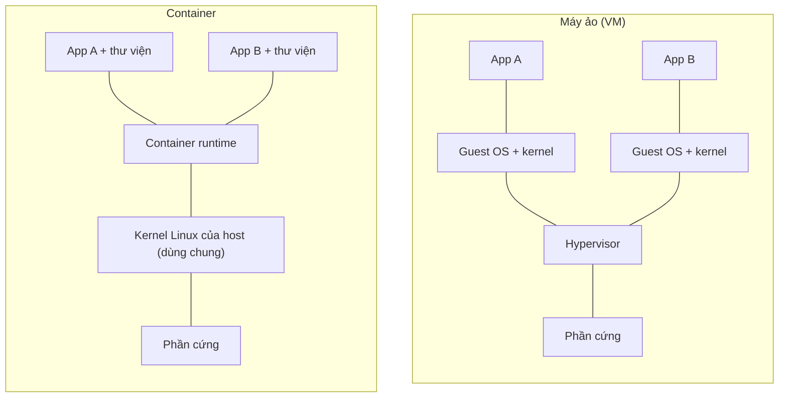

# Container & Docker — nền tảng

::: info Mục tiêu bài học
- Hiểu container giải quyết vấn đề gì và khác máy ảo ở đâu.
- Phân biệt **image**, **container**, **registry**, **tag**, **digest**.
- Tự viết Dockerfile, build và chạy một ứng dụng nhỏ — chính ứng dụng này sẽ được đưa lên Kubernetes ở các bài sau.
- Biết vì sao "chạy container bằng tay" là chưa đủ, và Kubernetes xuất hiện để làm gì.
:::

## 1. Vấn đề: "Trên máy em chạy được mà!"

Trước container, triển khai một ứng dụng nghĩa là cài đúng phiên bản runtime (Java, Node, Python...), đúng thư viện hệ thống, đúng file cấu hình trên từng server. Chỉ cần lệch một phiên bản là lỗi — và lỗi chỉ xuất hiện trên production.

**Container** đóng gói *ứng dụng + mọi thứ nó cần để chạy* (runtime, thư viện, file cấu hình mặc định) thành một khối gọi là **image**. Image chạy giống hệt nhau trên laptop, máy CI hay server production.

## 2. Container khác máy ảo thế nào?



| | Máy ảo | Container |
| --- | --- | --- |
| Cô lập bằng | Hypervisor, ảo hóa phần cứng | Linux **namespaces** (cô lập) + **cgroups** (giới hạn tài nguyên) |
| Kernel | Mỗi VM một kernel riêng | Dùng chung kernel của host |
| Khởi động | Vài chục giây đến vài phút | Mili-giây đến vài giây |
| Dung lượng | Vài GB | Vài MB đến vài trăm MB |
| Mức cô lập | Rất mạnh | Mạnh vừa phải (cần cấu hình bảo mật đúng) |

::: tip Container thực chất là gì?
Container **chỉ là một tiến trình Linux** được "đeo kính": namespaces khiến nó thấy hệ thống file, mạng, danh sách tiến trình riêng; cgroups giới hạn CPU/RAM nó được dùng. Hiểu điều này giúp bạn lý giải rất nhiều hành vi của Kubernetes về sau (ví dụ: vì sao container bị *OOMKilled*).
:::

## 3. Image, container, registry

- **Image**: bản mẫu *chỉ đọc*, gồm nhiều **layer** xếp chồng (mỗi lệnh trong Dockerfile tạo một layer). Layer được chia sẻ giữa các image nên tiết kiệm dung lượng.
- **Container**: một *thể hiện đang chạy* của image, có thêm một layer ghi được ở trên cùng. Xóa container là mất layer này.
- **Registry**: kho chứa image — Docker Hub, GitHub Container Registry (`ghcr.io`), Google Artifact Registry, Amazon ECR, Harbor (tự host)...

Tên đầy đủ của image:

```text
ghcr.io/stefanprodan/podinfo:6.15.0
└──┬──┘ └──────┬───────────┘ └──┬──┘
registry   repository           tag
```

Nếu không ghi registry, mặc định là Docker Hub (`docker.io`); không ghi tag thì mặc định là `latest`. Ngoài tag, image còn có **digest** — mã băm nội dung, bất biến:

```text
nginx@sha256:5f2a...e1c9     ← luôn trỏ đúng một image duy nhất
```

::: warning Tránh tag `latest` khi triển khai
`latest` chỉ là một nhãn, có thể bị ghi đè bất cứ lúc nào. Hôm nay `nginx:latest` là 1.31, vài tháng sau có thể là 1.33. Hãy dùng tag phiên bản cụ thể (`nginx:1.30.6`) hoặc digest để biết chính xác mình đang chạy gì.
:::

## 4. Viết Dockerfile đầu tiên

Ta sẽ đóng gói một web server Python siêu nhỏ, chỉ dùng thư viện chuẩn. Tạo thư mục `hello-k8s` với hai file:

::: code-group

```python [app.py]
from http.server import BaseHTTPRequestHandler, HTTPServer
import os
import socket


class Handler(BaseHTTPRequestHandler):
    def do_GET(self):
        body = f"Xin chào từ {socket.gethostname()} - phiên bản {os.getenv('APP_VERSION', 'v1')}\n"
        self.send_response(200)
        self.send_header("Content-Type", "text/plain; charset=utf-8")
        self.end_headers()
        self.wfile.write(body.encode())


if __name__ == "__main__":
    print("Đang lắng nghe ở cổng 8080...", flush=True)
    HTTPServer(("0.0.0.0", 8080), Handler).serve_forever()
```

```dockerfile [Dockerfile]
# 1. Image nền nhỏ gọn, có sẵn Python
FROM python:3.14-slim

# 2. Thư mục làm việc trong container
WORKDIR /app

# 3. Chép mã nguồn vào image
COPY app.py .

# 4. Biến môi trường mặc định (có thể ghi đè khi chạy)
ENV APP_VERSION=v1

# 5. Ghi chú port ứng dụng dùng (chỉ là metadata)
EXPOSE 8080

# 6. Không chạy bằng root
USER 1000

# 7. Lệnh khởi động — tiến trình chính (PID 1)
CMD ["python", "app.py"]
```

:::

Build và chạy:

```bash
docker build -t hello-k8s:v1 .
docker run -d --name hello -p 8080:8080 hello-k8s:v1

curl http://localhost:8080
# Xin chào từ 3f2c9a1b7d4e - phiên bản v1
```

`3f2c9a1b7d4e` chính là hostname của container — sau này trên Kubernetes, bạn sẽ thấy tên Pod ở vị trí này và dùng nó để kiểm chứng cân bằng tải.

## 5. Các lệnh Docker cần nhớ

| Lệnh | Ý nghĩa |
| --- | --- |
| `docker build -t ten:tag .` | Build image từ Dockerfile trong thư mục hiện tại |
| `docker images` | Liệt kê image trên máy |
| `docker run -d -p 8080:8080 --name x image` | Chạy container nền, publish port host:container |
| `docker ps` / `docker ps -a` | Container đang chạy / tất cả container |
| `docker logs -f x` | Xem log (stdout/stderr) của container |
| `docker exec -it x sh` | Mở shell bên trong container đang chạy |
| `docker stop x` / `docker rm x` | Dừng / xóa container |
| `docker tag` + `docker push` | Gắn tên registry và đẩy image lên registry |

Những khái niệm này có "người anh em" trên Kubernetes: `docker logs` ↔ `kubectl logs`, `docker exec` ↔ `kubectl exec`, `docker run` ↔ `kubectl run`.

## 6. OCI, containerd và chuyện "Kubernetes bỏ Docker"

Docker là bộ công cụ hoàn chỉnh (CLI, build, mạng, volume...). Bên dưới, phần thực sự chạy container là **containerd** và **runc**. Các chuẩn của **OCI** (Open Container Initiative) quy định định dạng image và cách chạy container, nên image build bằng Docker, Podman hay Buildah đều chạy được ở mọi nơi.

Kubernetes nói chuyện với runtime qua giao diện **CRI** (Container Runtime Interface). Từ v1.24, Kubernetes bỏ *dockershim* — lớp chuyển đổi để dùng Docker Engine làm runtime. Ngày nay các cluster dùng **containerd** (phổ biến nhất) hoặc **CRI-O**. Với bạn, điều đó có nghĩa:

- Vẫn build image bằng `docker build` bình thường.
- Trên node Kubernetes, không có lệnh `docker`; muốn soi container ở tầng thấp thì dùng `crictl`.

## 7. Chạy container bằng tay thì thiếu gì?

Hãy tưởng tượng bạn có 30 container chạy trên 5 server:

- Một server chết lúc 3 giờ sáng — **ai khởi động lại** các container trên đó, ở server khác?
- Lượng truy cập tăng gấp 5 — **ai thêm container** và chia tải?
- Ra phiên bản mới — **làm sao cập nhật dần** từng container mà không gián đoạn, và **quay lại** nếu lỗi?
- Container đổi IP mỗi lần khởi động lại — các dịch vụ **tìm nhau** bằng cách nào?
- Mật khẩu database, file cấu hình — **phân phối an toàn** ra sao?

Đó chính là những việc của một **container orchestrator**, và Kubernetes là orchestrator phổ biến nhất hiện nay. Bài tiếp theo sẽ đi vào chi tiết.

## Thực hành

**Bài 1.** Build image `hello-k8s:v1` như trên, chạy với biến môi trường `APP_VERSION=v2` mà **không** build lại image.

::: details Xem lời giải
```bash
docker run -d --name hello2 -p 8081:8080 -e APP_VERSION=v2 hello-k8s:v1
curl http://localhost:8081
# Xin chào từ ... - phiên bản v2
```
Biến môi trường khi chạy (`-e`) ghi đè giá trị `ENV` trong image. Trên Kubernetes, ta sẽ làm việc này bằng `env` và ConfigMap.
:::

**Bài 2.** Chạy `docker run --name bb busybox` rồi xem trạng thái bằng `docker ps -a`. Vì sao container dừng ngay? Làm sao để nó chạy liên tục?

::: details Xem lời giải
Lệnh mặc định của `busybox` là `sh`; không có terminal tương tác nên `sh` thoát ngay, container dừng theo (trạng thái `Exited (0)`). Muốn nó chạy liên tục, hãy cho nó một tiến trình chạy mãi:

```bash
docker run -d --name bb2 busybox sleep 3600
```

Bạn sẽ gặp lại đúng hiện tượng này trên Kubernetes dưới dạng `CrashLoopBackOff`.
:::

**Bài 3.** Giới hạn container chỉ được dùng 128 MB RAM và nửa CPU.

::: details Xem lời giải
```bash
docker run -d --name hello-limited -m 128m --cpus 0.5 -p 8082:8080 hello-k8s:v1
docker stats --no-stream hello-limited
```
Đây chính là cgroups. Trên Kubernetes, bạn khai báo điều này bằng `resources.limits` (Phần 2).
:::

Dọn dẹp: `docker rm -f hello hello2 bb bb2 hello-limited`.

## Lỗi thường gặp

- **Lưu dữ liệu trong container** → mất sạch khi container bị xóa. Dữ liệu cần bền vững phải nằm trên volume.
- **Nhầm `EXPOSE` là publish port** → `EXPOSE` không mở gì cả; cần `-p host:container`.
- **Ứng dụng chỉ lắng nghe `127.0.0.1`** → bên ngoài container không gọi được. Hãy lắng nghe `0.0.0.0`.
- **Image quá lớn** → dùng image nền `-slim`/`alpine`/distroless, multi-stage build, `.dockerignore`.

## Tóm tắt

- Container = tiến trình Linux được cô lập (namespaces) và giới hạn tài nguyên (cgroups), dùng chung kernel host.
- Image là bản mẫu nhiều layer, chỉ đọc; container là thể hiện đang chạy; registry là nơi lưu image.
- Image chuẩn OCI chạy được trên mọi runtime — Kubernetes dùng containerd/CRI-O.
- Chạy container ở quy mô lớn cần tự phục hồi, mở rộng, cập nhật dần, khám phá dịch vụ... → cần Kubernetes.

## Kiểm tra kiến thức

<Quiz />
