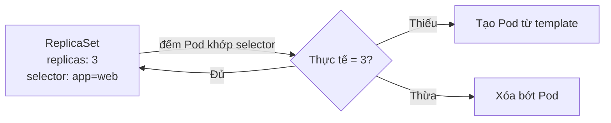
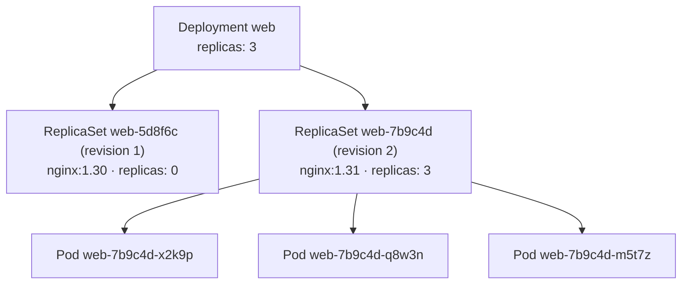
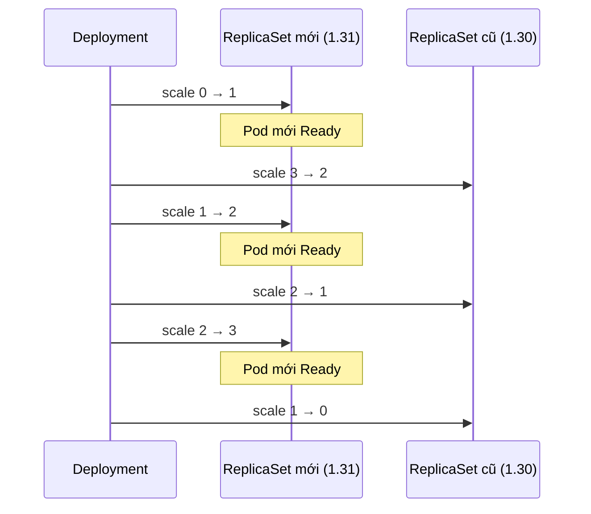

# ReplicaSet & Deployment

::: info Mục tiêu bài học
- Hiểu **ReplicaSet** giữ số bản sao Pod như thế nào.
- Viết **Deployment**, scale, cập nhật phiên bản không gián đoạn (**rolling update**).
- Theo dõi, tạm dừng và **rollback** một lần triển khai.
- Xử lý rollout bị kẹt.
:::

## 1. ReplicaSet — giữ đúng số bản sao

**ReplicaSet** có ba thành phần: số bản sao mong muốn (`replicas`), **selector** để đếm Pod, và **template** để tạo Pod mới khi thiếu.



Bạn hầu như **không tạo ReplicaSet trực tiếp**. ReplicaSet không biết cách cập nhật phiên bản: đổi image trong template của nó thì các Pod đang chạy vẫn giữ image cũ. Đó là việc của **Deployment**.

## 2. Deployment — quản lý phiên bản

**Deployment** quản lý ReplicaSet: mỗi phiên bản Pod template ứng với một ReplicaSet. Khi bạn đổi template, Deployment tạo ReplicaSet mới, tăng dần nó lên và giảm dần ReplicaSet cũ.



ReplicaSet cũ được giữ lại (với 0 replicas) để **rollback** tức thì.

## 3. Deployment đầu tiên

```yaml
# web-deploy.yaml
apiVersion: apps/v1
kind: Deployment
metadata:
  name: web
  labels:
    app: web
spec:
  replicas: 3
  revisionHistoryLimit: 5          # giữ 5 ReplicaSet cũ để rollback
  selector:
    matchLabels:
      app: web                     # PHẢI khớp với template.metadata.labels
  strategy:
    type: RollingUpdate
    rollingUpdate:
      maxSurge: 1                  # được tạo dư tối đa 1 Pod khi cập nhật
      maxUnavailable: 0            # không bao giờ giảm số Pod sẵn sàng
  template:                        # ↓ Pod template: y hệt spec của một Pod
    metadata:
      labels:
        app: web
    spec:
      containers:
        - name: nginx
          image: nginx:1.30
          ports:
            - containerPort: 80
```

```bash
kubectl apply -f web-deploy.yaml
kubectl get deploy,rs,pods -l app=web
```

```text
NAME                  READY   UP-TO-DATE   AVAILABLE   AGE
deployment.apps/web   3/3     3            3           20s

NAME                             DESIRED   CURRENT   READY   AGE
replicaset.apps/web-5d8f6c9b7d   3         3         3       20s

NAME                       READY   STATUS    RESTARTS   AGE
pod/web-5d8f6c9b7d-2xq9k   1/1     Running   0          20s
pod/web-5d8f6c9b7d-8hjlm   1/1     Running   0          20s
pod/web-5d8f6c9b7d-tw4vn   1/1     Running   0          20s
```

Tên Pod = `<deployment>-<pod-template-hash>-<chuỗi ngẫu nhiên>`. `pod-template-hash` là mã băm của template — template giống nhau thì hash giống nhau.

| Cột | Ý nghĩa |
| --- | --- |
| `READY` | Số Pod sẵn sàng / số mong muốn |
| `UP-TO-DATE` | Số Pod đã chạy template mới nhất |
| `AVAILABLE` | Số Pod sẵn sàng đủ lâu (`minReadySeconds`) để phục vụ |

**Thử khả năng tự phục hồi:** xóa một Pod rồi xem ngay danh sách — một Pod mới xuất hiện thay thế.

```bash
kubectl delete pod web-5d8f6c9b7d-2xq9k
kubectl get pods -l app=web
```

## 4. Scale

```bash
kubectl scale deployment web --replicas=5
```

Hoặc (khuyến nghị) sửa `replicas: 5` trong file rồi `kubectl apply -f web-deploy.yaml`. Scale **không** tạo revision mới — ReplicaSet hiện tại chỉ tăng số lượng. Ở Phần 2, bạn sẽ để **HorizontalPodAutoscaler** tự scale theo tải.

## 5. Rolling update — cập nhật cuốn chiếu

Đổi image (hoặc bất cứ gì trong `spec.template`) để bắt đầu cập nhật:

```bash
kubectl set image deployment/web nginx=nginx:1.31
kubectl rollout status deployment/web
```

```text
Waiting for deployment "web" rollout to finish: 1 out of 3 new replicas have been updated...
Waiting for deployment "web" rollout to finish: 2 out of 3 new replicas have been updated...
Waiting for deployment "web" rollout to finish: 1 old replicas are pending termination...
deployment "web" successfully rolled out
```

Với `maxSurge: 1, maxUnavailable: 0`, Deployment lặp lại chu trình: **tạo 1 Pod mới → chờ Pod mới Ready → xóa 1 Pod cũ**:



Hai tham số điều khiển tốc độ và độ an toàn (có thể ghi số Pod hoặc phần trăm):

| Tham số | Mặc định | Ý nghĩa |
| --- | --- | --- |
| `maxSurge` | 25% (làm tròn lên) | Số Pod được vượt quá `replicas` trong lúc cập nhật |
| `maxUnavailable` | 25% (làm tròn xuống) | Số Pod được phép không sẵn sàng so với `replicas` |

- `maxSurge: 1, maxUnavailable: 0` → an toàn nhất, cần dư tài nguyên cho 1 Pod.
- `maxSurge: 0, maxUnavailable: 1` → không cần thêm tài nguyên, nhưng tạm thời thiếu 1 Pod.
- `type: Recreate` → xóa hết Pod cũ rồi mới tạo Pod mới: **có gián đoạn**, chỉ dùng khi hai phiên bản không được chạy song song.

::: warning Rolling update cần readiness probe
Kubernetes chỉ biết Pod mới "sẵn sàng" khi container khởi động — trừ khi bạn khai báo **readinessProbe** (Phần 2). Không có probe, Pod của ứng dụng cần 20 giây để khởi động có thể nhận traffic ngay khi vừa chạy → người dùng gặp lỗi trong lúc deploy.
:::

## 6. Lịch sử và rollback

Ghi lý do thay đổi để lịch sử dễ đọc:

```bash
kubectl annotate deployment/web kubernetes.io/change-cause="Nâng nginx lên 1.31"
kubectl rollout history deployment/web
```

```text
deployment.apps/web
REVISION  CHANGE-CAUSE
1         <none>
2         Nâng nginx lên 1.31
```

```bash
kubectl rollout history deployment/web --revision=2   # xem chi tiết template của revision 2
kubectl rollout undo deployment/web                   # quay về revision trước
kubectl rollout undo deployment/web --to-revision=1   # quay về revision cụ thể
```

Rollback thực chất là **một lần rolling update** dùng lại ReplicaSet cũ — nên cũng nhanh và không gián đoạn. Sau khi undo, revision cũ được đánh số mới (revision 1 thành revision 3).

Các lệnh rollout hữu ích khác:

```bash
kubectl rollout restart deployment/web   # thay mới toàn bộ Pod (ví dụ để nạp lại Secret)
kubectl rollout pause deployment/web     # tạm dừng: gom nhiều thay đổi...
kubectl set image deployment/web nginx=nginx:1.31
kubectl set env deployment/web LOG_LEVEL=debug
kubectl rollout resume deployment/web    # ...rồi triển khai một lần
```

## 7. Khi rollout bị kẹt

Thử cố ý dùng image sai:

```bash
kubectl set image deployment/web nginx=nginx:khong-ton-tai
kubectl get pods -l app=web
```

```text
NAME                   READY   STATUS             RESTARTS   AGE
web-7b9c4d8f5-2kq8x    1/1     Running            0          5m
web-7b9c4d8f5-9xw2c    1/1     Running            0          5m
web-7b9c4d8f5-pl4mn    1/1     Running            0          5m
web-6f4d9c7b8-zt5vx    0/1     ImagePullBackOff   0          40s
```

Nhờ `maxUnavailable: 0`, cả 3 Pod cũ vẫn phục vụ. Pod mới không bao giờ Ready nên rollout dừng. Sau `progressDeadlineSeconds` (mặc định 600 giây), Deployment ghi nhận điều kiện `Progressing=False` với lý do `ProgressDeadlineExceeded` — các công cụ CI/CD dựa vào đây để báo deploy thất bại.

**Kubernetes không tự rollback.** Bạn xử lý bằng:

```bash
kubectl rollout undo deployment/web
# hoặc sửa image đúng rồi apply lại
```

## 8. Vượt ra ngoài rolling update

- **Blue/Green**: chạy song song hai Deployment (`web-blue`, `web-green`), chuyển Service sang bản mới bằng cách đổi selector.
- **Canary**: đưa một phần nhỏ traffic vào bản mới, theo dõi chỉ số rồi tăng dần. Làm tự động bằng **Argo Rollouts**, **Flagger** hoặc Gateway API (chia trọng số traffic).

## Thực hành

Làm trọn một vòng đời triển khai:

1. Tạo Deployment `shop` image `nginx:1.30`, 2 replicas, `maxSurge: 1`, `maxUnavailable: 0` (bằng file YAML).
2. Scale lên 4 replicas.
3. Cập nhật lên `nginx:1.31` kèm change-cause, theo dõi bằng `kubectl get pods -w` ở cửa sổ khác.
4. Cập nhật lên `nginx:1.31-sai` và quan sát.
5. Rollback về bản `1.31` và kiểm tra lịch sử.

::: details Xem lời giải
```bash
kubectl create deployment shop --image=nginx:1.30 --replicas=2 --dry-run=client -o yaml > shop.yaml
# thêm vào spec của shop.yaml:
#   strategy:
#     type: RollingUpdate
#     rollingUpdate: { maxSurge: 1, maxUnavailable: 0 }
kubectl apply -f shop.yaml

kubectl scale deployment shop --replicas=4

kubectl set image deployment/shop nginx=nginx:1.31
kubectl annotate deployment/shop kubernetes.io/change-cause="nginx 1.31"
kubectl rollout status deployment/shop

kubectl set image deployment/shop nginx=nginx:1.31-sai
kubectl get pods -l app=shop          # 4 Pod cũ Running + 1 Pod ImagePullBackOff

kubectl rollout undo deployment/shop
kubectl rollout status deployment/shop
kubectl rollout history deployment/shop
```
Lưu ý `kubectl create deployment` gắn label `app=shop` và tên container là `nginx` (lấy từ tên image).
:::

::: tip Luyện trên trình duyệt
[kubectl Playground](/thuc-hanh/playground) mô phỏng đầy đủ scale, rolling update, rollout bị kẹt và rollback — rất hợp để luyện tay bài này.
:::

## Lỗi thường gặp

- **`selector` does not match template `labels`** → `spec.selector.matchLabels` phải là tập con của `spec.template.metadata.labels`.
- **`field is immutable`** khi sửa `spec.selector` → selector không đổi được sau khi tạo; xóa và tạo lại Deployment.
- **Push image mới cùng tag `latest` nhưng Pod không đổi** → template không đổi nên không có rollout. Dùng tag mới cho mỗi bản build (ví dụ theo commit SHA).
- **Chỉnh tay ReplicaSet** của Deployment → Deployment ghi đè lại. Luôn thao tác qua Deployment.

## Tóm tắt

- ReplicaSet giữ đúng số Pod; Deployment quản lý các ReplicaSet theo phiên bản template.
- Thay đổi `spec.template` → rolling update; điều chỉnh bằng `maxSurge`/`maxUnavailable`, hoặc `Recreate`.
- `kubectl rollout status | history | undo | restart | pause | resume` để điều khiển triển khai.
- Rollout lỗi không làm sập ứng dụng nếu cấu hình đúng, nhưng Kubernetes không tự rollback.

## Kiểm tra kiến thức

<Quiz />
