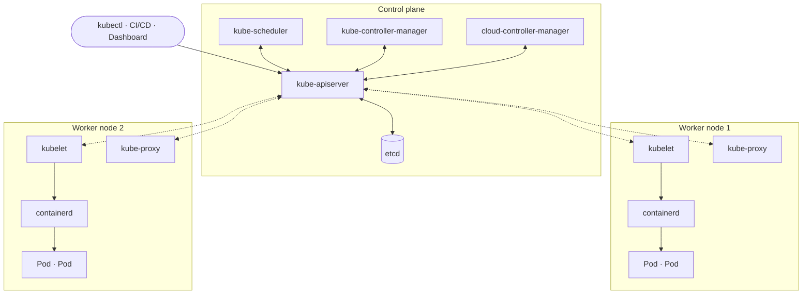
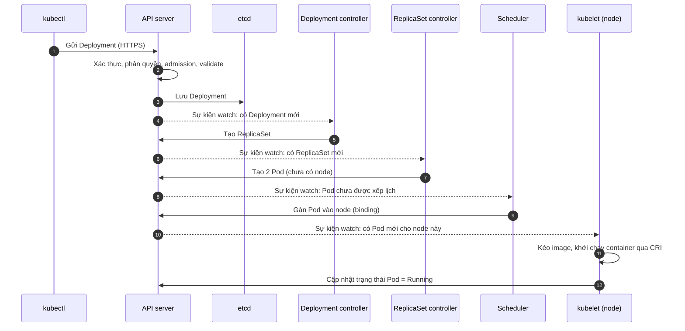
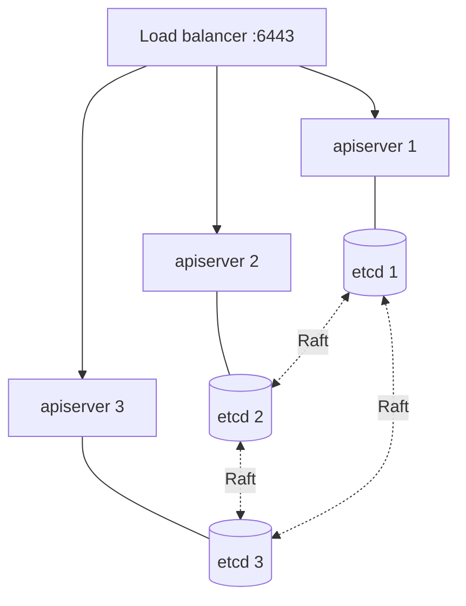

# Kiến trúc Kubernetes

::: info Mục tiêu bài học
- Kể tên và nêu vai trò của từng thành phần trong **control plane** và **worker node**.
- Mô tả hành trình của lệnh `kubectl apply` từ máy bạn đến container đang chạy.
- Hiểu vì sao mọi thứ đều đi qua **API server** và cơ chế **watch**.
- Tự quan sát các thành phần này trong cluster thật.
:::

## 1. Bức tranh tổng thể

Một **cluster** Kubernetes gồm hai nhóm máy:

- **Control plane** — "bộ não": lưu trạng thái, ra quyết định (xếp lịch, phản ứng sự kiện).
- **Worker node** — "cơ bắp": nơi container của ứng dụng thực sự chạy.



Để ý các đường nối: **mọi thành phần chỉ nói chuyện với API server** (kubelet và kube-proxy chủ động kết nối tới nó qua các đường nét đứt), không ai gọi trực tiếp ai. API server là trung tâm duy nhất.

## 2. Các thành phần control plane

### kube-apiserver — cổng giao tiếp duy nhất

- Cung cấp **REST API** cho mọi thao tác: `kubectl`, dashboard, CI/CD và chính các thành phần nội bộ.
- Mỗi request đi qua chuỗi: **xác thực** (bạn là ai?) → **phân quyền** (bạn được làm gì? — RBAC) → **admission** (có vi phạm chính sách không? có cần bổ sung giá trị mặc định?) → **kiểm tra hợp lệ** → ghi vào etcd.
- Không lưu trạng thái riêng nên có thể chạy nhiều bản song song sau một load balancer.

### etcd — bộ nhớ của cluster

- Cơ sở dữ liệu key-value phân tán, dùng thuật toán đồng thuận **Raft**, lưu **toàn bộ** trạng thái cluster: mọi Deployment, Pod, Secret...
- Mất etcd = mất cluster. Vì vậy etcd luôn cần **sao lưu định kỳ** (bài Vận hành cluster) và chạy 3 hoặc 5 thành viên ở production.

### kube-scheduler — người xếp chỗ

Theo dõi các Pod chưa có node và chọn node phù hợp qua hai bước:

1. **Lọc (filter):** loại các node không đủ CPU/RAM, không khớp `nodeSelector`, có *taint* mà Pod không chịu được...
2. **Chấm điểm (score):** xếp hạng các node còn lại (dàn đều Pod, ưu tiên node đã có sẵn image...) rồi chọn node điểm cao nhất.

Scheduler chỉ *ghi quyết định* (gán `spec.nodeName`), nó không khởi chạy container.

### kube-controller-manager — tập hợp các vòng lặp điều khiển

Một tiến trình chạy hàng chục controller, mỗi controller canh một loại đối tượng:

| Controller | Việc làm |
| --- | --- |
| Deployment | Tạo/cập nhật ReplicaSet khi Deployment thay đổi |
| ReplicaSet | Giữ đúng số Pod mong muốn |
| Node | Phát hiện node mất liên lạc, đánh dấu và xử lý Pod trên đó |
| Job / CronJob | Chạy tác vụ đến khi hoàn thành / theo lịch |
| EndpointSlice | Cập nhật danh sách Pod phía sau mỗi Service |
| ServiceAccount | Tạo ServiceAccount mặc định cho namespace mới |

### cloud-controller-manager — cầu nối với cloud

Chỉ có trên cluster chạy ở cloud: tạo load balancer khi bạn tạo Service `type: LoadBalancer`, gắn nhãn vùng (zone) cho node, xóa node khi VM bị hủy...

## 3. Các thành phần trên worker node

### kubelet — agent của node

- Theo dõi API server để biết **Pod nào được gán cho node mình**.
- Gọi **container runtime** qua chuẩn **CRI** để kéo image, tạo và khởi động container.
- Chạy **probe** (kiểm tra sức khỏe), báo cáo trạng thái Pod và node về API server.
- Có thể chạy **static Pod** từ file trên đĩa (`/etc/kubernetes/manifests`) — đây là cách chính các thành phần control plane được chạy trong cluster dựng bằng kubeadm.

### Container runtime

Phần mềm thực sự chạy container: **containerd** (phổ biến nhất) hoặc **CRI-O**, bên dưới dùng `runc` để tạo namespaces/cgroups.

### kube-proxy

Lập trình luật mạng trên node (iptables hoặc nftables) để lưu lượng gửi tới **Service** được chuyển đến đúng Pod phía sau. Một số plugin mạng như Cilium có thể thay thế hoàn toàn kube-proxy.

### CNI plugin

Cấp IP cho mỗi Pod và đảm bảo Pod trên các node khác nhau nói chuyện được với nhau (Calico, Cilium, Flannel, kindnet...).

## 4. Add-on thiết yếu

- **CoreDNS** — DNS nội bộ: cho phép gọi Service bằng tên như `web.default.svc.cluster.local`.
- **metrics-server** — thu thập CPU/RAM để `kubectl top` và autoscaling hoạt động.
- **Ingress / Gateway controller** — đưa lưu lượng HTTP từ ngoài vào cluster.

## 5. Hành trình của `kubectl apply`

Đây là phần quan trọng nhất của bài. Khi bạn chạy `kubectl apply -f deployment.yaml` với `replicas: 2`:



Ba điều cần rút ra:

1. **kubectl trả về ngay** sau bước 3 — lúc đó Pod chưa chạy. Vì vậy ta thường dùng `kubectl get pods -w` hoặc `kubectl rollout status` để theo dõi.
2. Các thành phần **không gọi nhau trực tiếp**. Chúng *watch* API server và phản ứng với thay đổi. Thiết kế này giúp hệ thống bền bỉ: một controller khởi động lại chỉ cần đọc lại trạng thái từ API server.
3. Mỗi bước là một **vòng lặp điều khiển** độc lập. Lỗi ở bước nào thì triệu chứng hiện ở bước đó — hiểu luồng này giúp bạn khoanh vùng sự cố rất nhanh (bài Troubleshooting).

## 6. Control plane có tính sẵn sàng cao (HA)

Ở production, control plane thường có **3 node**:



- API server chạy song song (active-active) sau load balancer.
- Scheduler và controller-manager cũng chạy 3 bản nhưng dùng **leader election**: chỉ một bản hoạt động, các bản khác chờ thay thế.
- etcd có thể chạy chung máy với control plane (*stacked*) hoặc tách riêng (*external*).

Với dịch vụ managed (EKS, GKE, AKS...), nhà cung cấp lo toàn bộ phần này cho bạn.

## 7. Tận mắt quan sát (trên cluster kind)

Sau khi làm xong [bài cài đặt](/co-ban/cai-dat), chạy:

```bash
kubectl get nodes -o wide
kubectl get pods -n kube-system -o wide
```

```text
NAME                                              READY   STATUS    NODE
coredns-7d764666f9-6x2xk                          1/1     Running   k8s-learn-control-plane
etcd-k8s-learn-control-plane                      1/1     Running   k8s-learn-control-plane
kindnet-2fkxw                                     1/1     Running   k8s-learn-worker
kube-apiserver-k8s-learn-control-plane            1/1     Running   k8s-learn-control-plane
kube-controller-manager-k8s-learn-control-plane   1/1     Running   k8s-learn-control-plane
kube-proxy-9jv5p                                  1/1     Running   k8s-learn-worker
kube-scheduler-k8s-learn-control-plane            1/1     Running   k8s-learn-control-plane
```

Các thành phần control plane chạy dưới dạng **static Pod**. Vì node của kind thực chất là một container Docker, bạn có thể "chui" vào node để xem file định nghĩa của chúng:

```bash
docker exec -it k8s-learn-control-plane ls /etc/kubernetes/manifests
# etcd.yaml  kube-apiserver.yaml  kube-controller-manager.yaml  kube-scheduler.yaml

docker exec -it k8s-learn-control-plane crictl ps    # container đang chạy trên node
```

## Thực hành

**Bài 1.** Trong cluster kind, tìm xem `kube-proxy` và `kindnet` chạy bao nhiêu Pod và vì sao số đó bằng số node.

::: details Xem lời giải
```bash
kubectl get pods -n kube-system -o wide | grep -E "kube-proxy|kindnet"
kubectl get daemonsets -n kube-system
```
Cả hai là **DaemonSet** — loại workload chạy đúng một Pod trên mỗi node, vì mỗi node đều cần lập trình mạng cho chính nó. Bạn sẽ học DaemonSet ở Phần 2.
:::

**Bài 2.** Đọc file `kube-apiserver.yaml` trên node control plane và tìm tham số chỉ ra địa chỉ etcd.

::: details Xem lời giải
```bash
docker exec k8s-learn-control-plane grep etcd-servers /etc/kubernetes/manifests/kube-apiserver.yaml
# - --etcd-servers=https://127.0.0.1:2379
```
API server nói chuyện với etcd qua HTTPS cổng 2379, có xác thực bằng chứng chỉ client.
:::

## Hiểu lầm thường gặp

- **"kubectl kết nối tới các node"** → Không, kubectl chỉ nói chuyện với API server. Kể cả `kubectl logs`/`exec` cũng đi qua API server rồi mới tới kubelet.
- **"Control plane không chạy Pod"** → Control plane chạy các static Pod hệ thống; Pod ứng dụng thường không được xếp lên đó vì node có *taint* `node-role.kubernetes.io/control-plane`.
- **"Mất control plane thì ứng dụng chết ngay"** → Container đang chạy vẫn chạy tiếp; chỉ là không thể thay đổi gì và không có ai tự phục hồi khi có sự cố.

## Tóm tắt

- **Control plane**: kube-apiserver (cổng duy nhất), etcd (lưu trạng thái), scheduler (chọn node), controller-manager (các vòng lặp điều khiển), cloud-controller-manager (tích hợp cloud).
- **Worker node**: kubelet (chạy Pod), container runtime (containerd/CRI-O), kube-proxy (mạng cho Service), CNI (mạng cho Pod).
- Mọi thành phần **watch** API server và phản ứng với thay đổi — không ai gọi trực tiếp ai.
- Production cần control plane HA và etcd được sao lưu.

## Kiểm tra kiến thức

<Quiz />
