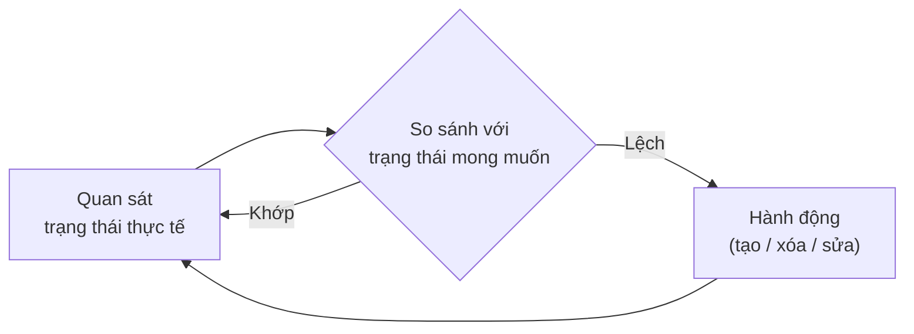
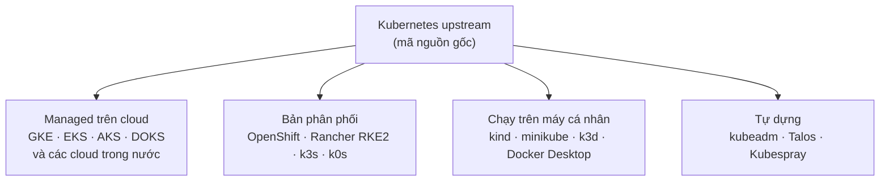
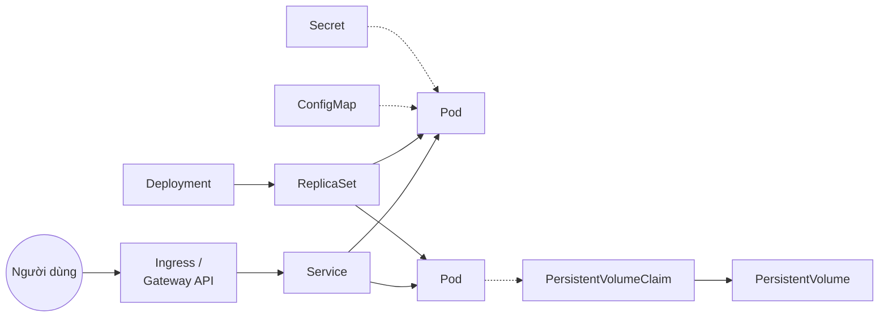

# Kubernetes là gì? Vì sao cần nó

::: info Mục tiêu bài học
- Định nghĩa được Kubernetes và những bài toán nó giải quyết.
- Hiểu **tư duy khai báo** và **vòng lặp điều khiển (reconciliation loop)** — chìa khóa để hiểu mọi thứ khác.
- Biết khi nào *không* nên dùng Kubernetes.
- Nắm bức tranh hệ sinh thái: bản phân phối, dịch vụ managed, chu kỳ phát hành.
:::

## 1. Định nghĩa

**Kubernetes** (viết tắt **K8s**) là nền tảng mã nguồn mở để **tự động triển khai, mở rộng và vận hành ứng dụng chạy trong container** trên một nhóm máy (gọi là *cluster*).

- Tên gọi bắt nguồn từ tiếng Hy Lạp *κυβερνήτης* — "người lái tàu", vì vậy logo là bánh lái tàu.
- Kubernetes kế thừa kinh nghiệm hơn 10 năm vận hành hệ thống **Borg** của Google, được mở mã nguồn năm 2014 và hiện do **CNCF** (Cloud Native Computing Foundation) quản lý.
- Ngày nay Kubernetes là "hệ điều hành của data center": mọi cloud lớn đều có dịch vụ Kubernetes, và rất nhiều công cụ (CI/CD, giám sát, database...) được thiết kế để chạy trên nó.

Hãy hình dung bạn có 20 máy chủ. Thay vì SSH vào từng máy để chạy container, bạn nói với Kubernetes: *"Tôi muốn 6 bản sao của ứng dụng web, mỗi bản 0,5 CPU và 256 MB RAM, mở cổng 80"*. Kubernetes tự chọn máy, khởi chạy, theo dõi và sửa chữa khi có sự cố.

## 2. Kubernetes làm được gì cho bạn?

| Khả năng | Ý nghĩa thực tế | Học ở bài |
| --- | --- | --- |
| **Tự phục hồi** (self-healing) | Container chết → khởi động lại; node chết → chạy lại Pod ở node khác | Deployment, Probes |
| **Mở rộng** (scaling) | Tăng/giảm số bản sao bằng một lệnh hoặc tự động theo tải | Deployment, Autoscaling |
| **Cập nhật cuốn chiếu** (rolling update) | Thay dần từng Pod sang phiên bản mới, lỗi thì rollback | Deployment |
| **Khám phá dịch vụ & cân bằng tải** | Các dịch vụ gọi nhau bằng tên DNS ổn định | Service |
| **Quản lý cấu hình & bí mật** | Tách cấu hình, mật khẩu ra khỏi image | ConfigMap & Secret |
| **Điều phối lưu trữ** | Tự cấp ổ đĩa từ cloud/NAS cho ứng dụng | Storage |
| **Xếp lịch thông minh** | Đặt container lên máy phù hợp, tận dụng tài nguyên | Scheduling |
| **Mở rộng chính Kubernetes** | Thêm loại tài nguyên mới (database, certificate...) | CRD & Operator |

## 3. Ý tưởng cốt lõi: khai báo trạng thái mong muốn

Có hai cách ra lệnh cho hệ thống:

- **Mệnh lệnh (imperative):** "Chạy container A trên máy 1. Rồi chạy container B trên máy 2. Nếu A chết thì..." — bạn phải lường trước mọi tình huống.
- **Khai báo (declarative):** "Tôi muốn luôn có 3 bản sao của A." — hệ thống tự lo phần còn lại.

Kubernetes theo cách thứ hai. Bạn gửi lên một **bản mô tả trạng thái mong muốn** (thường là file YAML), Kubernetes lưu lại, và các **controller** chạy một vòng lặp không bao giờ dừng:



Giống như **máy điều hòa**: bạn đặt 25°C (mong muốn); điều hòa liên tục đo nhiệt độ phòng (thực tế) và bật/tắt máy nén để giữ đúng 25°C. Bạn không cần ra lệnh "làm lạnh 3 phút".

Ví dụ trạng thái mong muốn của một ứng dụng web:

```yaml
apiVersion: apps/v1
kind: Deployment
metadata:
  name: web
spec:
  replicas: 3            # mong muốn: luôn có 3 bản sao
  selector:
    matchLabels:
      app: web
  template:
    metadata:
      labels:
        app: web
    spec:
      containers:
        - name: nginx
          image: nginx:1.30  # chạy image này
```

Nếu một Pod bị xóa, controller thấy "thực tế 2, mong muốn 3" và tạo thêm một Pod. Nếu bạn sửa `image` thành `nginx:1.31`, controller thấy lệch phiên bản và thay dần các Pod. **Mọi tính năng của Kubernetes đều là các vòng lặp như thế này** — hiểu được điều đó, bạn sẽ đoán được hành vi của hệ thống trong hầu hết tình huống.

::: tip Ghi nhớ
Trong Kubernetes, bạn hiếm khi "làm" điều gì trực tiếp. Bạn **sửa bản mô tả**, rồi để controller làm phần việc còn lại.
:::

## 4. Khi nào *không* nên dùng Kubernetes?

Kubernetes mạnh nhưng không miễn phí: cần thời gian học, người vận hành, và tài nguyên cho chính nó. Hãy cân nhắc giải pháp đơn giản hơn nếu:

- Ứng dụng nhỏ, ít thay đổi, một vài container → **Docker Compose trên một VM** là đủ.
- Team không có ai chịu trách nhiệm vận hành → dùng **PaaS** hoặc container serverless (Cloud Run, App Runner, Azure Container Apps...).
- Bạn chỉ cần chạy hàm theo sự kiện → **serverless functions**.

Kubernetes tỏa sáng khi có **nhiều dịch vụ**, **nhiều team**, cần **tự động mở rộng**, **triển khai liên tục** và **tính di động** giữa các môi trường. Dùng dịch vụ **managed** (EKS, GKE, AKS...) giúp giảm đáng kể gánh nặng vận hành control plane.

## 5. Hệ sinh thái Kubernetes



- **Managed Kubernetes**: nhà cung cấp vận hành control plane, bạn chỉ quản lý worker node và ứng dụng. Các cloud trong nước như Viettel, FPT, VNG, Bizfly cũng có dịch vụ Kubernetes managed.
- **Bản phân phối**: đóng gói Kubernetes kèm công cụ bổ sung (giao diện quản trị, bảo mật, nâng cấp...).
- **Local**: chạy cluster trên laptop để học và phát triển — ta sẽ dùng **kind** ở bài cài đặt.

Ngoài ra, CNCF Landscape có hàng trăm dự án xoay quanh Kubernetes: Helm (đóng gói), Prometheus (giám sát), Argo CD (GitOps), Cilium (mạng)... Bạn sẽ gặp các công cụ quan trọng nhất trong khóa học.

## 6. Chu kỳ phát hành

- Kubernetes đánh số phiên bản `v1.MINOR.PATCH`, ví dụ **v1.37.1**.
- Mỗi năm có **3 bản minor** (khoảng 4 tháng một lần). Mỗi bản minor được vá lỗi khoảng **14 tháng**.
- Tính năng mới đi qua 3 giai đoạn: **Alpha** (tắt mặc định, có thể thay đổi) → **Beta** → **Stable/GA** (ổn định, dùng cho production).
- API cũ có thể bị **deprecated** rồi **removed** — đó là lý do khi nâng cấp cluster phải kiểm tra manifest của mình.

## 7. Bản đồ các đối tượng bạn sẽ học



Đừng lo nếu chưa hiểu hết — mỗi ô trong sơ đồ là một bài học. Đến cuối Phần 1, bạn sẽ tự viết được toàn bộ các mảnh này.

## Thực hành

Chưa cần cài gì cả — mở [kubectl Playground](/thuc-hanh/playground) và thử:

1. Gõ `kubectl get nodes` để xem các máy trong cluster mô phỏng.
2. Tạo một Deployment: `kubectl create deployment web --image=nginx:1.30 --replicas=3`
3. Xem các Pod: `kubectl get pods` (chờ vài giây rồi chạy lại để thấy trạng thái chuyển sang `Running`).
4. Xóa một Pod bất kỳ: `kubectl delete pod <tên-pod>` rồi `kubectl get pods` lần nữa.

::: details Bạn quan sát thấy gì?
Pod bị xóa chuyển sang `Terminating`, đồng thời một Pod **mới** (tên khác) xuất hiện ở trạng thái `ContainerCreating`. Đó chính là vòng lặp điều khiển: ReplicaSet thấy chỉ còn 2/3 Pod nên tạo thêm một Pod để quay về trạng thái mong muốn.
:::

## Tóm tắt

- Kubernetes điều phối container trên một cluster nhiều máy: tự phục hồi, mở rộng, cập nhật cuốn chiếu, khám phá dịch vụ, quản lý cấu hình và lưu trữ.
- Bạn **khai báo trạng thái mong muốn**; các **controller** liên tục đưa trạng thái thực tế về khớp với mong muốn.
- Kubernetes không phải lúc nào cũng là lựa chọn đúng — hãy cân nhắc độ phức tạp.
- Có nhiều cách chạy Kubernetes: managed trên cloud, bản phân phối, tự dựng, hoặc trên máy cá nhân để học.

## Kiểm tra kiến thức

<Quiz />
