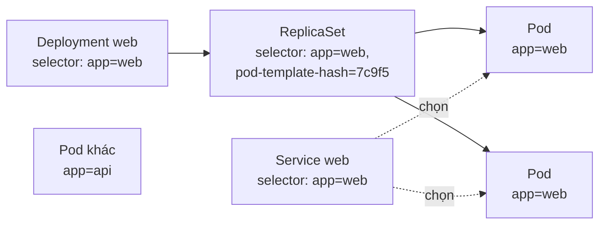

# Labels, Selectors & Namespace

::: info Mục tiêu bài học
- Dùng **label** để gắn nhãn và **selector** để chọn nhóm đối tượng.
- Hiểu vì sao label là "keo dán" kết nối Deployment, Service, Pod với nhau.
- Phân biệt label với **annotation**.
- Tổ chức cluster bằng **namespace** và gọi dịch vụ chéo namespace.
:::

## 1. Label — nhãn dán cho đối tượng

**Label** là cặp `key: value` gắn vào `metadata` của bất kỳ đối tượng nào để **nhận diện và phân nhóm**:

```yaml
metadata:
  name: web-7c9f5
  labels:
    app: web
    tier: frontend
    env: production
    version: "1.4.2"
```

Quy tắc: key có thể có tiền tố dạng tên miền (`app.kubernetes.io/name`), phần tên và giá trị tối đa 63 ký tự, gồm chữ, số, `-`, `_`, `.`.

Kubernetes khuyến nghị một bộ **label chuẩn** giúp các công cụ (dashboard, Helm, giám sát) hiểu ứng dụng của bạn:

```yaml
metadata:
  labels:
    app.kubernetes.io/name: shop-api          # tên ứng dụng
    app.kubernetes.io/instance: shop-api-prod # tên bản cài đặt cụ thể
    app.kubernetes.io/version: "2.4.1"
    app.kubernetes.io/component: backend      # vai trò trong kiến trúc
    app.kubernetes.io/part-of: shop           # thuộc hệ thống lớn nào
    app.kubernetes.io/managed-by: helm        # công cụ quản lý
```

## 2. Selector — chọn đối tượng theo label

Hai kiểu selector:

| Kiểu | Cú pháp | Ví dụ |
| --- | --- | --- |
| So sánh bằng | `=`, `==`, `!=` | `app=web`, `tier!=backend` |
| Theo tập hợp | `in`, `notin`, `key`, `!key` | `env in (dev,staging)`, `!canary` |

Nhiều điều kiện ngăn cách bằng dấu phẩy là phép **AND**.

```bash
kubectl get pods -l app=web
kubectl get pods -l 'app=web,tier!=backend'
kubectl get pods -l 'env in (dev,staging)'
kubectl get pods -l '!canary'                 # Pod KHÔNG có label canary
kubectl get pods -L app,tier                  # hiện giá trị label thành cột
kubectl delete pods -l env=test               # xóa hàng loạt theo label
```

Trong YAML, selector viết bằng `matchLabels` (so sánh bằng) và `matchExpressions` (tập hợp):

```yaml
selector:
  matchLabels:
    app: web
  matchExpressions:
    - key: tier
      operator: In            # In | NotIn | Exists | DoesNotExist
      values: [frontend, edge]
    - key: canary
      operator: DoesNotExist
```

## 3. Label là "keo dán" của Kubernetes

Các đối tượng Kubernetes **không tham chiếu nhau bằng tên** mà bằng label selector:



- **Service** gửi lưu lượng tới mọi Pod khớp selector của nó.
- **ReplicaSet** đếm các Pod khớp selector để biết đã đủ số lượng chưa.
- **NetworkPolicy**, **PodDisruptionBudget**, **nodeSelector**... cũng hoạt động theo label.

Hệ quả thú vị: đổi label của một Pod có thể **tách nó khỏi** Deployment và Service. Đây là mẹo gỡ lỗi kinh điển (xem phần Thực hành).

::: warning Selector trùng nhau
Hai Deployment có selector giống nhau sẽ "tranh giành" Pod của nhau, gây hành vi khó hiểu. Hãy đảm bảo label `app` (hoặc `app.kubernetes.io/name` + `instance`) là duy nhất cho mỗi ứng dụng trong namespace.
:::

## 4. Annotation — ghi chú không dùng để chọn

**Annotation** cũng là cặp key/value trong `metadata`, nhưng **không dùng cho selector**. Dùng để lưu thông tin dài hoặc dành cho công cụ:

```yaml
metadata:
  annotations:
    kubernetes.io/change-cause: "Nâng nginx lên 1.31 để vá CVE"   # hiện trong rollout history
    git.example.com/commit: "a1b2c3d"
    team.example.com/owner: "backend-team@example.com"
```

Nhiều controller đọc cấu hình từ annotation (ví dụ ingress controller, cert-manager, Prometheus Operator).

## 5. Namespace — chia cluster thành các không gian riêng

**Namespace** là cách chia một cluster vật lý thành nhiều "cluster ảo" để tách tài nguyên giữa các team, dự án hay môi trường.

```bash
kubectl get namespaces
```

```text
NAME                 STATUS   AGE
default              Active   2d     ← nơi tài nguyên rơi vào nếu không chỉ định
kube-node-lease      Active   2d     ← heartbeat của node
kube-public          Active   2d     ← dữ liệu công khai (hiếm dùng)
kube-system          Active   2d     ← thành phần hệ thống: CoreDNS, kube-proxy...
local-path-storage   Active   2d     ← storage provisioner của kind
```

Namespace mang lại:

- **Phạm vi tên**: hai namespace có thể cùng có Deployment tên `web`.
- **Ranh giới phân quyền**: RBAC cấp quyền theo namespace (Phần 3).
- **Hạn mức tài nguyên**: `ResourceQuota`, `LimitRange` theo namespace (Phần 2).
- **Chính sách mạng và bảo mật**: NetworkPolicy, Pod Security theo namespace.

::: info Không phải mọi thứ đều thuộc namespace
Node, PersistentVolume, StorageClass, Namespace, ClusterRole... là tài nguyên **cấp cluster**. Kiểm tra bằng `kubectl api-resources --namespaced=false`.
:::

Làm việc với namespace:

```bash
kubectl create namespace dev
kubectl run web --image=nginx:1.30 -n dev
kubectl get pods -n dev
kubectl get pods -A                              # mọi namespace
kubectl config set-context --current --namespace=dev   # đặt dev làm mặc định
```

Hoặc khai báo bằng YAML (nên dùng — có thể gắn label cho namespace):

```yaml
apiVersion: v1
kind: Namespace
metadata:
  name: shop-dev
  labels:
    team: shop
    env: dev
```

### DNS chéo namespace

Service `db` trong namespace `data` có tên DNS:

| Gọi từ | Tên dùng được |
| --- | --- |
| Cùng namespace `data` | `db` |
| Namespace khác | `db.data` hoặc `db.data.svc.cluster.local` |

::: danger Xóa namespace là xóa tất cả
`kubectl delete namespace dev` xóa **mọi** Deployment, Service, Secret, PVC (và dữ liệu nếu StorageClass xóa volume theo PVC) trong namespace đó. Không có thùng rác.
:::

### Namespace cho môi trường dev/staging/prod?

Dùng namespace để tách **dev** và **staging** trên cùng cluster là phổ biến. Với **production**, nhiều tổ chức chọn **cluster riêng** để cô lập hoàn toàn về tài nguyên, phiên bản Kubernetes và quyền truy cập.

## Thực hành

**Bài 1.** Tạo 3 Pod nginx: `fe-1` (`app=shop,tier=frontend,env=dev`), `be-1` (`app=shop,tier=backend,env=dev`), `be-2` (`app=shop,tier=backend,env=staging`). Viết lệnh:

1. Liệt kê Pod backend ở môi trường dev.
2. Liệt kê Pod không phải frontend, hiện cột `tier` và `env`.
3. Đổi `env` của `be-2` thành `prod`.

::: details Xem lời giải
```bash
kubectl run fe-1 --image=nginx:1.30 -l app=shop,tier=frontend,env=dev
kubectl run be-1 --image=nginx:1.30 -l app=shop,tier=backend,env=dev
kubectl run be-2 --image=nginx:1.30 -l app=shop,tier=backend,env=staging

kubectl get pods -l tier=backend,env=dev
kubectl get pods -l 'tier!=frontend' -L tier,env
kubectl label pod be-2 env=prod --overwrite

kubectl delete pods -l app=shop   # dọn dẹp
```
:::

**Bài 2 — Mẹo "cách ly" Pod để gỡ lỗi.** Tạo Deployment `web` 3 replicas. Đổi label `app` của một Pod thành `debug`. Chuyện gì xảy ra với số Pod?

::: details Xem lời giải
```bash
kubectl create deployment web --image=nginx:1.30 --replicas=3
kubectl get pods --show-labels
kubectl label pod <một-pod-web> app=debug --overwrite
kubectl get pods --show-labels
```
Pod bị đổi label không còn khớp selector `app=web` → ReplicaSet chỉ thấy 2 Pod nên **tạo thêm 1 Pod mới**. Pod cũ vẫn chạy nhưng đã "mồ côi", không nhận traffic từ Service — bạn có thể thoải mái `exec` vào gỡ lỗi mà không ảnh hưởng người dùng. Xong thì xóa nó.
:::

**Bài 3.** Tạo namespace `team-a`, chạy Pod `whoami` trong đó và liệt kê Pod của mọi namespace có label `run=whoami`.

::: details Xem lời giải
```bash
kubectl create namespace team-a
kubectl run whoami --image=traefik/whoami:v1.11 -n team-a
kubectl get pods -A -l run=whoami
```
`kubectl run` tự gắn label `run=<tên>` cho Pod.
:::

## Lỗi thường gặp

- **Service không có endpoint** → selector của Service không khớp label của Pod (sai chính tả, sai hoa thường). Kiểm tra bằng `kubectl get pods -l <selector>`.
- **Sửa selector của Deployment** → bị từ chối vì `spec.selector` là **bất biến**. Phải tạo Deployment mới.
- **Label value dạng số không có nháy** trong YAML → `version: 1.10` bị hiểu là số; label value bắt buộc là chuỗi, hãy viết `"1.10"`.

## Tóm tắt

- **Label**: key/value để nhận diện và nhóm; **selector** chọn đối tượng theo label (so sánh bằng hoặc tập hợp).
- Service, ReplicaSet, NetworkPolicy... liên kết với Pod qua label — label sai là kết nối đứt.
- **Annotation**: thông tin kèm theo, không dùng để chọn.
- **Namespace** chia cluster theo team/môi trường; tên DNS chéo namespace là `<service>.<namespace>`. Xóa namespace = xóa toàn bộ nội dung.

## Kiểm tra kiến thức

<Quiz />
