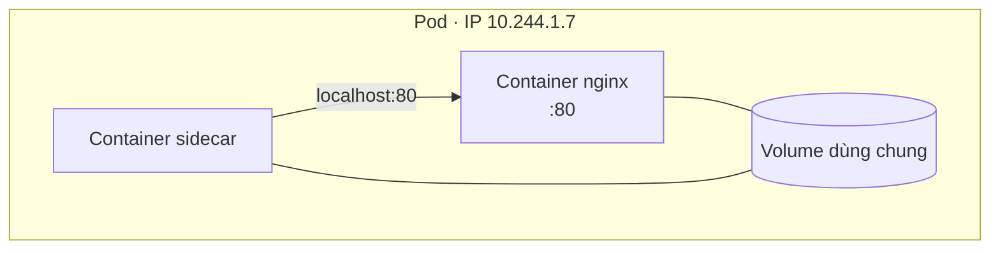
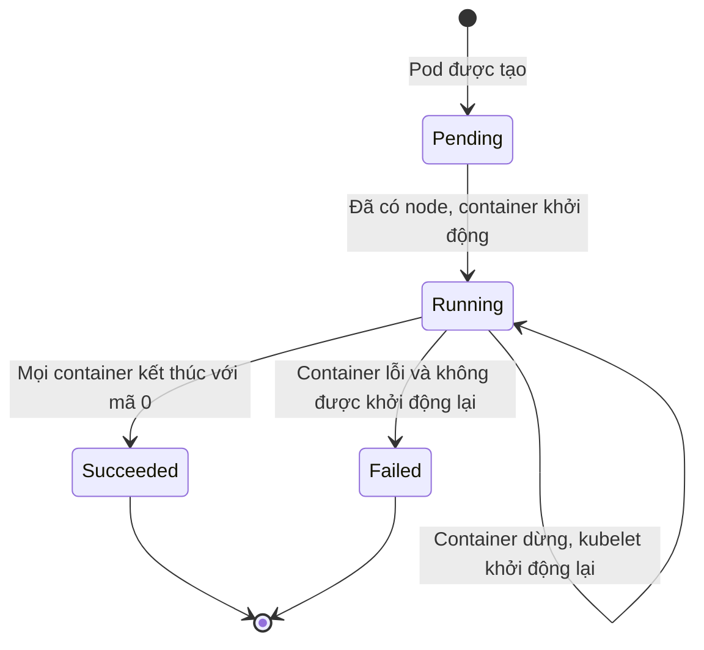
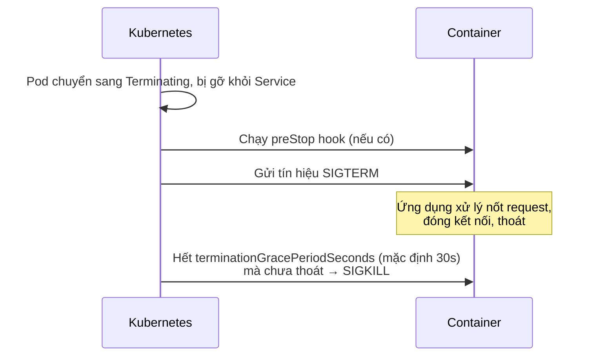

# Pod — đơn vị nhỏ nhất

::: info Mục tiêu bài học
- Hiểu Pod là gì và vì sao Kubernetes không chạy container "trần".
- Tự viết manifest Pod, tạo, quan sát, gỡ lỗi và xóa Pod.
- Nắm **vòng đời Pod**, `restartPolicy` và ý nghĩa các trạng thái thường gặp.
- Dùng **init container**, **sidecar**, biến môi trường, `command`/`args`, volume `emptyDir`.
- Hiểu quá trình **tắt Pod an toàn** (graceful shutdown).
:::

## 1. Pod là gì?

**Pod** là đơn vị nhỏ nhất Kubernetes triển khai và quản lý. Một Pod chứa **một hoặc nhiều container** luôn được xếp lên **cùng một node** và chia sẻ với nhau:

- **Mạng**: chung một địa chỉ IP và không gian cổng → gọi nhau qua `localhost`.
- **Volume**: có thể mount chung thư mục để trao đổi file.
- **Vòng đời**: được tạo, xếp lịch và xóa cùng nhau.



Hãy hình dung Pod là **một căn hộ**: các container là những người ở chung, cùng địa chỉ nhà (IP), dùng chung phòng khách (volume). Phần lớn Pod trong thực tế chỉ có **một container chính**; nhiều container chỉ dùng khi chúng thực sự gắn bó chặt chẽ.

## 2. Pod đầu tiên

```yaml
# pod.yaml
apiVersion: v1
kind: Pod
metadata:
  name: nginx
  labels:
    app: nginx           # nhãn để Service/selector tìm thấy Pod (bài sau)
spec:
  containers:
    - name: nginx        # tên container trong Pod
      image: nginx:1.30  # image chạy
      ports:
        - containerPort: 80   # mang tính tài liệu, giống EXPOSE
```

```bash
kubectl apply -f pod.yaml
kubectl get pods -o wide
```

```text
NAME    READY   STATUS    RESTARTS   AGE   IP           NODE
nginx   1/1     Running   0          8s    10.244.1.4   k8s-learn-worker
```

- `READY 1/1`: số container sẵn sàng / tổng số container.
- `STATUS`: trạng thái tóm tắt (xem mục 3).
- `RESTARTS`: số lần container được khởi động lại — tăng liên tục là dấu hiệu bất thường.

Khám phá Pod:

```bash
kubectl describe pod nginx                 # chi tiết + Events ở cuối
kubectl logs nginx                         # log của nginx
kubectl exec nginx -- nginx -v             # chạy lệnh trong container
kubectl port-forward pod/nginx 8080:80     # mở http://localhost:8080
kubectl delete pod nginx
```

## 3. Vòng đời Pod



| Phase | Ý nghĩa |
| --- | --- |
| `Pending` | Đã được chấp nhận nhưng chưa chạy: đang chờ xếp lịch, đang kéo image... |
| `Running` | Đã gán node, ít nhất một container đang chạy |
| `Succeeded` | Mọi container kết thúc thành công, không khởi động lại (thường gặp ở Job) |
| `Failed` | Mọi container đã kết thúc, ít nhất một container lỗi |
| `Unknown` | Mất liên lạc với node |

Cột **STATUS** trong `kubectl get pods` chi tiết hơn phase — đây là những giá trị bạn sẽ gặp hằng ngày:

| STATUS | Nghĩa là | Hướng xử lý |
| --- | --- | --- |
| `ContainerCreating` | Đang kéo image / tạo container | Chờ; nếu lâu, `describe` xem Events |
| `ImagePullBackOff` / `ErrImagePull` | Không kéo được image | Sai tên/tag, registry private thiếu `imagePullSecrets` |
| `CrashLoopBackOff` | Container khởi động rồi chết lặp lại | `kubectl logs --previous`, kiểm tra lệnh khởi động, cấu hình |
| `CreateContainerConfigError` | Thiếu ConfigMap/Secret được tham chiếu | Tạo đúng ConfigMap/Secret |
| `OOMKilled` | Vượt giới hạn RAM | Tăng `limits.memory` hoặc sửa rò rỉ bộ nhớ |
| `Completed` | Container kết thúc với mã 0 | Bình thường với Job; bất thường với web server |
| `Terminating` | Đang tắt | Chờ hết thời gian ân hạn |

### restartPolicy

| Giá trị | Hành vi | Dùng cho |
| --- | --- | --- |
| `Always` (mặc định) | Luôn khởi động lại container khi nó dừng | Dịch vụ chạy liên tục |
| `OnFailure` | Chỉ khởi động lại khi thoát với mã lỗi ≠ 0 | Job |
| `Never` | Không bao giờ khởi động lại | Job, tác vụ chạy một lần |

Khi container chết lặp lại, kubelet chờ lâu dần trước mỗi lần khởi động lại (10s, 20s, 40s... tối đa 5 phút) — đó chính là **BackOff** trong `CrashLoopBackOff`.

::: warning Pod là “phù du”
Pod **không tự hồi sinh**: nếu bạn xóa Pod hoặc node chứa nó chết, Pod biến mất. Pod tạo lại sẽ có **IP mới**. Vì vậy trong thực tế ta **không tạo Pod trực tiếp** mà dùng **Deployment** (bài 8) và truy cập qua **Service** (bài 9).
:::

## 4. command, args và biến môi trường

| Dockerfile | Kubernetes | Ghi chú |
| --- | --- | --- |
| `ENTRYPOINT` | `command` | Chương trình chạy |
| `CMD` | `args` | Tham số truyền cho chương trình |

```yaml
apiVersion: v1
kind: Pod
metadata:
  name: env-demo
spec:
  restartPolicy: Never
  containers:
    - name: demo
      image: busybox:1.37
      command: ["sh", "-c"]
      args: ["echo Pod $POD_NAME ở IP $POD_IP, phiên bản $APP_VERSION; sleep 3600"]
      env:
        - name: APP_VERSION        # giá trị tĩnh — LUÔN là chuỗi
          value: "v2"
        - name: POD_NAME           # Downward API: lấy thông tin của chính Pod
          valueFrom:
            fieldRef:
              fieldPath: metadata.name
        - name: POD_IP
          valueFrom:
            fieldRef:
              fieldPath: status.podIP
```

```bash
kubectl apply -f env-demo.yaml
kubectl logs env-demo
# Pod env-demo ở IP 10.244.2.5, phiên bản v2
```

Downward API rất hữu ích để ứng dụng ghi log kèm tên Pod, node, namespace mà không cần gọi API.

## 5. Nhiều container trong một Pod

### Init container — chuẩn bị trước khi chạy

**Init container** chạy **lần lượt, đến khi hoàn thành**, trước khi container chính khởi động. Dùng để: chờ database sẵn sàng, chạy migration, tải cấu hình, đặt quyền thư mục...

### Sidecar — trợ thủ chạy song song

**Sidecar** chạy song song suốt đời container chính: chuyển log, proxy mạng (service mesh), đồng bộ file, làm mới chứng chỉ...

Ví dụ: init container tạo trang chủ, nginx phục vụ trang, sidecar cập nhật nội dung mỗi 10 giây — cả ba chia sẻ một volume `emptyDir`:

```yaml
# web-sidecar.yaml
apiVersion: v1
kind: Pod
metadata:
  name: web-sidecar
spec:
  volumes:
    - name: html
      emptyDir: {}                 # thư mục trống, sống cùng Pod
  initContainers:
    - name: init-html
      image: busybox:1.37
      command: ["sh", "-c", "echo '<h1>Xin chao tu init container</h1>' > /work/index.html"]
      volumeMounts:
        - name: html
          mountPath: /work
  containers:
    - name: nginx
      image: nginx:1.30
      ports:
        - containerPort: 80
      volumeMounts:
        - name: html
          mountPath: /usr/share/nginx/html
    - name: updater
      image: busybox:1.37
      command: ["sh", "-c", "while true; do echo \"<p>Cap nhat: $(date)</p>\" >> /work/index.html; sleep 10; done"]
      volumeMounts:
        - name: html
          mountPath: /work
```

```bash
kubectl apply -f web-sidecar.yaml
kubectl get pod web-sidecar -w          # Init:0/1 → PodInitializing → Running (2/2)
kubectl port-forward pod/web-sidecar 8080:80
curl http://localhost:8080              # nội dung dài thêm sau mỗi 10 giây
kubectl logs web-sidecar -c updater     # Pod nhiều container: chỉ rõ container bằng -c
```

### Native sidecar (GA từ v1.33)

Cách trên có nhược điểm: không đảm bảo sidecar khởi động *trước* container chính, và với Job thì sidecar chạy mãi khiến Job không bao giờ kết thúc. Kubernetes giải quyết bằng **native sidecar** — một init container có `restartPolicy: Always`:

```yaml
spec:
  initContainers:
    - name: log-shipper
      image: busybox:1.37
      restartPolicy: Always          # ← biến init container thành sidecar
      command: ["sh", "-c", "tail -F /var/log/app/app.log"]
      volumeMounts:
        - name: logs
          mountPath: /var/log/app
  containers:
    - name: app
      image: busybox:1.37
      command: ["sh", "-c", "while true; do echo \"$(date) xu ly request\" >> /var/log/app/app.log; sleep 2; done"]
      volumeMounts:
        - name: logs
          mountPath: /var/log/app
  volumes:
    - name: logs
      emptyDir: {}
```

Native sidecar khởi động trước và **sẵn sàng trước** container chính, được tắt **sau** container chính, và không cản Job hoàn thành.

## 6. Tắt Pod an toàn (graceful shutdown)

Khi Pod bị xóa (scale down, cập nhật phiên bản, drain node...):



Để không rớt request khi cập nhật:

- Ứng dụng phải **bắt SIGTERM** và dừng gọn gàng (ngừng nhận request mới, làm xong request đang dở).
- Container chạy bằng shell script cần `exec` chương trình chính để nó nhận được tín hiệu.
- Có thể thêm `preStop` chờ vài giây để các node kịp cập nhật luật mạng trước khi ứng dụng dừng:

```yaml
spec:
  terminationGracePeriodSeconds: 45
  containers:
    - name: app
      image: nginx:1.30
      lifecycle:
        preStop:
          sleep:
            seconds: 5     # hành động sleep có sẵn, không cần lệnh sleep trong image
```

## 7. Không sửa được Pod đang chạy?

Phần lớn trường của Pod là **bất biến** sau khi tạo. Thử đổi `ports` hay `env` rồi `apply`, bạn sẽ nhận lỗi:

```text
The Pod "nginx" is invalid: spec: Forbidden: pod updates may not change fields
other than `spec.containers[*].image`, `spec.initContainers[*].image`, ...
```

Muốn thay đổi thì xóa và tạo lại — một lý do nữa để dùng Deployment, vốn tự lo việc thay thế Pod. (Riêng CPU/RAM có thể resize tại chỗ từ v1.35 — xem bài Tài nguyên.)

## Thực hành

**Bài 1.** Tạo Pod `redis` chạy image `redis:8` có label `app=cache, tier=backend`. Kiểm tra log có dòng `Ready to accept connections`.

::: details Xem lời giải
```bash
kubectl run redis --image=redis:8 --labels="app=cache,tier=backend"
kubectl logs redis | grep -i ready
```
Hoặc viết YAML với `metadata.labels` gồm hai nhãn trên rồi `kubectl apply -f`.
:::

**Bài 2.** Tạo Pod `crash` dùng image `busybox:1.37` **không có** command. Quan sát `STATUS` và `RESTARTS` trong 1–2 phút. Giải thích và sửa.

::: details Xem lời giải
```bash
kubectl run crash --image=busybox:1.37
kubectl get pod crash -w
# Completed → CrashLoopBackOff, RESTARTS tăng dần
```
Lệnh mặc định của busybox (`sh`) thoát ngay vì không có terminal. Với `restartPolicy: Always`, kubelet khởi động lại liên tục → `CrashLoopBackOff`. Sửa:
```bash
kubectl delete pod crash
kubectl run crash --image=busybox:1.37 -- sleep 3600
```
:::

**Bài 3.** Viết Pod có init container chờ đến khi Service `db` tồn tại (phân giải được DNS) rồi mới chạy container chính.

::: details Xem lời giải
```yaml
apiVersion: v1
kind: Pod
metadata:
  name: app-wait-db
spec:
  initContainers:
    - name: wait-db
      image: busybox:1.37
      command: ["sh", "-c", "until nslookup db; do echo 'chờ db...'; sleep 2; done"]
  containers:
    - name: app
      image: nginx:1.30
```
Pod sẽ ở trạng thái `Init:0/1` cho đến khi bạn tạo Service `db` (bài 9), ví dụ `kubectl create service clusterip db --tcp=5432:5432`.
:::

## Lỗi thường gặp

- **Container chính thoát ngay** → Pod `Completed`/`CrashLoopBackOff`. Tiến trình chính phải chạy ở foreground (không chạy kiểu daemon).
- **Ghi biến môi trường dạng số không có nháy** → `value: 8080` gây lỗi; phải là `value: "8080"`.
- **Nhét nhiều ứng dụng độc lập vào một Pod** → không scale riêng được, cập nhật một cái phải khởi động lại cả nhóm. Mỗi dịch vụ một Pod (Deployment) riêng.
- **Ứng dụng không xử lý SIGTERM** → mỗi lần deploy rớt request và phải chờ đủ 30 giây mới bị kill.

## Tóm tắt

- Pod = một hoặc nhiều container dùng chung mạng (IP, localhost) và volume, luôn nằm trên cùng node.
- Phase: Pending → Running → Succeeded/Failed. Cột STATUS cho biết chi tiết: `ImagePullBackOff`, `CrashLoopBackOff`...
- `restartPolicy`: Always (mặc định), OnFailure, Never.
- Init container chạy trước; sidecar chạy song song (native sidecar = init container với `restartPolicy: Always`).
- Pod là phù du — dùng Deployment để quản lý và Service để truy cập.

## Kiểm tra kiến thức

<Quiz />
