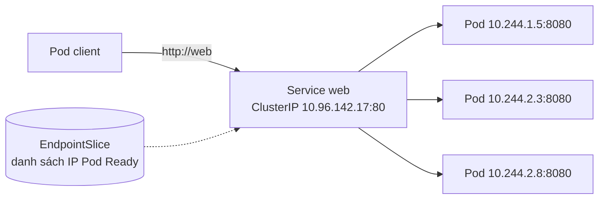
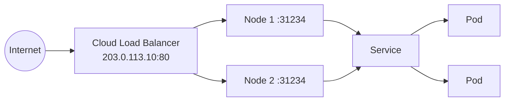
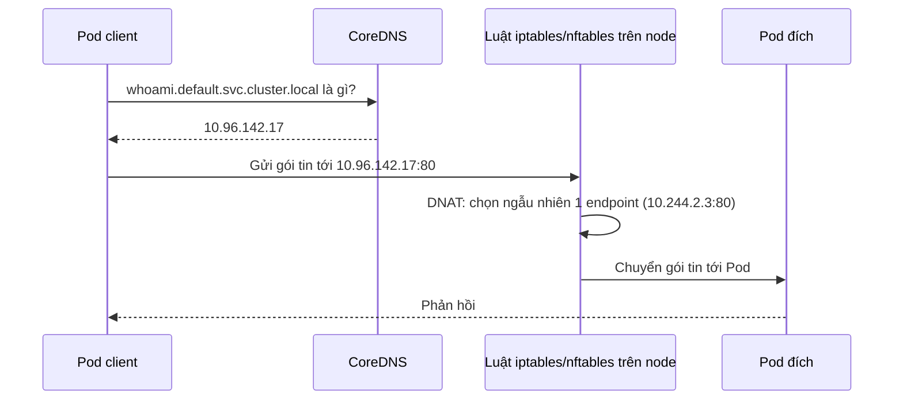

# Service & DNS nội bộ

::: info Mục tiêu bài học
- Hiểu vì sao cần **Service** thay vì gọi thẳng IP của Pod.
- Phân biệt `port`, `targetPort`, `containerPort`, `nodePort`.
- Dùng đúng các loại Service: **ClusterIP**, **NodePort**, **LoadBalancer**, **ExternalName**, **headless**.
- Gọi dịch vụ qua **DNS nội bộ** và tự kiểm chứng cân bằng tải.
:::

## 1. Vấn đề: Pod đến rồi đi

Pod có IP riêng, nhưng IP đó **không đáng tin**: Pod bị thay thế khi cập nhật, scale, node lỗi... và mỗi Pod mới có IP mới. Ngoài ra có nhiều bản sao — client nên gọi bản nào?

**Service** giải quyết cả hai: một **địa chỉ ổn định** (IP ảo + tên DNS) và **cân bằng tải** tới tất cả Pod khớp selector đang sẵn sàng.



## 2. Service ClusterIP đầu tiên

Ta dùng image `traefik/whoami` — một web server nhỏ trả về tên Pod đã xử lý request, rất tiện để *thấy* cân bằng tải.

```yaml
# whoami.yaml
apiVersion: apps/v1
kind: Deployment
metadata:
  name: whoami
spec:
  replicas: 3
  selector:
    matchLabels:
      app: whoami
  template:
    metadata:
      labels:
        app: whoami
    spec:
      containers:
        - name: whoami
          image: traefik/whoami:v1.11
          ports:
            - name: http           # đặt tên cho cổng
              containerPort: 80
---
apiVersion: v1
kind: Service
metadata:
  name: whoami
spec:
  type: ClusterIP                  # mặc định, có thể bỏ
  selector:
    app: whoami                    # chọn Pod có label app=whoami
  ports:
    - name: http
      port: 80                     # cổng của Service
      targetPort: http             # cổng của container (số hoặc tên)
```

```bash
kubectl apply -f whoami.yaml
kubectl get svc whoami
kubectl get endpointslices -l kubernetes.io/service-name=whoami
```

```text
NAME     TYPE        CLUSTER-IP     EXTERNAL-IP   PORT(S)   AGE
whoami   ClusterIP   10.96.142.17   <none>        80/TCP    10s

NAME           ADDRESSTYPE   PORTS   ENDPOINTS                          AGE
whoami-7xk2p   IPv4          80      10.244.1.5,10.244.2.3,10.244.2.8   10s
```

Bốn khái niệm "cổng" hay bị nhầm:

| Trường | Thuộc về | Ý nghĩa |
| --- | --- | --- |
| `containerPort` | Pod | Cổng container lắng nghe (mang tính tài liệu, đặt tên được) |
| `targetPort` | Service | Cổng trên Pod mà Service chuyển traffic tới |
| `port` | Service | Cổng của Service — client gọi vào đây |
| `nodePort` | Service (NodePort/LoadBalancer) | Cổng mở trên **mọi node** |

::: tip Dùng tên cổng cho `targetPort`
`targetPort: http` thay vì số giúp bạn đổi cổng container mà không phải sửa Service.
:::

## 3. Kiểm chứng cân bằng tải và DNS

Chạy một Pod tạm thời làm "client" bên trong cluster:

```bash
kubectl run tmp --rm -it --image=busybox:1.37 --restart=Never -- sh
```

Trong shell của Pod `tmp`:

```bash
for i in 1 2 3 4 5 6; do wget -qO- http://whoami | grep Hostname; done
```

```text
Hostname: whoami-6d4b8c7f9-2kq8x
Hostname: whoami-6d4b8c7f9-pl4mn
Hostname: whoami-6d4b8c7f9-2kq8x
Hostname: whoami-6d4b8c7f9-9xw2c
...
```

Request được rải ngẫu nhiên lên các Pod. Giờ xem DNS:

```bash
nslookup whoami
cat /etc/resolv.conf
```

```text
Server:     10.96.0.10
Address:    10.96.0.10:53

Name:   whoami.default.svc.cluster.local
Address: 10.96.142.17

search default.svc.cluster.local svc.cluster.local cluster.local
nameserver 10.96.0.10
options ndots:5
```

- `10.96.0.10` là **CoreDNS** (Service `kube-dns` trong `kube-system`).
- Nhờ dòng `search`, tên ngắn `whoami` được tự mở rộng thành `whoami.default.svc.cluster.local`.
- Tên đầy đủ: `<service>.<namespace>.svc.cluster.local`.

Gõ `exit` để thoát — Pod `tmp` tự bị xóa nhờ `--rm`.

## 4. Các loại Service

### ClusterIP (mặc định)

Chỉ truy cập được **bên trong cluster**. Dùng cho giao tiếp giữa các dịch vụ (frontend → backend → database). Đây là loại phổ biến nhất.

### NodePort

Mở một cổng (30000–32767) trên **mọi node**; traffic tới `<IP bất kỳ node>:<nodePort>` được chuyển vào Service.

```yaml
apiVersion: v1
kind: Service
metadata:
  name: whoami-nodeport
spec:
  type: NodePort
  selector:
    app: whoami
  ports:
    - port: 80
      targetPort: http
      nodePort: 30080        # bỏ trống để Kubernetes tự cấp
```

Với cluster kind trong bài cài đặt, cổng 30080 của node đã được map ra máy bạn:

```bash
kubectl apply -f whoami-nodeport.yaml
curl http://localhost:30080        # hoặc mở bằng trình duyệt
```

NodePort hợp cho thử nghiệm hoặc khi bạn tự đặt load balancer bên ngoài; ít khi phơi trực tiếp ra Internet.

### LoadBalancer

Trên cloud, Kubernetes (qua cloud-controller-manager) **tạo một load balancer thật** và gán IP công khai cho Service. Bên dưới nó vẫn dùng NodePort.



Trên máy cá nhân hoặc máy chủ vật lý không có cloud, `EXTERNAL-IP` sẽ mãi là `<pending>`. Giải pháp: **MetalLB** (bare metal), **cloud-provider-kind** (cho kind), hoặc `minikube tunnel`.

::: info Một LoadBalancer cho mỗi Service thì tốn kém
Mỗi Service LoadBalancer thường là một load balancer tính phí riêng. Với nhiều ứng dụng web, ta dùng **một** điểm vào chung là Ingress/Gateway (Phần 2) và định tuyến theo tên miền, đường dẫn.
:::

### ExternalName

Tạo bí danh DNS (CNAME) trỏ ra dịch vụ bên ngoài — ứng dụng gọi `payment-api` như dịch vụ nội bộ, sau này chuyển vào cluster chỉ cần đổi Service:

```yaml
apiVersion: v1
kind: Service
metadata:
  name: payment-api
spec:
  type: ExternalName
  externalName: api.payment.example.com
```

### Headless Service

Đặt `clusterIP: None` → không có IP ảo, không cân bằng tải; DNS trả về **thẳng IP các Pod**. Dùng cho StatefulSet (mỗi Pod có tên DNS riêng như `db-0.db`) và các client tự cân bằng tải (một số driver database, gRPC).

```yaml
apiVersion: v1
kind: Service
metadata:
  name: db
spec:
  clusterIP: None
  selector:
    app: db
  ports:
    - port: 5432
```

## 5. Service hoạt động bên dưới ra sao?



- **EndpointSlice controller** theo dõi Pod khớp selector và ghi danh sách IP của các Pod **Ready**.
- **kube-proxy** trên mỗi node đọc Service + EndpointSlice và lập trình luật mạng; việc "cân bằng tải" diễn ra ngay trong kernel của node phía client.
- Vì ClusterIP chỉ là luật chuyển tiếp cho các cổng cụ thể, **ping ClusterIP không có phản hồi** — đó là bình thường.

Một số tùy chọn hữu ích:

| Trường | Tác dụng |
| --- | --- |
| `sessionAffinity: ClientIP` | Request từ cùng một IP client luôn vào cùng một Pod |
| `externalTrafficPolicy: Local` | Giữ IP nguồn thật của client; chỉ gửi vào Pod trên node nhận traffic |
| `publishNotReadyAddresses: true` | Đưa cả Pod chưa Ready vào DNS (dùng cho cụm cần tự khám phá nhau) |

## 6. Chọn cách truy cập nào?

| Nhu cầu | Giải pháp |
| --- | --- |
| Dịch vụ gọi nhau trong cluster | Service **ClusterIP** + DNS |
| Lập trình viên thử nhanh từ laptop | `kubectl port-forward svc/web 8080:80` |
| Phơi một dịch vụ TCP/UDP ra ngoài | Service **LoadBalancer** |
| Nhiều website/API HTTP ra Internet | **Ingress / Gateway API** (Phần 2) |
| Trỏ tới dịch vụ ngoài cluster | **ExternalName** |

## Thực hành

**Bài 1.** Tạo Deployment `api` (image `traefik/whoami:v1.11`, 2 replicas) và expose nó bằng lệnh mệnh lệnh ở cổng 8080 của Service. Gọi thử từ một Pod khác.

::: details Xem lời giải
```bash
kubectl create deployment api --image=traefik/whoami:v1.11 --replicas=2
kubectl expose deployment api --port=8080 --target-port=80
kubectl run tmp --rm -it --image=busybox:1.37 --restart=Never -- wget -qO- http://api:8080
```
`kubectl expose` tự lấy selector từ Deployment (`app=api`).
:::

**Bài 2 — Gỡ lỗi Service.** Áp dụng file sau và tìm 2 lỗi khiến `wget -qO- http://broken` thất bại:

```yaml
apiVersion: apps/v1
kind: Deployment
metadata:
  name: broken
spec:
  replicas: 2
  selector:
    matchLabels: { app: broken }
  template:
    metadata:
      labels: { app: broken }
    spec:
      containers:
        - name: web
          image: nginx:1.30
---
apiVersion: v1
kind: Service
metadata:
  name: broken
spec:
  selector:
    app: brokn
  ports:
    - port: 80
      targetPort: 8080
```

::: details Xem lời giải
```bash
kubectl get endpointslices -l kubernetes.io/service-name=broken   # ENDPOINTS: <unset>
kubectl describe svc broken                                       # Selector: app=brokn
```
1. Selector sai chính tả `brokn` → Service không có endpoint. Sửa thành `app: broken`.
2. Sau khi sửa, endpoint có rồi nhưng vẫn lỗi `Connection refused` vì nginx lắng nghe cổng **80**, không phải 8080. Sửa `targetPort: 80`.

Quy trình gỡ lỗi Service: **có endpoint không?** → **targetPort đúng chưa?** → **Pod có thực sự trả lời không?** (`kubectl port-forward pod/<pod> 8080:80`).
:::

**Bài 3.** Từ namespace `default`, gọi Service `kube-dns` trong `kube-system` bằng tên đầy đủ và giải thích vì sao gọi `kube-dns` (tên ngắn) thì không được.

::: details Xem lời giải
```bash
kubectl run tmp --rm -it --image=busybox:1.37 --restart=Never -- nslookup kube-dns.kube-system.svc.cluster.local
```
Tên ngắn chỉ được mở rộng với namespace của Pod gọi (`default`), nên `kube-dns` → `kube-dns.default.svc.cluster.local` — không tồn tại.
:::

## Lỗi thường gặp

| Triệu chứng | Kiểm tra |
| --- | --- |
| `wget: bad address 'web'` | Sai tên Service hoặc khác namespace → dùng `web.<namespace>` |
| Kết nối treo / `Connection refused` | Service không có endpoint (selector sai, Pod chưa Ready) hoặc sai `targetPort` |
| `EXTERNAL-IP <pending>` mãi | Cluster không có bộ cấp load balancer (kind, bare metal) |
| Chỉ một Pod nhận hết traffic | Client dùng kết nối giữ lâu (HTTP keep-alive, gRPC) — cân bằng tải theo kết nối, không theo request |

## Tóm tắt

- Service = IP ảo ổn định + tên DNS + cân bằng tải tới các Pod **Ready** khớp **selector**.
- `port` (Service) → `targetPort` (Pod); `nodePort` mở trên mọi node.
- ClusterIP cho nội bộ, NodePort/LoadBalancer cho bên ngoài, ExternalName làm bí danh, headless cho truy cập từng Pod.
- DNS: `<service>.<namespace>.svc.cluster.local`; tên ngắn chỉ dùng trong cùng namespace.

## Kiểm tra kiến thức

<Quiz />
