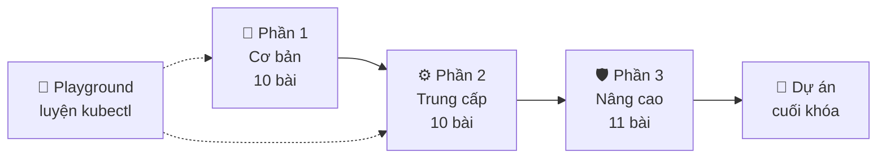

# Giới thiệu & lộ trình học

Chào mừng bạn đến với **K8s Learn** — bộ tài liệu tự học Kubernetes bằng tiếng Việt, đi từ "container là gì" đến vận hành cluster production. Nội dung được cập nhật theo **Kubernetes v1.37** (tháng 10/2026).

## Khóa học này dành cho ai?

- **Lập trình viên** muốn tự triển khai ứng dụng của mình lên Kubernetes thay vì "ném qua tường" cho đội vận hành.
- **DevOps / SRE / sysadmin** cần nền tảng bài bản để vận hành cluster thật.
- **Sinh viên** muốn có kỹ năng cloud-native và chuẩn bị cho chứng chỉ CKAD, CKA.

## Bạn cần biết gì trước?

| Kiến thức | Mức cần có | Ghi chú |
| --- | --- | --- |
| Dòng lệnh Linux | `cd`, `ls`, `cat`, `curl`, biến môi trường | Trên Windows nên dùng WSL2 hoặc Git Bash |
| Mạng cơ bản | IP, port, DNS, HTTP | Sẽ được nhắc lại khi cần |
| Docker / container | Biết chạy `docker run` là đủ | [Bài 1](/co-ban/container-va-docker) ôn lại toàn bộ |
| YAML | Không bắt buộc | Có phần "YAML cấp tốc" trong [bài kubectl](/co-ban/kubectl#yaml-cap-toc) |

::: tip Không cần cloud, không tốn tiền
Mọi bài thực hành đều chạy trên máy cá nhân với **kind** hoặc **minikube**. Máy có 8 GB RAM và 4 CPU là thoải mái; 4 GB RAM vẫn chạy được cluster 1 node. Nếu chưa muốn cài gì, hãy mở [kubectl Playground](/thuc-hanh/playground) để thử ngay trên trình duyệt.
:::

## Cấu trúc khóa học



- **Phần 1 — Cơ bản:** container, kiến trúc, cài đặt, kubectl và các đối tượng cốt lõi (Pod, Deployment, Service, ConfigMap, Secret). Học xong bạn tự triển khai được một ứng dụng web.
- **Phần 2 — Trung cấp:** làm cho ứng dụng *chạy ổn định*: health check, tài nguyên, lưu trữ, StatefulSet, Job, định tuyến HTTP, lập lịch, autoscaling, đóng gói bằng Helm và Kustomize.
- **Phần 3 — Nâng cao:** bảo mật, mạng chuyên sâu, giám sát, xử lý sự cố, mở rộng Kubernetes bằng CRD/Operator, GitOps và vận hành cluster production.
- **Dự án cuối khóa:** triển khai ứng dụng nhiều tầng hoàn chỉnh, áp dụng gần như mọi thứ đã học.

## Mỗi bài học gồm những gì?

1. **Mục tiêu** — bạn sẽ làm được gì sau bài học.
2. **Khái niệm** — giải thích "vì sao" trước "làm thế nào", có sơ đồ minh họa.
3. **Ví dụ YAML / lệnh** — chạy được ngay trên cluster thật.
4. **Thực hành** — bài tập có lời giải (bấm để mở).
5. **Lỗi thường gặp** — những cái bẫy người mới hay vướng.
6. **Quiz** — kiểm tra nhanh, có giải thích cho từng đáp án.

Cuối mỗi bài có nút **Đánh dấu hoàn thành**. Tiến độ được lưu trong trình duyệt (localStorage) — không cần đăng nhập, nhưng nếu đổi máy hoặc xóa dữ liệu trình duyệt thì tiến độ sẽ mất.

## Quy ước trong tài liệu

```bash
# Dòng bắt đầu bằng # là chú thích — không cần gõ
kubectl get pods            # lệnh bạn chạy
```

```text
NAME    READY   STATUS    RESTARTS   AGE     ← kết quả mẫu (tên Pod, thời gian sẽ khác trên máy bạn)
nginx   1/1     Running   0          12s
```

- Khối có nhãn **Mẹo** là kinh nghiệm thực tế; **Lưu ý** là chỗ dễ sai; **Cảnh báo** là thao tác có thể gây mất dữ liệu hoặc gián đoạn dịch vụ.
- Thuật ngữ tiếng Anh (Pod, Deployment, node...) được giữ nguyên vì đó là tên bạn sẽ gặp trong tài liệu, log và lệnh. Xem thêm [bảng thuật ngữ](/tham-khao/thuat-ngu).

## Kế hoạch học gợi ý (6 tuần)

| Tuần | Nội dung | Mục tiêu đầu ra |
| --- | --- | --- |
| 1 | Phần 1, bài 1–5 | Có cluster kind chạy trên máy, dùng kubectl thành thạo |
| 2 | Phần 1, bài 6–10 | Tự viết YAML triển khai một web app có Service và cấu hình |
| 3 | Phần 2, bài 1–5 | Ứng dụng có health check, giới hạn tài nguyên, lưu trữ bền vững |
| 4 | Phần 2, bài 6–10 | Định tuyến HTTP, autoscaling, đóng gói bằng Helm/Kustomize |
| 5 | Phần 3, bài 1–6 | Bảo mật, mạng, giám sát và tự xử lý sự cố |
| 6 | Phần 3, bài 7–11 + dự án | Hiểu Operator, GitOps, vận hành; hoàn thành dự án cuối khóa |

Mỗi ngày 45–60 phút là đủ. Quan trọng là **đều đặn** và **thực hành trên cluster thật**.

## Tiến độ của bạn

<Roadmap />
