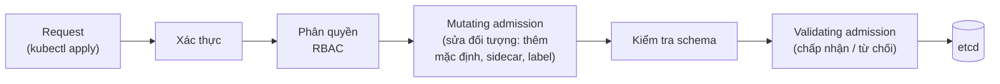

# Admission control & Policy

::: info Mục tiêu bài học
- Hiểu vị trí của **admission** trong vòng đời một request và các admission controller có sẵn.
- Phân biệt **mutating** và **validating**, webhook và policy tích hợp.
- Viết **ValidatingAdmissionPolicy** bằng CEL để áp quy định cho toàn cluster.
- Dùng **Kyverno** cho các chính sách phổ biến và triển khai policy an toàn (audit trước, enforce sau).
:::

## 1. Admission nằm ở đâu?



RBAC trả lời "**ai** được làm gì". Admission trả lời "**nội dung** request có tuân thủ quy định không": image phải từ registry công ty, mọi Deployment phải có label `team`, không được dùng tag `latest`, namespace production phải có ít nhất 2 replicas...

## 2. Admission controller có sẵn

API server đã bật sẵn nhiều admission plugin, bạn dùng chúng hằng ngày mà không biết:

| Plugin | Việc làm |
| --- | --- |
| `NamespaceLifecycle` | Chặn tạo đối tượng trong namespace đang bị xóa |
| `LimitRanger` | Áp giá trị mặc định/giới hạn từ LimitRange |
| `ResourceQuota` | Từ chối khi vượt quota |
| `ServiceAccount` | Gán ServiceAccount mặc định, mount token |
| `PodSecurity` | Thực thi Pod Security Standards |
| `DefaultStorageClass` | Gán StorageClass mặc định cho PVC |
| `MutatingAdmissionWebhook` / `ValidatingAdmissionWebhook` | Gọi webhook bên ngoài |
| `ValidatingAdmissionPolicy` / `MutatingAdmissionPolicy` | Chạy policy viết bằng CEL |

## 3. Admission webhook

Bạn tự viết dịch vụ HTTPS nhận `AdmissionReview` và trả về cho phép/từ chối (validating) hoặc kèm JSON patch (mutating), rồi đăng ký bằng `ValidatingWebhookConfiguration` / `MutatingWebhookConfiguration`. Service mesh dùng mutating webhook để chèn sidecar; cert-manager, Kyverno, Gatekeeper đều dựa trên webhook.

::: warning Webhook là một điểm lỗi
- `failurePolicy: Fail` + webhook sập = mọi request khớp bị từ chối (kể cả deploy bản sửa lỗi).
- Luôn **loại trừ** namespace hệ thống (`kube-system`...) qua `namespaceSelector`.
- Chạy webhook với nhiều replicas, PDB, `timeoutSeconds` ngắn.
:::

## 4. ValidatingAdmissionPolicy — luật CEL không cần webhook

Từ v1.30, Kubernetes có sẵn **ValidatingAdmissionPolicy**: luật viết bằng **CEL**, chạy ngay trong API server. Gồm hai đối tượng: **policy** (luật) và **binding** (áp cho đâu, hành động gì).

```yaml
# require-team-label.yaml
apiVersion: admissionregistration.k8s.io/v1
kind: ValidatingAdmissionPolicy
metadata:
  name: deployment-standards
spec:
  failurePolicy: Fail
  matchConstraints:
    resourceRules:
      - apiGroups: ["apps"]
        apiVersions: ["v1"]
        operations: ["CREATE", "UPDATE"]
        resources: ["deployments"]
  validations:
    - expression: "has(object.metadata.labels) && 'team' in object.metadata.labels"
      message: "Deployment phải có label 'team'"
    - expression: >-
        object.spec.template.spec.containers.all(c,
          !c.image.endsWith(':latest') && c.image.contains(':'))
      message: "Image phải có tag cụ thể và không dùng ':latest'"
    - expression: "object.spec.replicas <= 10"
      messageExpression: "'replicas tối đa là 10, bạn đặt ' + string(object.spec.replicas)"
---
apiVersion: admissionregistration.k8s.io/v1
kind: ValidatingAdmissionPolicyBinding
metadata:
  name: deployment-standards
spec:
  policyName: deployment-standards
  validationActions: ["Deny"]        # hoặc ["Warn"], ["Audit"] khi thử nghiệm
  matchResources:
    namespaceSelector:
      matchLabels:
        policy: strict               # chỉ áp cho namespace có label này
```

```bash
kubectl apply -f require-team-label.yaml
kubectl create namespace strict-demo
kubectl label namespace strict-demo policy=strict

kubectl create deployment web --image=nginx -n strict-demo
```

```text
error: failed to create deployment: deployments.apps "web" is forbidden: ValidatingAdmissionPolicy
'deployment-standards' with binding 'deployment-standards' denied request: Deployment phải có label 'team'
```

```bash
kubectl create deployment web --image=nginx:1.30 -n strict-demo --dry-run=client -o yaml \
  | kubectl label --local -f - team=shop -o yaml \
  | kubectl apply -f -
# deployment.apps/web created
```

Biến dùng được trong CEL: `object` (đối tượng mới), `oldObject` (khi UPDATE), `request` (thông tin request: user, operation...), `params` (tham số từ một ConfigMap/CRD khi dùng `paramKind`), `namespaceObject`.

**MutatingAdmissionPolicy** (stable từ v1.36) bổ sung khả năng *sửa* đối tượng bằng CEL — ví dụ tự gắn label mặc định, thêm `securityContext` — cũng không cần webhook.

## 5. Kyverno — policy engine đầy đủ

Policy tích hợp chỉ kiểm tra lúc admission. **Kyverno** (CNCF) bổ sung:

- **Mutate** và **generate**: tự tạo NetworkPolicy/Quota mặc định khi có namespace mới.
- **Xác minh chữ ký image** (Sigstore cosign, Notary).
- **Quét nền** (background scan) các tài nguyên đã tồn tại và **báo cáo** vi phạm (PolicyReport).
- **Ngoại lệ** chi tiết, công cụ CLI để test policy trong CI.
- Thư viện hàng trăm policy mẫu.

```bash
helm repo add kyverno https://kyverno.github.io/kyverno/
helm repo update
helm install kyverno kyverno/kyverno -n kyverno --create-namespace
```

Các bản Kyverno mới dùng các loại policy dựa trên CEL (`ValidatingPolicy`, `MutatingPolicy`, `GeneratingPolicy`, `DeletingPolicy`, `ImageValidatingPolicy`); loại `ClusterPolicy` cũ đã được đánh dấu deprecated.

```yaml
# require-requests.yaml
apiVersion: policies.kyverno.io/v1
kind: ValidatingPolicy
metadata:
  name: require-resource-requests
spec:
  validationActions: ["Audit"]          # chạy thử: chỉ ghi nhận vi phạm
  matchConstraints:
    resourceRules:
      - apiGroups: [""]
        apiVersions: ["v1"]
        operations: ["CREATE", "UPDATE"]
        resources: ["pods"]
  validations:
    - expression: >-
        object.spec.containers.all(c,
          has(c.resources) && has(c.resources.requests) &&
          'cpu' in c.resources.requests && 'memory' in c.resources.requests)
      message: "Mọi container phải khai báo requests.cpu và requests.memory"
```

Kyverno tự sinh luật tương ứng cho Deployment, StatefulSet, Job... từ policy viết cho Pod (auto-gen), nên lỗi được báo ngay ở Deployment thay vì âm thầm ở ReplicaSet.

```bash
kubectl apply -f require-requests.yaml
kubectl get policyreport -A                       # xem vi phạm của tài nguyên hiện có
```

Khi đã sửa hết vi phạm, đổi `validationActions: ["Deny"]` để bắt đầu chặn.

### Các lựa chọn khác

- **OPA Gatekeeper** — policy viết bằng **Rego**, mạnh và linh hoạt, phổ biến ở tổ chức đã dùng Open Policy Agent.
- **Kubewarden** — policy biên dịch thành WebAssembly, viết bằng nhiều ngôn ngữ.

## 6. Bộ chính sách khởi đầu gợi ý

| Chính sách | Lý do |
| --- | --- |
| Cấm tag `latest`, bắt buộc tag/digest | Tái lập được, rollback được |
| Chỉ cho image từ registry được duyệt | Chống image lạ, chuỗi cung ứng |
| Bắt buộc requests (và memory limit) | Lập lịch đúng, tránh "hàng xóm ồn ào" |
| Bắt buộc label `team`, `app.kubernetes.io/name` | Truy vết chủ sở hữu, chi phí |
| Bắt buộc readinessProbe cho Deployment | Rolling update an toàn |
| Pod Security `baseline`/`restricted` | Gia cố container |
| Tự sinh NetworkPolicy default-deny cho namespace mới | An toàn mặc định |
| Cấm Service `NodePort`/`LoadBalancer` ngoài namespace được phép | Kiểm soát điểm phơi ra ngoài |

## Thực hành

**Bài 1.** Viết ValidatingAdmissionPolicy cấm tạo Service kiểu `NodePort` trong các namespace có label `env=prod`. Thử với hai namespace.

::: details Xem lời giải
```yaml
apiVersion: admissionregistration.k8s.io/v1
kind: ValidatingAdmissionPolicy
metadata:
  name: no-nodeport
spec:
  matchConstraints:
    resourceRules:
      - apiGroups: [""]
        apiVersions: ["v1"]
        operations: ["CREATE", "UPDATE"]
        resources: ["services"]
  validations:
    - expression: "!has(object.spec.type) || object.spec.type != 'NodePort'"
      message: "Không được dùng Service NodePort ở môi trường production"
---
apiVersion: admissionregistration.k8s.io/v1
kind: ValidatingAdmissionPolicyBinding
metadata:
  name: no-nodeport
spec:
  policyName: no-nodeport
  validationActions: ["Deny"]
  matchResources:
    namespaceSelector:
      matchLabels: { env: prod }
```
```bash
kubectl create ns p1 && kubectl label ns p1 env=prod
kubectl create ns d1
kubectl create service nodeport x --tcp=80:80 -n p1   # bị từ chối
kubectl create service nodeport x --tcp=80:80 -n d1   # được phép
```
:::

**Bài 2.** Đổi binding ở mục 4 sang `validationActions: ["Warn"]`, tạo Deployment vi phạm và quan sát khác biệt.

::: details Xem lời giải
Deployment **được tạo**, nhưng kubectl in cảnh báo `Warning: Validation failed for ValidatingAdmissionPolicy 'deployment-standards' ...`. `Warn` hữu ích để thông báo cho các team trước khi chuyển sang `Deny`; `Audit` ghi vào audit log để quản trị viên thống kê.
:::

## Tóm tắt

- Admission chạy sau xác thực/phân quyền, trước khi lưu: mutating rồi validating.
- Nhiều admission plugin có sẵn (LimitRanger, ResourceQuota, PodSecurity...).
- Webhook linh hoạt nhưng là điểm lỗi — cấu hình cẩn thận.
- ValidatingAdmissionPolicy (CEL) và MutatingAdmissionPolicy cho chính sách không cần webhook.
- Kyverno bổ sung mutate/generate/verify image/báo cáo; triển khai theo trình tự Audit → Warn → Deny.

## Kiểm tra kiến thức

<Quiz />
