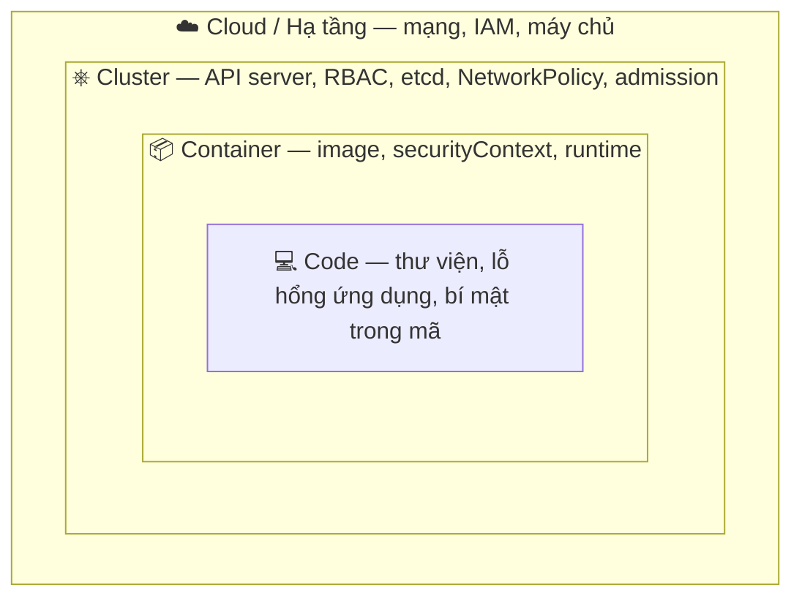
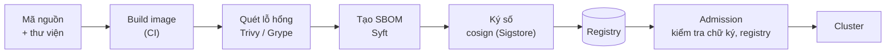

# Bảo mật Pod & chuỗi cung ứng

::: info Mục tiêu bài học
- Hiểu mô hình **4C** của bảo mật cloud-native.
- Gia cố Pod bằng **securityContext**: non-root, chỉ đọc, bỏ capabilities, seccomp.
- Áp dụng **Pod Security Standards** bằng **Pod Security Admission** theo namespace.
- Bảo vệ **chuỗi cung ứng phần mềm**: image tối giản, quét lỗ hổng, SBOM, ký số.
- Biết các lớp bảo vệ khác: mã hóa Secret, audit log, giám sát runtime, CIS benchmark.
:::

## 1. Mô hình 4C



Mỗi lớp bảo vệ lớp bên trong. Lớp ngoài yếu thì lớp trong mạnh mấy cũng không đủ — và ngược lại, cluster an toàn không cứu được ứng dụng có lỗ hổng SQL injection. Bài này tập trung vào lớp **Container** và một phần **Cluster**.

## 2. securityContext — gia cố từng Pod

Mặc định nhiều image chạy bằng **root**, có thể ghi lên mọi nơi trong file system của container và giữ nhiều Linux capabilities. Nếu kẻ tấn công chiếm được tiến trình, chúng có nhiều công cụ để leo thang. Hãy thu hẹp tối đa:

```yaml
# secure-web.yaml
apiVersion: apps/v1
kind: Deployment
metadata:
  name: secure-web
spec:
  replicas: 2
  selector:
    matchLabels: { app: secure-web }
  template:
    metadata:
      labels: { app: secure-web }
    spec:
      automountServiceAccountToken: false     # không cần gọi Kubernetes API
      securityContext:                        # áp cho cả Pod
        runAsNonRoot: true
        runAsUser: 101
        runAsGroup: 101
        fsGroup: 101                          # volume được gán group này để ghi được
        seccompProfile:
          type: RuntimeDefault                # lọc system call nguy hiểm
      containers:
        - name: web
          image: nginxinc/nginx-unprivileged:1.30-alpine   # nginx chạy non-root, cổng 8080
          ports:
            - containerPort: 8080
          securityContext:                    # áp cho container
            allowPrivilegeEscalation: false
            readOnlyRootFilesystem: true
            capabilities:
              drop: ["ALL"]
          resources:
            requests: { cpu: 50m, memory: 32Mi }
            limits: { memory: 64Mi }
          volumeMounts:
            - name: tmp
              mountPath: /tmp                 # nơi duy nhất nginx cần ghi
      volumes:
        - name: tmp
          emptyDir: {}
```

| Thiết lập | Tác dụng |
| --- | --- |
| `runAsNonRoot: true` | Từ chối chạy nếu image dùng root (UID 0) |
| `runAsUser` / `runAsGroup` | Chỉ định UID/GID cụ thể |
| `readOnlyRootFilesystem: true` | Kẻ tấn công không thể ghi đè binary, cài công cụ |
| `allowPrivilegeEscalation: false` | Chặn leo thang qua setuid/setgid |
| `capabilities.drop: ["ALL"]` | Bỏ mọi đặc quyền kernel; chỉ `add` cái thật sự cần (ví dụ `NET_BIND_SERVICE`) |
| `seccompProfile: RuntimeDefault` | Chặn các system call hiếm khi cần |
| `privileged: true` | **Tránh** — gần như ngang quyền root trên node |

::: tip Ứng dụng không chạy được khi bật readOnlyRootFilesystem?
Xem log để biết nó cần ghi vào đâu (thường là `/tmp`, thư mục cache), rồi mount `emptyDir` đúng các đường dẫn đó.
:::

### User namespaces (GA từ v1.36)

Đặt `hostUsers: false` để UID 0 bên trong container được ánh xạ thành một UID không đặc quyền trên node — kể cả khi tiến trình "là root" trong container, thoát ra node nó cũng chỉ là user thường:

```yaml
spec:
  hostUsers: false
```

## 3. Pod Security Standards & Pod Security Admission

**Pod Security Standards** định nghĩa 3 mức chính sách:

| Mức | Ý nghĩa | Dùng cho |
| --- | --- | --- |
| `privileged` | Không giới hạn | Thành phần hệ thống (CNI, CSI, agent giám sát) |
| `baseline` | Chặn các cấu hình nguy hiểm đã biết (privileged, hostNetwork, hostPath...) | Mặc định hợp lý cho hầu hết ứng dụng |
| `restricted` | Theo best practice gia cố: non-root, drop ALL, seccomp... | Ứng dụng nhạy cảm, môi trường multi-tenant |

**Pod Security Admission** (có sẵn trong Kubernetes) áp dụng chính sách theo **label của namespace**, với 3 chế độ:

```yaml
apiVersion: v1
kind: Namespace
metadata:
  name: secure
  labels:
    pod-security.kubernetes.io/enforce: restricted   # từ chối Pod vi phạm
    pod-security.kubernetes.io/warn: restricted      # cảnh báo cho người dùng kubectl
    pod-security.kubernetes.io/audit: restricted     # ghi vào audit log
```

```bash
kubectl apply -f secure-ns.yaml
kubectl run bad --image=nginx:1.30 -n secure
```

```text
Error from server (Forbidden): pods "bad" is forbidden: violates PodSecurity "restricted:latest":
allowPrivilegeEscalation != false (container "bad" must set securityContext.allowPrivilegeEscalation=false),
unrestricted capabilities (container "bad" must set securityContext.capabilities.drop=["ALL"]),
runAsNonRoot != true (pod or container "bad" must set securityContext.runAsNonRoot=true),
seccompProfile (pod or container "bad" must set securityContext.seccompProfile.type to "RuntimeDefault" or "Localhost")
```

Thông báo lỗi chỉ rõ từng trường cần sửa. Deployment `secure-web` ở trên thỏa mức `restricted`:

```bash
kubectl apply -f secure-web.yaml -n secure
kubectl get pods -n secure
```

::: warning Deployment được tạo nhưng không có Pod?
PSA kiểm tra **Pod**, không kiểm tra Deployment. Deployment vi phạm vẫn được tạo (kèm cảnh báo nếu bật `warn`), nhưng ReplicaSet không tạo được Pod. Xem lỗi: `kubectl describe rs -n secure` → sự kiện `FailedCreate`.
:::

**Lộ trình áp dụng an toàn:** bắt đầu với `warn` + `audit` ở mức `restricted` để thấy vi phạm mà không chặn gì → sửa dần manifest → bật `enforce`. Kiểm tra trước bằng:

```bash
kubectl label --dry-run=server --overwrite ns secure pod-security.kubernetes.io/enforce=restricted
```

Cần chính sách chi tiết hơn (bắt buộc label, cấm tag `latest`, giới hạn registry...) → dùng **Admission Policy / Kyverno** ở [bài sau](/nang-cao/admission-policy).

## 4. Chuỗi cung ứng phần mềm (supply chain)



**Image tối giản**: ít phần mềm = ít lỗ hổng. Dùng multi-stage build và image nền `distroless`, `-slim`, `alpine`, hoặc image "hardened" có ít CVE.

**Quét lỗ hổng** trong CI và định kỳ trên registry:

```bash
trivy image nginx:1.30                       # liệt kê CVE theo mức độ
trivy image --severity HIGH,CRITICAL --exit-code 1 myapp:1.0.0   # làm fail pipeline
trivy k8s --report summary                   # quét workload và cấu hình đang chạy trong cluster
```

**SBOM** (Software Bill of Materials) — danh sách mọi thành phần trong image, giúp trả lời ngay "chúng ta có bị ảnh hưởng bởi CVE mới công bố không?".

**Ký số và xác minh** với Sigstore cosign:

```bash
cosign sign --key cosign.key ghcr.io/my-org/shop@sha256:3f2c...   # trong CI
cosign verify --key cosign.pub ghcr.io/my-org/shop@sha256:3f2c...
```

Ký "keyless" bằng danh tính OIDC của pipeline (GitHub Actions, GitLab CI) giúp khỏi phải quản lý khóa. Sau đó dùng policy engine (Kyverno `ImageValidatingPolicy`...) để **chỉ cho phép image có chữ ký hợp lệ** chạy trong cluster.

**Thực hành khác:** chỉ kéo image từ registry tin cậy (hoặc registry nội bộ/proxy như Harbor), ghim theo **digest**, cập nhật image nền thường xuyên (Renovate/Dependabot).

## 5. Bảo vệ Secret và API server

- **Mã hóa Secret khi lưu trong etcd** — trên cluster tự dựng, cấu hình `EncryptionConfiguration` cho API server (ưu tiên provider KMS v2):

```yaml
apiVersion: apiserver.config.k8s.io/v1
kind: EncryptionConfiguration
resources:
  - resources: ["secrets"]
    providers:
      - kms:
          apiVersion: v2
          name: vault-kms
          endpoint: unix:///var/run/kmsplugin/socket.sock
      - identity: {}        # vẫn đọc được dữ liệu cũ chưa mã hóa
```

- **Không phơi API server ra Internet** nếu không cần; giới hạn IP truy cập, dùng VPN/bastion.
- **Bật audit log** để biết ai đã làm gì, khi nào (managed Kubernetes thường có tùy chọn bật sẵn).
- **RBAC tối thiểu** ([bài RBAC](/nang-cao/rbac)) và **NetworkPolicy** ([bài sau](/nang-cao/network-policy)).

## 6. Giám sát runtime và kiểm tra tuân thủ

- **Falco** — theo dõi system call bằng eBPF, cảnh báo khi có hành vi đáng ngờ: mở shell trong container, đọc file nhạy cảm, kết nối tới địa chỉ lạ, ghi vào thư mục binary...
- **kube-bench** — đối chiếu cấu hình cluster với **CIS Kubernetes Benchmark**:

```bash
kubectl apply -f https://raw.githubusercontent.com/aquasecurity/kube-bench/main/job.yaml
kubectl logs job/kube-bench
```

- **Trivy / Kubescape** — quét cấu hình manifest (misconfiguration) ngay trong CI, trước khi lên cluster.

## Thực hành

**Bài 1.** Tạo namespace `secure` ở mức `restricted` (enforce). Thử triển khai Deployment nginx thường, đọc lỗi, rồi sửa manifest để chạy được (gợi ý: đổi image và thêm securityContext).

::: details Xem lời giải
```bash
kubectl create namespace secure
kubectl label ns secure pod-security.kubernetes.io/enforce=restricted pod-security.kubernetes.io/warn=restricted
kubectl create deployment plain --image=nginx:1.30 -n secure   # có cảnh báo
kubectl get pods -n secure                                    # không có Pod
kubectl describe rs -n secure | grep -A2 FailedCreate
```
Sửa: dùng manifest `secure-web.yaml` ở mục 2 (image `nginxinc/nginx-unprivileged`, đủ các trường securityContext, mount `/tmp`).
:::

**Bài 2.** Quét image `nginx:1.30` và `nginxinc/nginx-unprivileged:1.30-alpine` bằng Trivy (cài Trivy hoặc chạy bằng Docker). So sánh số lỗ hổng HIGH/CRITICAL.

::: details Xem lời giải
```bash
docker run --rm aquasec/trivy:0.76.1 image --severity HIGH,CRITICAL nginx:1.30
docker run --rm aquasec/trivy:0.76.1 image --severity HIGH,CRITICAL nginxinc/nginx-unprivileged:1.30-alpine
```
Image nền Alpine thường có ít gói hơn nên ít CVE hơn bản Debian. Con số thay đổi theo thời gian — quan trọng là thói quen quét định kỳ và đặt ngưỡng chặn trong CI.
:::

## Lỗi thường gặp

- **`container has runAsNonRoot and image has non-numeric user (app), cannot verify user is non-root`** → image khai báo `USER app` dạng tên; đặt `runAsUser` bằng số.
- **`Permission denied` khi ghi volume** sau khi chuyển sang non-root → thêm `fsGroup`.
- **Ứng dụng cần cổng < 1024** khi chạy non-root → cho ứng dụng nghe cổng cao (8080) và để Service map 80 → 8080.
- **Bật `enforce: restricted` cho `kube-system`** → làm hỏng các thành phần hệ thống cần đặc quyền.

## Tóm tắt

- Bảo mật nhiều lớp (4C): cloud → cluster → container → code.
- securityContext tối thiểu: `runAsNonRoot`, `allowPrivilegeEscalation: false`, `capabilities.drop: [ALL]`, `seccompProfile: RuntimeDefault`, `readOnlyRootFilesystem`.
- Pod Security Admission áp mức privileged/baseline/restricted theo label namespace (enforce/warn/audit).
- Chuỗi cung ứng: image tối giản → quét lỗ hổng → SBOM → ký số → kiểm tra khi admission.
- Bổ sung: mã hóa Secret, audit log, Falco, kube-bench.

## Kiểm tra kiến thức

<Quiz />
