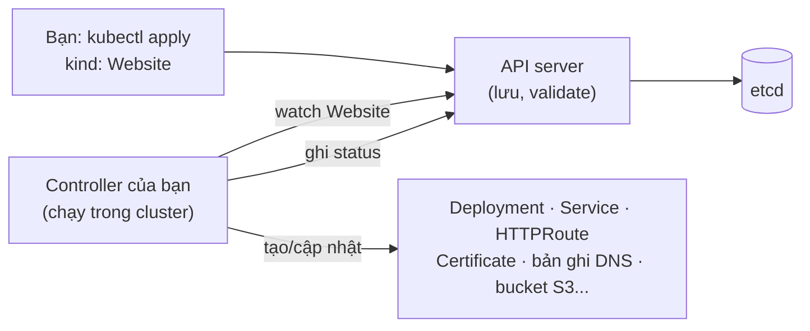
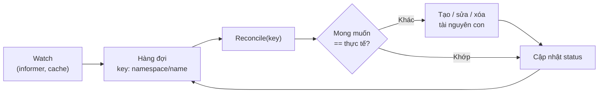

# CRD, Controller & Operator

::: info Mục tiêu bài học
- Hiểu Kubernetes là một **nền tảng mở rộng được**, không chỉ là bộ điều phối container.
- Tạo **CustomResourceDefinition (CRD)** có schema, giá trị mặc định, cột hiển thị và luật **CEL**.
- Nắm **controller pattern**: watch → reconcile, owner reference, finalizer, status/conditions.
- Thấy Operator hoạt động thật qua **cert-manager**, và biết các công cụ để tự viết Operator.
:::

## 1. Kubernetes là "nền tảng để xây nền tảng"

Mọi thứ bạn đã học — Deployment, Service, Job — đều theo cùng một khuôn mẫu: **một kiểu dữ liệu trong API** + **một controller** đưa thực tế về khớp mong muốn. Kubernetes cho phép bạn thêm kiểu dữ liệu của riêng mình và controller của riêng mình:



Đó là cách Argo CD (`Application`), cert-manager (`Certificate`), Prometheus Operator (`ServiceMonitor`), Gateway API (`HTTPRoute`)... mở rộng Kubernetes.

## 2. Tạo CustomResourceDefinition

```yaml
# website-crd.yaml
apiVersion: apiextensions.k8s.io/v1
kind: CustomResourceDefinition
metadata:
  name: websites.learn.example.com        # <plural>.<group>
spec:
  group: learn.example.com
  scope: Namespaced
  names:
    kind: Website
    plural: websites
    singular: website
    shortNames: ["ws"]
  versions:
    - name: v1alpha1
      served: true
      storage: true
      subresources:
        status: {}                          # status cập nhật riêng, người dùng không ghi đè được
      additionalPrinterColumns:             # cột hiển thị trong kubectl get
        - name: Domain
          type: string
          jsonPath: .spec.domain
        - name: Replicas
          type: integer
          jsonPath: .spec.replicas
        - name: Age
          type: date
          jsonPath: .metadata.creationTimestamp
      schema:
        openAPIV3Schema:
          type: object
          properties:
            spec:
              type: object
              required: ["domain", "image"]
              properties:
                domain:
                  type: string
                  maxLength: 253                # giới hạn độ dài giúp API server ước lượng chi phí luật CEL
                  pattern: '^[a-z0-9.-]+$'
                image:
                  type: string
                replicas:
                  type: integer
                  minimum: 1
                  maximum: 10
                  default: 2                # giá trị mặc định do API server điền
              x-kubernetes-validations:     # luật CEL
                - rule: "!self.domain.endsWith('.local') || self.replicas <= 2"
                  message: "Website nội bộ (.local) chỉ được tối đa 2 replicas"
            status:
              type: object
              x-kubernetes-preserve-unknown-fields: true
```

```bash
kubectl apply -f website-crd.yaml
kubectl api-resources | grep websites
kubectl explain website.spec
```

Giờ tạo đối tượng của kiểu dữ liệu mới:

```yaml
# blog.yaml
apiVersion: learn.example.com/v1alpha1
kind: Website
metadata:
  name: blog
spec:
  domain: blog.example.com
  image: nginx:1.30
```

```bash
kubectl apply -f blog.yaml
kubectl get websites            # hoặc: kubectl get ws
```

```text
NAME   DOMAIN             REPLICAS   AGE
blog   blog.example.com   2          5s       ← replicas được điền mặc định = 2
```

Thử dữ liệu sai — API server tự kiểm tra theo schema và luật CEL:

```bash
kubectl patch ws blog --type=merge -p '{"spec":{"replicas":20}}'
# The Website "blog" is invalid: spec.replicas: Invalid value: 20: spec.replicas in body should be less than or equal to 10
```

Nhưng... **không có Pod nào được tạo**. CRD chỉ là dữ liệu. Ta cần controller.

## 3. Controller pattern

Một controller là chương trình chạy liên tục:



Nguyên tắc thiết kế quan trọng:

- **Level-triggered, không edge-triggered**: hàm reconcile nhận *tên đối tượng*, đọc trạng thái hiện tại và đưa mọi thứ về đúng — không phụ thuộc "sự kiện gì vừa xảy ra". Nhờ vậy controller khởi động lại vẫn tự sửa được mọi thứ.
- **Idempotent**: chạy reconcile 100 lần cho cùng một trạng thái phải cho cùng kết quả.
- **Owner reference**: tài nguyên con trỏ về cha → xóa `Website` là Deployment/Service con tự bị xóa (garbage collection).
- **Finalizer**: khi cần dọn tài nguyên **ngoài cluster** (bản ghi DNS, bucket) trước khi đối tượng biến mất.
- **Status & conditions**: báo cáo cho người dùng (`Ready=True`, `Progressing`, lý do lỗi...).

Phác thảo reconcile với **controller-runtime** (Go — thư viện dưới Kubebuilder/Operator SDK):

```go
func (r *WebsiteReconciler) Reconcile(ctx context.Context, req ctrl.Request) (ctrl.Result, error) {
    var site learnv1alpha1.Website
    if err := r.Get(ctx, req.NamespacedName, &site); err != nil {
        return ctrl.Result{}, client.IgnoreNotFound(err) // đã bị xóa → không làm gì
    }

    // Trạng thái mong muốn: một Deployment chạy image của website
    dep := &appsv1.Deployment{ObjectMeta: metav1.ObjectMeta{Name: site.Name, Namespace: site.Namespace}}
    _, err := controllerutil.CreateOrUpdate(ctx, r.Client, dep, func() error {
        dep.Spec = desiredDeploymentSpec(&site)              // replicas, image, labels...
        return ctrl.SetControllerReference(&site, dep, r.Scheme) // owner reference
    })
    if err != nil {
        return ctrl.Result{}, err // trả lỗi → được thử lại với backoff
    }

    // ... tương tự cho Service, HTTPRoute ...

    meta.SetStatusCondition(&site.Status.Conditions, metav1.Condition{
        Type: "Ready", Status: metav1.ConditionTrue, Reason: "Reconciled", Message: "Website đã sẵn sàng",
    })
    return ctrl.Result{}, r.Status().Update(ctx, &site)
}
```

## 4. Thấy Operator hoạt động: cert-manager

**cert-manager** là Operator quản lý chứng chỉ TLS: bạn khai báo `Certificate`, nó xin chứng chỉ (Let's Encrypt, CA nội bộ...), lưu vào Secret và tự gia hạn.

```bash
kubectl apply -f https://github.com/cert-manager/cert-manager/releases/download/v1.21.3/cert-manager.yaml
kubectl wait --for=condition=Available deployment --all -n cert-manager --timeout=180s
kubectl get crd | grep cert-manager            # các kiểu dữ liệu mới: Certificate, Issuer...
```

```yaml
# cert-demo.yaml
apiVersion: cert-manager.io/v1
kind: Issuer
metadata:
  name: selfsigned
spec:
  selfSigned: {}
---
apiVersion: cert-manager.io/v1
kind: Certificate
metadata:
  name: demo
spec:
  secretName: demo-tls          # cert-manager sẽ TẠO Secret này
  dnsNames: ["demo.example.com"]
  duration: 2160h               # 90 ngày
  renewBefore: 360h             # gia hạn trước 15 ngày
  issuerRef:
    name: selfsigned
    kind: Issuer
```

```bash
kubectl apply -f cert-demo.yaml
kubectl get certificate demo          # READY True
kubectl get secret demo-tls           # Secret kiểu kubernetes.io/tls do Operator tạo
kubectl describe certificate demo     # Events: Issuing, Generated, Issued...
kubectl delete secret demo-tls        # thử "phá" — Operator tự cấp lại trong giây lát
kubectl get secret demo-tls
```

Bạn vừa thấy đủ bộ: CRD (kiểu dữ liệu) + controller (reconcile) + tự phục hồi.

## 5. Mức độ trưởng thành của Operator

| Mức | Khả năng | Ví dụ với database |
| --- | --- | --- |
| 1. Basic install | Cài đặt, cấu hình | Tạo cụm từ một CR |
| 2. Seamless upgrades | Nâng cấp phiên bản | Nâng PostgreSQL 17 → 18 |
| 3. Full lifecycle | Backup, restore, failover | Backup lên S3, khôi phục theo thời điểm |
| 4. Deep insights | Metric, cảnh báo, log | Phơi metric replication lag |
| 5. Auto pilot | Tự điều chỉnh, tự chữa | Tự scale, tự chuyển primary |

Khi chọn Operator cho hệ thống quan trọng, hãy đánh giá: mức trưởng thành, cộng đồng/nhà cung cấp, tài liệu backup/restore, lịch sử sự cố.

## 6. Tự viết Operator

| Công cụ | Ngôn ngữ | Ghi chú |
| --- | --- | --- |
| **Kubebuilder** / **Operator SDK** | Go | Chuẩn de facto, sinh khung dự án, CRD, RBAC, webhook |
| **Kopf** | Python | Nhanh để thử nghiệm, viết bằng decorator |
| **Java Operator SDK** | Java | Cho hệ sinh thái JVM |
| **KubeOps** | .NET | Cho hệ sinh thái C# |
| **Crossplane** | Khai báo (YAML) | Quản lý hạ tầng cloud (database, bucket...) như tài nguyên Kubernetes |

```bash
kubebuilder init --domain example.com --repo github.com/me/website-operator
kubebuilder create api --group learn --version v1alpha1 --kind Website
make manifests && make install && make run    # chạy controller ngay từ máy bạn
```

::: tip Có cần viết Operator không?
Phần lớn nhu cầu nội bộ giải quyết được bằng Helm/Kustomize + GitOps. Viết Operator khi bạn cần **tự động hóa vận hành liên tục** (phản ứng với thay đổi, tự sửa chữa) cho một hệ thống mà nhiều team dùng chung — và chấp nhận duy trì một phần mềm chạy trong cluster.
:::

## Thực hành

**Bài 1.** Thêm vào CRD `Website` trường `spec.tls` (boolean, mặc định `false`) và luật CEL: nếu `tls` là `true` thì `domain` không được kết thúc bằng `.local`. Kiểm thử với hai đối tượng hợp lệ và không hợp lệ.

::: details Xem lời giải
Trong `spec.properties` thêm:
```yaml
tls:
  type: boolean
  default: false
```
Và thêm vào `x-kubernetes-validations`:
```yaml
- rule: "!self.tls || !self.domain.endsWith('.local')"
  message: "Không thể bật TLS công khai cho tên miền .local"
```
```bash
kubectl apply -f website-crd.yaml
kubectl apply -f - <<'EOF'
apiVersion: learn.example.com/v1alpha1
kind: Website
metadata: { name: intranet }
spec: { domain: wiki.local, image: nginx:1.30, tls: true }
EOF
# → bị từ chối với thông báo của luật CEL
```
:::

**Bài 2.** Quan sát owner reference và garbage collection có sẵn: tạo Deployment, xem `ownerReferences` của ReplicaSet và Pod, rồi xóa Deployment với `--cascade=orphan`. Chuyện gì xảy ra?

::: details Xem lời giải
```bash
kubectl create deployment gc-demo --image=nginx:1.30
kubectl get rs -l app=gc-demo -o jsonpath='{.items[0].metadata.ownerReferences}'
kubectl delete deployment gc-demo --cascade=orphan
kubectl get rs,pods -l app=gc-demo        # ReplicaSet và Pod vẫn còn, "mồ côi"
kubectl delete rs -l app=gc-demo          # xóa cha → Pod con bị xóa theo
```
:::

## Tóm tắt

- CRD thêm kiểu dữ liệu mới vào Kubernetes API, có schema, mặc định, cột hiển thị và luật CEL.
- Controller chạy vòng lặp reconcile level-triggered, idempotent; dùng owner reference, finalizer, status/conditions.
- Operator = CRD + controller chứa kiến thức vận hành (cert-manager, CloudNativePG, Prometheus Operator...).
- Tự viết bằng Kubebuilder/Operator SDK (Go), Kopf (Python)... khi thực sự cần tự động hóa liên tục.

## Kiểm tra kiến thức

<Quiz />
