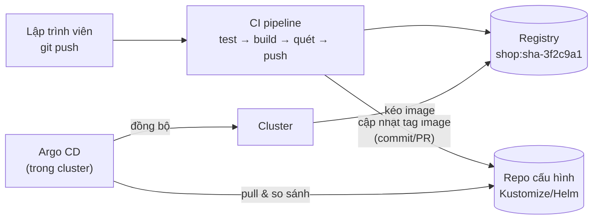

# CI/CD & GitOps với Argo CD

::: info Mục tiêu bài học
- Thiết kế quy trình từ commit tới production: **CI** (build, test, quét, đẩy image) và **CD**.
- Hiểu **GitOps** và vì sao mô hình **pull** an toàn hơn push.
- Cài **Argo CD**, triển khai ứng dụng từ Git, bật **auto-sync**, **prune**, **self-heal**.
- Tổ chức repo cấu hình, dùng **ApplicationSet**, xử lý **Secret** và **canary** trong GitOps.
:::

## 1. Từ commit tới production



| Giai đoạn | Việc làm | Công cụ |
| --- | --- | --- |
| **CI** | Test, build image, quét lỗ hổng, ký số, đẩy lên registry | GitHub Actions, GitLab CI, Jenkins, Tekton |
| **Cập nhật cấu hình** | Đổi tag image trong repo cấu hình (thường qua Pull Request) | `kustomize edit`, Renovate, Argo CD Image Updater |
| **CD (GitOps)** | Đồng bộ cluster với Git, phát hiện lệch | **Argo CD**, **Flux** |

### Push hay pull?

| | Push (pipeline chạy `kubectl apply`/`helm upgrade`) | Pull (GitOps) |
| --- | --- | --- |
| Thông tin đăng nhập cluster | Nằm trong hệ thống CI (rủi ro lộ) | Chỉ agent trong cluster có quyền |
| Phát hiện sửa tay trên cluster | Không | Có — và tự sửa lại |
| Lịch sử, review | Log pipeline | Git: commit, PR, blame |
| Rollback | Chạy lại pipeline cũ | `git revert` |

**4 nguyên tắc GitOps** (OpenGitOps): trạng thái mong muốn được **khai báo**, **phiên bản hóa và bất biến** (trong Git), được **kéo tự động**, và được **đối chiếu liên tục**.

## 2. Tổ chức repository

Phổ biến nhất: tách **repo mã nguồn** và **repo cấu hình**:

```text
shop-app/                 ← repo mã nguồn: code, Dockerfile, CI
shop-config/              ← repo cấu hình: Argo CD theo dõi repo này
├── base/
└── overlays/
    ├── dev/
    ├── staging/
    └── production/
```

Lợi ích: lịch sử triển khai sạch sẽ, phân quyền riêng (ai được merge vào `production`), tránh vòng lặp CI vô tận khi CI tự commit tag mới.

## 3. Pipeline CI mẫu (GitHub Actions)

```yaml
# .github/workflows/ci.yml trong repo shop-app
name: ci
on:
  push:
    branches: [main]

permissions:
  contents: read
  packages: write

jobs:
  build:
    runs-on: ubuntu-latest
    steps:
      - uses: actions/checkout@v4
      - name: Chạy test
        run: make test
      - uses: docker/setup-buildx-action@v3
      - uses: docker/login-action@v3
        with:
          registry: ghcr.io
          username: ${{ github.actor }}
          password: ${{ secrets.GITHUB_TOKEN }}
      - uses: docker/build-push-action@v6
        with:
          push: true
          tags: ghcr.io/${{ github.repository }}:${{ github.sha }}

  update-config:
    needs: build
    runs-on: ubuntu-latest
    steps:
      - uses: actions/checkout@v4
        with:
          repository: my-org/shop-config
          token: ${{ secrets.CONFIG_REPO_TOKEN }}
      - name: Cập nhật tag image cho môi trường dev
        run: |
          cd overlays/dev
          kustomize edit set image shop=ghcr.io/${{ github.repository }}:${{ github.sha }}
          git config user.name "ci-bot"
          git config user.email "ci-bot@example.com"
          git commit -am "dev: deploy shop ${{ github.sha }}"
          git push
```

Thêm bước quét lỗ hổng (Trivy) và ký image (cosign) như ở [bài Bảo mật](/nang-cao/bao-mat). Với **production**, thay vì push thẳng, hãy để CI mở **Pull Request** đổi tag — có người duyệt mới merge. GitLab CI hay Jenkins làm tương tự.

## 4. Cài và dùng Argo CD

```bash
kubectl create namespace argocd
kubectl apply -n argocd --server-side --force-conflicts \
  -f https://raw.githubusercontent.com/argoproj/argo-cd/stable/manifests/install.yaml
kubectl wait --for=condition=Available deployment --all -n argocd --timeout=300s

# Mật khẩu admin ban đầu
kubectl -n argocd get secret argocd-initial-admin-secret -o jsonpath="{.data.password}" | base64 -d; echo

# Mở giao diện: https://localhost:8080 (user: admin; chấp nhận chứng chỉ tự ký)
kubectl port-forward svc/argocd-server -n argocd 8080:443
```

::: info Vì sao `--server-side --force-conflicts`?
Một số CRD của Argo CD (như ApplicationSet) quá lớn so với giới hạn annotation của `kubectl apply` kiểu client-side. Server-side apply tránh được giới hạn này.
:::

### Application đầu tiên

```yaml
# guestbook-app.yaml
apiVersion: argoproj.io/v1alpha1
kind: Application
metadata:
  name: guestbook
  namespace: argocd
spec:
  project: default
  source:
    repoURL: https://github.com/argoproj/argocd-example-apps.git
    targetRevision: HEAD
    path: guestbook                 # thư mục chứa manifest (YAML thuần, Kustomize hoặc Helm)
  destination:
    server: https://kubernetes.default.svc
    namespace: guestbook
  syncPolicy:
    automated:
      prune: true                   # xóa tài nguyên không còn trong Git
      selfHeal: true                # sửa lại khi có người chỉnh tay trên cluster
    syncOptions:
      - CreateNamespace=true
```

```bash
kubectl apply -f guestbook-app.yaml
kubectl get applications -n argocd
kubectl get all -n guestbook
```

Trong giao diện Argo CD, bạn thấy cây tài nguyên (Application → Deployment → ReplicaSet → Pod), trạng thái **Sync** (khớp Git chưa) và **Health** (chạy ổn chưa).

### Thử self-heal

```bash
kubectl scale deployment guestbook-ui -n guestbook --replicas=5
kubectl get deploy guestbook-ui -n guestbook -w
# Chỉ vài giây sau, Argo CD đưa replicas về đúng giá trị trong Git
```

Muốn thay đổi thật sự? **Sửa trong Git** — fork repo ví dụ, trỏ `repoURL` về bản fork, đổi `replicas` rồi commit.

## 5. Tính năng quan trọng của Argo CD

| Tính năng | Dùng để |
| --- | --- |
| **Sync waves** (`argocd.argoproj.io/sync-wave: "-1"`) | Thứ tự triển khai: Namespace/CRD trước, ứng dụng sau |
| **Hooks** (`PreSync`, `PostSync`, `SyncFail`) | Chạy Job migration trước khi deploy, smoke test sau deploy |
| **AppProject** | Giới hạn repo nguồn, cluster/namespace đích, loại tài nguyên cho từng team |
| **ApplicationSet** | Sinh nhiều Application từ một mẫu (mỗi môi trường, mỗi cluster) |
| **App of Apps** | Một Application quản lý các Application khác — "bootstrap" cả cluster từ Git |
| **SSO + RBAC** | Đăng nhập bằng OIDC, phân quyền theo nhóm |
| **Thông báo** | Gửi trạng thái sync/health tới Slack, Teams, Telegram... |

Ví dụ ApplicationSet: mỗi thư mục trong `overlays/` thành một Application:

```yaml
apiVersion: argoproj.io/v1alpha1
kind: ApplicationSet
metadata:
  name: shop
  namespace: argocd
spec:
  goTemplate: true
  generators:
    - git:
        repoURL: https://github.com/my-org/shop-config.git
        revision: HEAD
        directories:
          - path: overlays/*
  template:
    metadata:
      name: 'shop-{{.path.basename}}'
    spec:
      project: default
      source:
        repoURL: https://github.com/my-org/shop-config.git
        targetRevision: HEAD
        path: '{{.path.path}}'
      destination:
        server: https://kubernetes.default.svc
        namespace: 'shop-{{.path.basename}}'
      syncPolicy:
        automated: { prune: true, selfHeal: true }
        syncOptions: ["CreateNamespace=true"]
```

## 6. Secret trong GitOps

Không commit Secret thô. Các lựa chọn:

| Cách | Ý tưởng | Ghi chú |
| --- | --- | --- |
| **External Secrets Operator** | Git chỉ chứa `ExternalSecret` (tham chiếu); operator lấy giá trị từ Vault/AWS/GCP/Azure | Phổ biến nhất ở production |
| **Sealed Secrets** | Mã hóa bằng khóa công khai của cluster, commit bản mã hóa | Đơn giản, cần backup khóa của controller |
| **SOPS** | Mã hóa từng giá trị trong file YAML (age, KMS) | Flux hỗ trợ sẵn; Argo CD qua plugin |

## 7. Triển khai lũy tiến (progressive delivery)

**Argo Rollouts** thay Deployment bằng `Rollout` hỗ trợ canary/blue-green có **phân tích tự động**: chuyển 10% traffic → kiểm tra tỉ lệ lỗi trong Prometheus → đạt thì tăng 30%, 60%, 100%; không đạt thì tự rollback. **Flagger** (hệ Flux) có chức năng tương tự.

## 8. Flux — lựa chọn thay thế

**Flux** (CNCF) cũng là GitOps theo mô hình pull, thiên về "thuần Kubernetes": không có giao diện web mặc định, cấu hình bằng các CRD (`GitRepository`, `Kustomization`, `HelmRelease`, `ImageUpdateAutomation`). Argo CD mạnh về giao diện và trải nghiệm đa team; Flux gọn nhẹ, hợp quy trình thuần Git/CLI. Cả hai đều là dự án CNCF đã "graduated".

## Thực hành

**Bài 1.** Cài Argo CD trên cluster kind và triển khai `guestbook` như mục 4. Thử xóa Service `guestbook-ui` bằng tay và quan sát.

::: details Xem lời giải
```bash
kubectl delete svc guestbook-ui -n guestbook
kubectl get svc -n guestbook -w
```
Với `selfHeal: true`, Argo CD phát hiện tài nguyên thiếu so với Git và tạo lại gần như ngay lập tức. Tắt `selfHeal` thì Application chuyển sang trạng thái `OutOfSync` và chờ bạn bấm Sync.
:::

**Bài 2.** Tạo repo Git của riêng bạn chứa cấu trúc Kustomize ở [bài Kustomize](/trung-cap/kustomize). Tạo Application trỏ vào `overlays/dev`, sau đó đổi `newTag` của image trong Git và quan sát Argo CD tự rollout.

::: details Gợi ý
- Repo public thì Argo CD đọc được ngay; repo private cần khai báo thông tin truy cập trong **Settings → Repositories** (hoặc Secret có label `argocd.argoproj.io/secret-type: repository`).
- Mặc định Argo CD kiểm tra Git mỗi ~3 phút; cấu hình webhook từ GitHub/GitLab để đồng bộ tức thì.
:::

## Tóm tắt

- CI build/quét/đẩy image và cập nhật tag trong repo cấu hình; CD theo GitOps kéo trạng thái từ Git.
- GitOps: Git là nguồn sự thật; agent trong cluster đối chiếu liên tục; rollback bằng `git revert`.
- Argo CD: Application, auto-sync với prune/selfHeal, sync waves, hooks, AppProject, ApplicationSet.
- Secret: External Secrets Operator, Sealed Secrets hoặc SOPS — không commit base64.
- Argo Rollouts/Flagger cho canary có phân tích tự động; Flux là lựa chọn thay thế Argo CD.

## Kiểm tra kiến thức

<Quiz />
