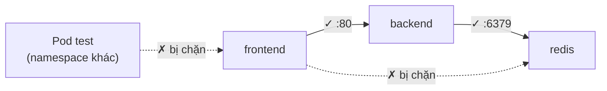

# NetworkPolicy — tường lửa cho Pod

::: info Mục tiêu bài học
- Hiểu vì sao mạng Kubernetes mặc định là "mở toang" và rủi ro của nó.
- Viết NetworkPolicy cho **ingress** và **egress** theo Pod, namespace, dải IP và cổng.
- Áp dụng mẫu **default deny** + mở tường minh, không quên **DNS**.
- Tránh cái bẫy AND/OR trong selector và kiểm thử policy.
:::

## 1. Mặc định: ai cũng gọi được ai

Mô hình mạng của Kubernetes là **phẳng**: mọi Pod có thể kết nối tới mọi Pod khác, kể cả ở namespace khác. Nếu một Pod frontend bị chiếm quyền, kẻ tấn công có thể quét và gọi thẳng vào database.

**NetworkPolicy** là tường lửa theo label: bạn mô tả **luồng nào được phép**, mọi luồng khác bị chặn.

::: warning Cần CNI hỗ trợ
NetworkPolicy do **plugin mạng (CNI)** thực thi: Calico, Cilium, Antrea, kindnet (kind ≥ v0.24)... Trên CNI không hỗ trợ, policy được tạo nhưng **không có tác dụng gì** — và không báo lỗi.
:::

## 2. Cấu trúc một NetworkPolicy

```yaml
apiVersion: networking.k8s.io/v1
kind: NetworkPolicy
metadata:
  name: db-allow-backend
  namespace: shop
spec:
  podSelector:                 # policy áp cho Pod nào (trong namespace này)
    matchLabels:
      app: db
  policyTypes: ["Ingress", "Egress"]
  ingress:                     # ai được gọi VÀO các Pod db
    - from:
        - podSelector:
            matchLabels:
              app: backend
      ports:
        - protocol: TCP
          port: 5432
  egress: []                   # db không được gọi RA đâu cả
```

Quy tắc cốt lõi:

1. Pod **không bị policy nào chọn** → không bị giới hạn (mở hoàn toàn).
2. Pod **bị ít nhất một policy chọn** theo chiều Ingress (hoặc Egress) → chiều đó chỉ cho phép những gì được liệt kê.
3. Nhiều policy cùng chọn một Pod → quyền là **hợp** của tất cả (không có rule "deny" tường minh).
4. Traffic phản hồi của kết nối đã được phép tự động được cho qua (stateful).

## 3. Các mẫu thường dùng

### Chặn mọi traffic đi vào namespace

```yaml
apiVersion: networking.k8s.io/v1
kind: NetworkPolicy
metadata:
  name: default-deny-ingress
  namespace: shop
spec:
  podSelector: {}              # {} = mọi Pod trong namespace
  policyTypes: ["Ingress"]
```

### Chặn mọi traffic đi ra, nhưng cho phép DNS

```yaml
apiVersion: networking.k8s.io/v1
kind: NetworkPolicy
metadata:
  name: default-deny-egress
  namespace: shop
spec:
  podSelector: {}
  policyTypes: ["Egress"]
---
apiVersion: networking.k8s.io/v1
kind: NetworkPolicy
metadata:
  name: allow-dns
  namespace: shop
spec:
  podSelector: {}
  policyTypes: ["Egress"]
  egress:
    - to:
        - namespaceSelector:
            matchLabels:
              kubernetes.io/metadata.name: kube-system
          podSelector:
            matchLabels:
              k8s-app: kube-dns
      ports:
        - { protocol: UDP, port: 53 }
        - { protocol: TCP, port: 53 }
```

::: tip Label `kubernetes.io/metadata.name`
Mọi namespace tự động có label này với giá trị là tên namespace — tiện để chọn namespace theo tên trong `namespaceSelector`.
:::

### Cho phép traffic từ gateway/ingress controller

```yaml
ingress:
  - from:
      - namespaceSelector:
          matchLabels:
            kubernetes.io/metadata.name: envoy-gateway-system
    ports:
      - { protocol: TCP, port: 9898 }
```

### Cho phép gọi ra một dải IP bên ngoài (ví dụ API đối tác)

```yaml
egress:
  - to:
      - ipBlock:
          cidr: 203.0.113.0/24
          except: ["203.0.113.66/32"]
    ports:
      - { protocol: TCP, port: 443 }
```

## 4. Cái bẫy AND / OR

::: code-group

```yaml [(A) Một phần tử → AND]
ingress:
  - from:
      - namespaceSelector:
          matchLabels: { team: shop }
        podSelector:
          matchLabels: { app: backend }
# → chỉ Pod "backend" NẰM TRONG namespace có label team=shop
```

```yaml [(B) Hai phần tử → OR]
ingress:
  - from:
      - namespaceSelector:
          matchLabels: { team: shop }
      - podSelector:
          matchLabels: { app: backend }
# → MỌI Pod trong namespace team=shop, HOẶC Pod "backend" trong namespace của policy
```

:::

Chỉ khác một dấu `-` nhưng (B) mở rộng hơn rất nhiều. Hãy đọc kỹ và **kiểm thử** mọi policy.

## 5. Thực hành: bảo vệ ứng dụng 3 tầng



Triển khai ứng dụng:

```bash
kubectl create namespace shop
kubectl -n shop run frontend --image=nginx:1.30 --labels=app=frontend
kubectl -n shop run backend --image=nginx:1.30 --labels=app=backend --expose --port=80
kubectl -n shop run redis --image=redis:8 --labels=app=redis --expose --port=6379
```

Trước khi có policy, frontend gọi được thẳng redis:

```bash
kubectl -n shop exec frontend -- bash -c 'timeout 2 bash -c "</dev/tcp/redis/6379" && echo MO || echo CHAN'
# MO
```

Áp dụng policy:

```yaml
# shop-netpol.yaml
apiVersion: networking.k8s.io/v1
kind: NetworkPolicy
metadata:
  name: default-deny-ingress
  namespace: shop
spec:
  podSelector: {}
  policyTypes: ["Ingress"]
---
apiVersion: networking.k8s.io/v1
kind: NetworkPolicy
metadata:
  name: backend-from-frontend
  namespace: shop
spec:
  podSelector:
    matchLabels: { app: backend }
  policyTypes: ["Ingress"]
  ingress:
    - from:
        - podSelector:
            matchLabels: { app: frontend }
      ports:
        - { protocol: TCP, port: 80 }
---
apiVersion: networking.k8s.io/v1
kind: NetworkPolicy
metadata:
  name: redis-from-backend
  namespace: shop
spec:
  podSelector:
    matchLabels: { app: redis }
  policyTypes: ["Ingress"]
  ingress:
    - from:
        - podSelector:
            matchLabels: { app: backend }
      ports:
        - { protocol: TCP, port: 6379 }
```

```bash
kubectl apply -f shop-netpol.yaml

# frontend → backend: được phép
kubectl -n shop exec frontend -- curl -s -o /dev/null -w "%{http_code}\n" --max-time 3 http://backend
# 200

# frontend → redis: bị chặn
kubectl -n shop exec frontend -- bash -c 'timeout 2 bash -c "</dev/tcp/redis/6379" && echo MO || echo CHAN'
# CHAN

# backend → redis: được phép
kubectl -n shop exec backend -- bash -c 'timeout 2 bash -c "</dev/tcp/redis/6379" && echo MO || echo CHAN'
# MO

# Pod ở namespace khác → backend: bị chặn
kubectl run test --rm -it --image=busybox:1.37 --restart=Never -- wget -qO- -T 3 http://backend.shop
# wget: download timed out
```

::: info Vì sao dùng `/dev/tcp` của bash?
Image nginx (Debian) có sẵn bash, và cú pháp `</dev/tcp/host/port` của bash là cách kiểm tra mở cổng TCP không cần cài thêm công cụ.
:::

## 6. Vượt ra ngoài NetworkPolicy chuẩn

NetworkPolicy chuẩn chỉ làm việc ở **tầng 3/4** (IP, cổng) và theo namespace. Nhu cầu nâng cao:

- **Chính sách cấp cluster do admin quản lý** (team ứng dụng không ghi đè được): dự án *AdminNetworkPolicy* của SIG Network, hoặc tính năng tương đương của Calico/Cilium.
- **Lọc theo tên miền (FQDN)** cho egress, ví dụ chỉ cho gọi `api.stripe.com`: Cilium, Calico.
- **Lọc tầng 7** (HTTP method/path): Cilium, service mesh (Istio, Linkerd).
- **Quan sát luồng mạng** để viết policy chính xác: Cilium Hubble.

## Lỗi thường gặp

| Triệu chứng | Nguyên nhân |
| --- | --- |
| Policy không có tác dụng | CNI không hỗ trợ NetworkPolicy |
| Mọi thứ hỏng sau khi chặn egress | Quên cho phép DNS (UDP/TCP 53 tới kube-dns) |
| Ingress controller trả 502/504 sau khi bật default deny | Chưa cho phép traffic từ namespace của controller |
| Policy "mở" hơn mong đợi | Nhầm AND/OR trong `from`/`to` |
| Probe của kubelet bị chặn? | Thường không — đa số CNI luôn cho phép traffic từ node tới Pod của nó |

## Tóm tắt

- Mặc định mạng Pod mở hoàn toàn; namespace không phải ranh giới mạng.
- Pod bị policy chọn theo chiều nào thì chiều đó chỉ cho phép những gì liệt kê; nhiều policy cộng dồn quyền.
- Mẫu chuẩn: default deny (ingress + egress) → cho phép DNS → mở từng luồng cần thiết.
- Cẩn thận AND/OR trong selector; luôn kiểm thử; cần CNI hỗ trợ.

## Kiểm tra kiến thức

<Quiz />
