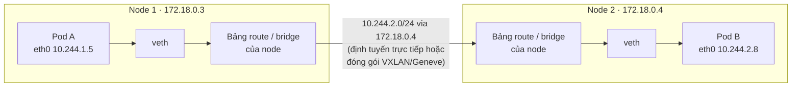

# Mạng Kubernetes chuyên sâu

::: info Mục tiêu bài học
- Nắm **4 bài toán mạng** Kubernetes giải quyết và vai trò của **CNI**.
- Theo dõi **đường đi của gói tin** giữa container, Pod, node.
- Hiểu kube-proxy hiện thực Service ra sao (iptables, nftables, eBPF) và tự soi luật trên node.
- Làm chủ **CoreDNS**, vấn đề `ndots` và các tối ưu DNS.
- Hiểu traffic **vào** và **ra** khỏi cluster.
:::

## 1. Mô hình mạng của Kubernetes

Kubernetes đặt ra các yêu cầu, còn cách hiện thực do **plugin mạng (CNI)** đảm nhận:

1. **Mỗi Pod một IP riêng** (IP-per-Pod).
2. **Mọi Pod giao tiếp trực tiếp với mọi Pod**, kể cả khác node, **không qua NAT**.
3. Agent trên node (kubelet...) giao tiếp được với mọi Pod trên node đó.

Bốn bài toán mạng và ai giải quyết:

| Bài toán | Giải pháp |
| --- | --- |
| Container ↔ container trong Pod | Chung network namespace → `localhost` |
| Pod ↔ Pod | **CNI plugin** |
| Pod ↔ Service | **kube-proxy** (hoặc CNI thay thế kube-proxy) + CoreDNS |
| Bên ngoài ↔ Service | NodePort, LoadBalancer, Ingress/Gateway |

## 2. Bên trong một Pod

Khi tạo Pod, kubelet yêu cầu runtime tạo một **sandbox** — container `pause` giữ **network namespace** của Pod. Các container ứng dụng tham gia namespace đó nên dùng chung IP. Container ứng dụng có khởi động lại thì Pod vẫn giữ nguyên IP.

Sau đó runtime gọi **CNI plugin** (lệnh `ADD`) để:

- Tạo cặp **veth**: một đầu là `eth0` trong Pod, đầu kia gắn vào node (bridge hoặc định tuyến trực tiếp).
- **Cấp IP** cho Pod từ dải Pod CIDR của node (IPAM).
- Thiết lập route để Pod nói chuyện được với Pod ở node khác.

```bash
kubectl get nodes -o custom-columns=NAME:.metadata.name,POD_CIDR:.spec.podCIDR
```

```text
NAME                      POD_CIDR
k8s-learn-control-plane   10.244.0.0/24
k8s-learn-worker          10.244.1.0/24
k8s-learn-worker2         10.244.2.0/24
```

## 3. Gói tin đi giữa hai node



Các CNI làm việc này theo hai cách chính:

- **Định tuyến trực tiếp (native routing)**: mỗi node biết "dải 10.244.2.0/24 nằm sau node 2" — qua route tĩnh (kindnet) hoặc BGP (Calico). Hiệu năng cao, cần mạng hạ tầng cho phép.
- **Overlay**: đóng gói gói tin Pod trong gói UDP (VXLAN, Geneve) giữa các node. Chạy được trên hầu hết mạng, tốn thêm header.

Trên cloud, CNI "VPC-native" (AWS VPC CNI, Azure CNI, GKE) cấp cho Pod IP thật của mạng VPC.

| CNI | Đặc điểm nổi bật |
| --- | --- |
| **Cilium** | eBPF, thay thế kube-proxy, NetworkPolicy L3–L7, quan sát luồng (Hubble), service mesh |
| **Calico** | BGP hoặc overlay, NetworkPolicy mạnh, phổ biến on-premise |
| **Flannel** | Đơn giản, overlay VXLAN; không tự thực thi NetworkPolicy |
| **kindnet** | Mặc định của kind, định tuyến trực tiếp, có NetworkPolicy |

Tự quan sát trên node kind:

```bash
docker exec k8s-learn-worker ip route
# 10.244.0.0/24 via 172.18.0.2 dev eth0
# 10.244.2.0/24 via 172.18.0.4 dev eth0
# 10.244.1.5 dev veth3a1f... scope host     ← route tới từng Pod trên node này
```

## 4. Service được hiện thực thế nào?

ClusterIP **không gắn với card mạng nào**. **kube-proxy** trên mỗi node theo dõi Service và EndpointSlice, rồi lập trình kernel để "bắt" gói tin gửi tới ClusterIP và **DNAT** sang IP của một Pod.

### Chế độ iptables (mặc định lâu năm)

```bash
docker exec k8s-learn-worker iptables -t nat -L KUBE-SERVICES -n | grep whoami
# KUBE-SVC-ABCD...  tcp -- 0.0.0.0/0  10.96.142.17  /* default/whoami:http cluster IP */ tcp dpt:80

docker exec k8s-learn-worker iptables -t nat -L KUBE-SVC-ABCD... -n
# KUBE-SEP-1111...  /* default/whoami:http -> 10.244.1.5:80 */ statistic mode random probability 0.33333
# KUBE-SEP-2222...  /* default/whoami:http -> 10.244.2.3:80 */ statistic mode random probability 0.50000
# KUBE-SEP-3333...  /* default/whoami:http -> 10.244.2.8:80 */
```

Chuỗi luật: `KUBE-SERVICES` → `KUBE-SVC-<service>` → chọn ngẫu nhiên một `KUBE-SEP-<endpoint>` (xác suất 1/3, rồi 1/2 của phần còn lại, rồi phần cuối) → DNAT tới IP Pod. Cân bằng tải diễn ra **ở node phía client, cho mỗi kết nối mới**.

### Các chế độ khác

| Chế độ | Trạng thái | Ghi chú |
| --- | --- | --- |
| `iptables` | Ổn định, phổ biến | Hiệu năng giảm khi có hàng chục nghìn Service |
| `nftables` | GA từ v1.33 | Hướng đi mới trên Linux, hiệu năng cập nhật luật tốt hơn |
| `ipvs` | **Deprecated từ v1.35** | Dự kiến tắt mặc định ở v1.40 — nên chuyển sang nftables |
| Thay thế bằng eBPF | Tùy CNI | Cilium (kube-proxy replacement) xử lý Service bằng eBPF |

### Định tuyến theo vị trí

Mặc định traffic tới Service có thể đi sang node/zone bất kỳ. Với cluster nhiều zone (traffic liên zone tốn tiền và tăng độ trễ), dùng:

```yaml
spec:
  trafficDistribution: PreferSameZone   # ưu tiên endpoint cùng zone (hoặc PreferSameNode)
```

## 5. CoreDNS và DNS trong cluster

CoreDNS chạy dưới dạng Deployment trong `kube-system`, phía sau Service `kube-dns` (thường là `10.96.0.10`). kubelet ghi `/etc/resolv.conf` cho mỗi Pod trỏ tới IP này.

```bash
kubectl -n kube-system get configmap coredns -o yaml
```

```text
.:53 {
    errors
    health { lameduck 5s }
    ready
    kubernetes cluster.local in-addr.arpa ip6.arpa {   ← trả lời tên *.cluster.local
       pods insecure
       fallthrough in-addr.arpa ip6.arpa
       ttl 30
    }
    prometheus :9153
    forward . /etc/resolv.conf                          ← tên khác: hỏi DNS của node
    cache 30
    loop
    reload
    loadbalance
}
```

| Bản ghi | Ví dụ |
| --- | --- |
| Service | `web.shop.svc.cluster.local` → ClusterIP |
| Headless Service | `db.shop.svc.cluster.local` → danh sách IP Pod |
| Pod của StatefulSet | `db-0.db.shop.svc.cluster.local` |
| SRV (cổng có tên) | `_http._tcp.web.shop.svc.cluster.local` |

### Vấn đề `ndots:5`

```text
search shop.svc.cluster.local svc.cluster.local cluster.local
options ndots:5
```

Tên có **ít hơn 5 dấu chấm** được thử với từng search domain trước. Tra `api.github.com` sinh ra chuỗi truy vấn:

```text
api.github.com.shop.svc.cluster.local   → NXDOMAIN
api.github.com.svc.cluster.local        → NXDOMAIN
api.github.com.cluster.local            → NXDOMAIN
api.github.com.                         → OK
```

(×2 nếu tra cả IPv4 lẫn IPv6.) Với ứng dụng gọi API bên ngoài liên tục, đây là tải DNS đáng kể. Cách giảm:

- Dùng tên đầy đủ có **dấu chấm cuối**: `api.github.com.`
- Giảm `ndots` cho Pod cần thiết:

```yaml
spec:
  dnsConfig:
    options:
      - name: ndots
        value: "2"
```

- Triển khai **NodeLocal DNSCache** (cache DNS trên từng node).

## 6. Traffic vào và ra khỏi cluster

**Vào (ingress):** NodePort / LoadBalancer (tầng 4) → Ingress/Gateway (tầng 7). Lưu ý `externalTrafficPolicy`:

| Giá trị | Hành vi |
| --- | --- |
| `Cluster` (mặc định) | Node nhận traffic có thể chuyển sang Pod ở node khác (thêm 1 bước nhảy); **IP nguồn của client bị thay** bằng IP node |
| `Local` | Chỉ chuyển tới Pod trên chính node đó; **giữ IP client thật**; load balancer bỏ qua node không có Pod |

**Ra (egress):** Pod gọi ra Internet thường được **SNAT** thành IP của node. Nếu đối tác cần whitelist IP cố định, dùng NAT gateway của cloud hoặc tính năng **egress gateway** của CNI (Cilium, Calico).

## 7. Service mesh — khi nào cần?

Service mesh (Istio, Linkerd, Cilium) chèn một lớp proxy (sidecar, hoặc proxy dùng chung theo node như **Istio ambient mode**) để có:

- **mTLS** tự động giữa các dịch vụ (mã hóa + định danh).
- Retry, timeout, circuit breaker, chia traffic theo phần trăm.
- Metric và tracing cho mọi request mà không sửa mã.

Đổi lại là thêm độ phức tạp vận hành. Hãy bắt đầu khi bạn thực sự cần mTLS toàn hệ thống hoặc quản lý traffic tinh vi giữa nhiều dịch vụ.

## Thực hành

**Bài 1.** Tìm IP Pod của một Pod `whoami`, sau đó vào node chứa nó và tìm interface veth tương ứng.

::: details Xem lời giải
```bash
kubectl get pod -l app=whoami -o wide          # lấy IP và NODE
docker exec <node> ip route | grep <pod-ip>    # 10.244.1.5 dev vethXXXX scope host
docker exec <node> ip link show vethXXXX
```
:::

**Bài 2.** Dùng Pod gỡ lỗi mạng `nicolaka/netshoot` để: (1) xem các truy vấn DNS phát sinh khi tra `example.com`, (2) kiểm tra kết nối tới Service `whoami`.

::: details Xem lời giải
```bash
kubectl run netshoot --rm -it --image=nicolaka/netshoot:v0.16 -- bash
# Trong Pod:
dig example.com +search +showsearch      # thấy các lần thử với search domain
dig example.com.                         # dấu chấm cuối → chỉ một truy vấn
curl -s whoami | head -n 3
nc -zv whoami 80
```
netshoot có sẵn hầu hết công cụ mạng: `dig`, `nslookup`, `curl`, `tcpdump`, `iperf3`, `mtr`, `ss`...
:::

**Bài 3.** Đếm số luật NAT của kube-proxy trên một node, tạo thêm Deployment 5 replicas + Service, đếm lại và giải thích.

::: details Xem lời giải
```bash
docker exec k8s-learn-worker sh -c 'iptables-save -t nat | grep -c KUBE'
kubectl create deployment many --image=nginx:1.30 --replicas=5
kubectl expose deployment many --port=80
docker exec k8s-learn-worker sh -c 'iptables-save -t nat | grep -c KUBE'
```
Mỗi Service thêm một chain `KUBE-SVC-*`, mỗi endpoint thêm một chain `KUBE-SEP-*` cùng các luật DNAT — mọi node đều phải giữ toàn bộ luật này. Ở quy mô hàng chục nghìn Service, đó là lý do nftables/eBPF hiệu quả hơn.
:::

## Tóm tắt

- Mô hình mạng: mỗi Pod một IP, Pod ↔ Pod không NAT; CNI hiện thực bằng định tuyến trực tiếp hoặc overlay.
- Container `pause` giữ network namespace; veth nối Pod với node.
- kube-proxy hiện thực Service bằng DNAT (iptables/nftables) hoặc CNI dùng eBPF; ipvs đã deprecated.
- CoreDNS phục vụ `*.cluster.local`; chú ý `ndots:5` khi gọi tên miền ngoài.
- `externalTrafficPolicy: Local` giữ IP client; egress mặc định SNAT theo IP node.

## Kiểm tra kiến thức

<Quiz />
