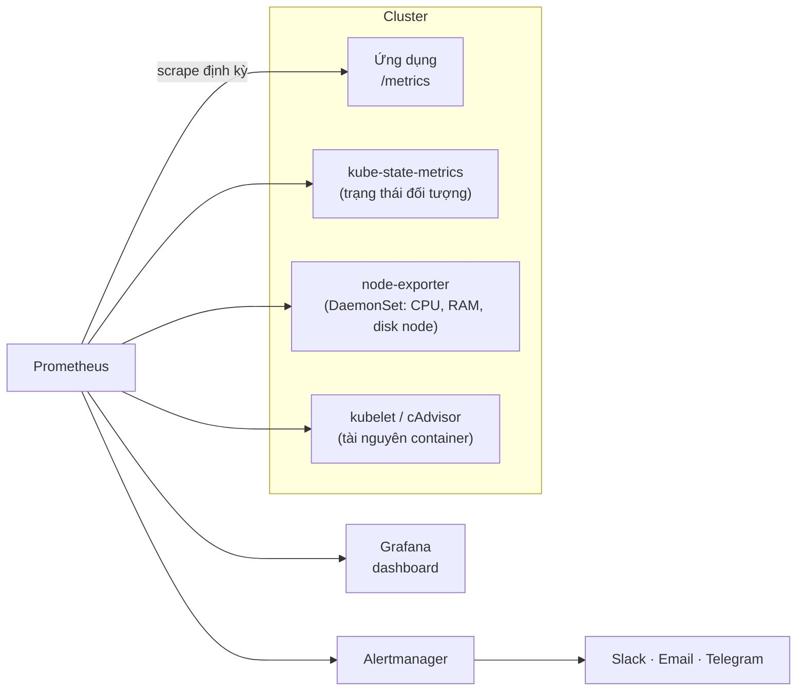
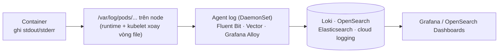
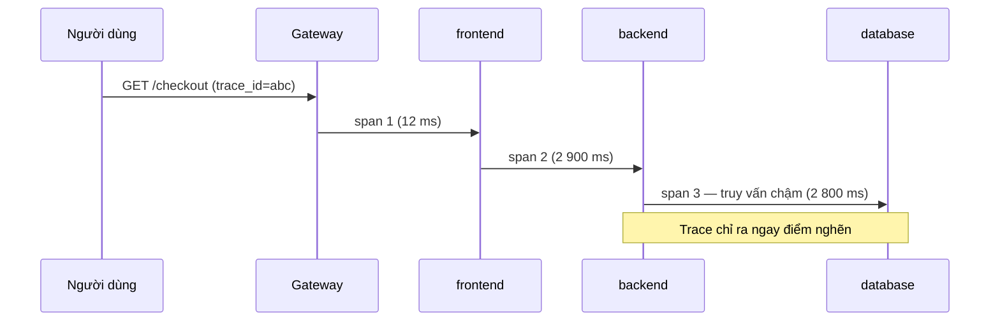

# Giám sát, logging & tracing

::: info Mục tiêu bài học
- Hiểu ba trụ cột **metrics – logs – traces** và câu hỏi mỗi loại trả lời.
- Cài **kube-prometheus-stack** (Prometheus, Grafana, Alertmanager) và viết PromQL cơ bản.
- Thu thập metric ứng dụng bằng **ServiceMonitor**, tạo cảnh báo bằng **PrometheusRule**.
- Nắm kiến trúc **log tập trung** và **tracing với OpenTelemetry**.
- Áp dụng tư duy **SLO** khi thiết kế cảnh báo.
:::

## 1. Ba trụ cột

| Trụ cột | Trả lời câu hỏi | Công cụ phổ biến |
| --- | --- | --- |
| **Metrics** | Hệ thống có ổn không? Xu hướng ra sao? | Prometheus, Grafana, VictoriaMetrics, Thanos/Mimir |
| **Logs** | Chuyện gì đã xảy ra, chi tiết thế nào? | Fluent Bit, Vector, Grafana Alloy → Loki, OpenSearch |
| **Traces** | Request đi qua những dịch vụ nào, chậm ở đâu? | OpenTelemetry → Jaeger, Tempo |

Thêm vào đó: **Events** của Kubernetes (`kubectl get events`) và **profiling** liên tục (Pyroscope, Parca).

Có sẵn trong Kubernetes (không cần cài thêm): `kubectl logs`, `kubectl get events`, `kubectl describe`, và `kubectl top` (khi có metrics-server) — đủ cho gỡ lỗi nhanh, nhưng không lưu lịch sử và không cảnh báo được.

## 2. Metrics với Prometheus



Bộ **kube-prometheus-stack** cài tất cả những thứ trên kèm sẵn dashboard và cảnh báo cho Kubernetes:

```bash
helm repo add prometheus-community https://prometheus-community.github.io/helm-charts
helm repo update
helm install monitoring prometheus-community/kube-prometheus-stack \
  -n monitoring --create-namespace

kubectl get pods -n monitoring
kubectl get svc -n monitoring
```

Mở Grafana:

```bash
kubectl -n monitoring get secret monitoring-grafana -o jsonpath="{.data.admin-password}" | base64 -d; echo
kubectl -n monitoring port-forward svc/monitoring-grafana 3000:80
# http://localhost:3000 — user: admin
```

Vào **Dashboards** → thư mục *Kubernetes / Compute Resources* để xem CPU/RAM theo cluster, namespace, Pod.

### PromQL cơ bản

Mở Prometheus (`kubectl -n monitoring port-forward svc/monitoring-kube-prometheus-prometheus 9090`) và thử:

```text
# CPU (lõi) mỗi Pod đang dùng trong namespace shop
sum by (pod) (rate(container_cpu_usage_seconds_total{namespace="shop", container!=""}[5m]))

# RAM (working set) mỗi Pod
sum by (pod) (container_memory_working_set_bytes{namespace="shop", container!=""})

# Container khởi động lại trong 1 giờ qua
increase(kube_pod_container_status_restarts_total[1h]) > 0

# Deployment chưa đủ replicas sẵn sàng
kube_deployment_spec_replicas != kube_deployment_status_replicas_available

# Tỉ lệ lỗi 5xx (nếu ứng dụng có metric http_requests_total)
sum(rate(http_requests_total{status=~"5.."}[5m])) / sum(rate(http_requests_total[5m]))
```

Bốn loại metric: **counter** (chỉ tăng — dùng với `rate()`), **gauge** (lên xuống), **histogram** và **summary** (phân phối, ví dụ độ trễ — dùng `histogram_quantile()`).

### Thu thập metric của ứng dụng: ServiceMonitor

podinfo phơi metric ở `/metrics` trên cổng `http`. Khai báo cho Prometheus Operator biết cần scrape:

```yaml
apiVersion: monitoring.coreos.com/v1
kind: ServiceMonitor
metadata:
  name: podinfo
  namespace: default
  labels:
    release: monitoring        # mặc định stack chỉ chọn ServiceMonitor có label release=<tên release>
spec:
  selector:
    matchLabels:
      app: podinfo             # chọn Service có label này
  endpoints:
    - port: http               # tên cổng trong Service
      path: /metrics
      interval: 30s
```

Service của podinfo cần có label `app: podinfo` và cổng tên `http`. Sau một phút, vào Prometheus → **Status → Targets** để kiểm tra.

::: tip Ứng dụng của bạn phơi metric thế nào?
Dùng thư viện Prometheus client (Go, Java Micrometer, Python, .NET, Node.js...) hoặc **OpenTelemetry SDK**. Tối thiểu nên có các chỉ số **RED**: **R**ate (request/giây), **E**rrors (tỉ lệ lỗi), **D**uration (độ trễ).
:::

## 3. Cảnh báo

```yaml
apiVersion: monitoring.coreos.com/v1
kind: PrometheusRule
metadata:
  name: shop-alerts
  namespace: monitoring
  labels:
    release: monitoring
spec:
  groups:
    - name: shop
      rules:
        - alert: ShopHighErrorRate
          expr: |
            sum(rate(http_requests_total{namespace="shop", status=~"5.."}[5m]))
              / sum(rate(http_requests_total{namespace="shop"}[5m])) > 0.05
          for: 10m
          labels:
            severity: critical
          annotations:
            summary: "Tỉ lệ lỗi 5xx của shop vượt 5% trong 10 phút"
            runbook_url: "https://wiki.example.com/runbooks/shop-5xx"
        - alert: PodCrashLooping
          expr: increase(kube_pod_container_status_restarts_total{namespace="shop"}[15m]) > 3
          for: 5m
          labels:
            severity: warning
          annotations:
            summary: "Pod {{ $labels.pod }} khởi động lại liên tục"
```

**Alertmanager** gom nhóm, khử trùng lặp, im lặng (silence) và định tuyến cảnh báo tới Slack, email, Microsoft Teams, Telegram, PagerDuty... theo `severity`, team, namespace.

### Tư duy SLO

- **SLI** (chỉ số): ví dụ tỉ lệ request thành công, tỉ lệ request dưới 300 ms.
- **SLO** (mục tiêu): 99,9% request thành công trong 30 ngày.
- **Error budget**: 0,1% còn lại — "ngân sách" được phép lỗi. Còn ngân sách thì tự tin deploy; sắp hết thì ưu tiên ổn định.

Cảnh báo theo **tốc độ đốt ngân sách lỗi** (burn rate) thay vì từng ngưỡng CPU sẽ giảm mạnh cảnh báo vô ích.

## 4. Logging tập trung



Nguyên tắc:

- Ứng dụng ghi log ra **stdout/stderr**, không tự ghi file trong container.
- Dùng **log có cấu trúc (JSON)**: `{"level":"error","msg":"thanh toán thất bại","order_id":"A123","trace_id":"..."}` — dễ lọc, dễ thống kê, liên kết được với trace.
- Agent bổ sung metadata Kubernetes (namespace, Pod, label) vào từng dòng log.
- Không ghi mật khẩu, token, dữ liệu cá nhân vào log.

Gỡ lỗi nhanh không cần hệ thống log: công cụ **stern** xem log nhiều Pod cùng lúc với màu sắc:

```bash
stern -n shop 'frontend|backend' --since 10m
kubectl logs -n shop -l app=backend --prefix --tail=20 -f     # tương tự bằng kubectl
```

## 5. Tracing với OpenTelemetry

**OpenTelemetry (OTel)** là chuẩn mở (CNCF) cho metrics, logs, traces: một SDK trong ứng dụng, một **Collector** nhận – xử lý – xuất dữ liệu tới backend bất kỳ.



Cấu hình ứng dụng gửi trace tới Collector thường chỉ cần biến môi trường chuẩn:

```yaml
env:
  - name: OTEL_SERVICE_NAME
    value: shop-backend
  - name: OTEL_EXPORTER_OTLP_ENDPOINT
    value: http://otel-collector.observability:4317
  - name: OTEL_RESOURCE_ATTRIBUTES
    value: deployment.environment=production
```

**OpenTelemetry Operator** còn có thể tự động "tiêm" instrumentation cho Java, .NET, Python, Node.js, Go qua annotation — có trace mà không sửa mã. Backend lưu trace: **Jaeger**, **Grafana Tempo**, hoặc dịch vụ cloud.

## 6. Giao diện quản lý cluster

- **k9s** (terminal) — duyệt tài nguyên, xem log, exec, port-forward cực nhanh.
- **Headlamp** — giao diện web hiện đại, mở rộng bằng plugin.
- **Lens / Freelens** — ứng dụng desktop.

## Thực hành

**Bài 1.** Cài kube-prometheus-stack trên cluster kind. Tìm trong Grafana dashboard hiển thị CPU/RAM của namespace `kube-system`.

::: details Xem lời giải
Làm theo mục 2. Trong Grafana: **Dashboards → Kubernetes / Compute Resources / Namespace (Pods)**, chọn namespace `kube-system`. Lưu ý stack này khá nặng (Prometheus cần vài trăm MB RAM) — đảm bảo Docker đủ tài nguyên.
:::

**Bài 2.** Tạo ServiceMonitor cho podinfo (bài Probes), rồi viết PromQL hiển thị số request/giây theo mã trạng thái của podinfo.

::: details Xem lời giải
Sau khi target `podinfo` ở trạng thái UP:
```text
sum by (status) (rate(http_requests_total{namespace="default"}[1m]))
```
podinfo có counter `http_requests_total` (nhãn `status`) và histogram `http_request_duration_seconds` (nhãn `method`, `path`, `status`). Nhãn `namespace`, `pod`, `service` do Prometheus Operator tự gắn khi scrape. Tạo tải bằng vòng lặp `wget` từ một Pod busybox để thấy đồ thị thay đổi; thử thêm độ trễ P95:
```text
histogram_quantile(0.95, sum by (le) (rate(http_request_duration_seconds_bucket{namespace="default"}[5m])))
```
:::

**Bài 3.** Viết PrometheusRule cảnh báo khi một Deployment trong namespace `shop` có số replicas sẵn sàng ít hơn mong muốn quá 10 phút.

::: details Xem lời giải
```yaml
- alert: DeploymentReplicasMismatch
  expr: |
    kube_deployment_spec_replicas{namespace="shop"}
      != kube_deployment_status_replicas_available{namespace="shop"}
  for: 10m
  labels:
    severity: warning
  annotations:
    summary: "Deployment {{ $labels.deployment }} thiếu replicas sẵn sàng"
```
:::

## Tóm tắt

- Metrics cho biết **có vấn đề không**, logs và traces cho biết **vì sao**.
- kube-prometheus-stack: Prometheus + Grafana + Alertmanager + kube-state-metrics + node-exporter; ServiceMonitor để scrape ứng dụng, PrometheusRule để cảnh báo.
- Log ra stdout/stderr dạng JSON; agent DaemonSet gửi về hệ thống tập trung.
- OpenTelemetry là chuẩn chung cho tracing (và cả metrics/logs).
- Cảnh báo theo triệu chứng và SLO, kèm runbook.

## Kiểm tra kiến thức

<Quiz />
