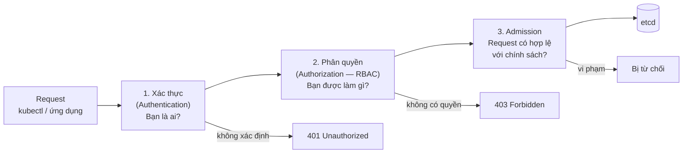
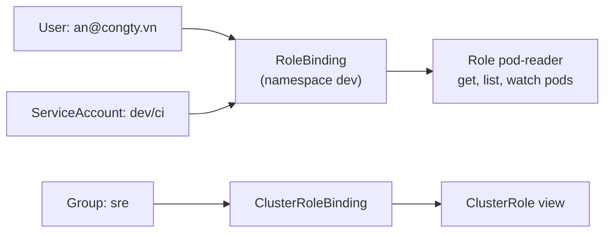

# RBAC & ServiceAccount

::: info Mục tiêu bài học
- Hiểu chuỗi **xác thực → phân quyền → admission** của API server.
- Phân biệt **user**, **group**, **ServiceAccount**.
- Viết **Role/ClusterRole** và **RoleBinding/ClusterRoleBinding**, kiểm tra bằng `kubectl auth can-i`.
- Cho ứng dụng gọi Kubernetes API an toàn bằng ServiceAccount và token ngắn hạn.
- Áp dụng **nguyên tắc quyền tối thiểu** và nhận diện quyền nguy hiểm.
:::

## 1. Ba cửa kiểm soát của API server



Bài này tập trung vào **xác thực** và **phân quyền RBAC**; admission ở bài [Admission & Policy](/nang-cao/admission-policy).

## 2. Ai đang gọi API? — Xác thực

| Loại danh tính | Dùng cho | Cách xác thực phổ biến |
| --- | --- | --- |
| **User** (người) | Quản trị viên, lập trình viên | Chứng chỉ client X.509, **OIDC** (Keycloak, Dex, Entra ID, Google...), IAM của cloud |
| **Group** | Nhóm người dùng | Trường `O` trong chứng chỉ, claim `groups` trong OIDC |
| **ServiceAccount** | Ứng dụng chạy trong cluster | Token do Kubernetes cấp (JWT ngắn hạn) |

Kubernetes **không có đối tượng User** — nó tin danh tính do cơ chế xác thực cung cấp. ServiceAccount thì là đối tượng thật trong namespace.

```bash
kubectl auth whoami
```

```text
ATTRIBUTE   VALUE
Username    kubernetes-admin
Groups      [kubeadm:cluster-admins system:authenticated]
```

::: tip Production: dùng OIDC/SSO cho con người
Chứng chỉ client khó thu hồi (không có cơ chế revoke). Với tổ chức, hãy tích hợp OIDC/SSO: nghỉ việc → khóa tài khoản SSO là mất quyền vào cluster.
:::

## 3. RBAC — bốn đối tượng

| Đối tượng | Phạm vi | Nội dung |
| --- | --- | --- |
| **Role** | Một namespace | Tập quyền (rules) |
| **ClusterRole** | Toàn cluster | Tập quyền, dùng cho tài nguyên cluster-scoped hoặc tái sử dụng |
| **RoleBinding** | Một namespace | Gán Role **hoặc ClusterRole** cho subject trong namespace đó |
| **ClusterRoleBinding** | Toàn cluster | Gán ClusterRole cho subject trên mọi namespace |



RBAC **chỉ có quyền cho phép** (không có "deny") và mặc định **không có quyền gì**.

### Một rule gồm gì?

```yaml
rules:
  - apiGroups: [""]                 # "" = core API (pods, services, configmaps, secrets...)
    resources: ["pods", "pods/log"] # pods/log, pods/exec là subresource
    verbs: ["get", "list", "watch"]
  - apiGroups: ["apps"]
    resources: ["deployments"]
    verbs: ["get", "list", "watch", "update", "patch"]
    resourceNames: ["web"]          # tùy chọn: chỉ áp dụng cho đối tượng tên "web"
```

Verbs thường gặp: `get`, `list`, `watch`, `create`, `update`, `patch`, `delete`, `deletecollection`. Tra API group của tài nguyên bằng `kubectl api-resources`.

## 4. Thực hành: tài khoản chỉ đọc cho namespace dev

```yaml
# rbac-dev.yaml
apiVersion: v1
kind: Namespace
metadata:
  name: dev
---
apiVersion: v1
kind: ServiceAccount
metadata:
  name: pod-reader
  namespace: dev
---
apiVersion: rbac.authorization.k8s.io/v1
kind: Role
metadata:
  name: pod-reader
  namespace: dev
rules:
  - apiGroups: [""]
    resources: ["pods", "pods/log"]
    verbs: ["get", "list", "watch"]
---
apiVersion: rbac.authorization.k8s.io/v1
kind: RoleBinding
metadata:
  name: pod-reader
  namespace: dev
subjects:
  - kind: ServiceAccount
    name: pod-reader
    namespace: dev
roleRef:
  kind: Role
  name: pod-reader
  apiGroup: rbac.authorization.k8s.io
```

```bash
kubectl apply -f rbac-dev.yaml

SA=system:serviceaccount:dev:pod-reader
kubectl auth can-i list pods -n dev --as=$SA          # yes
kubectl auth can-i delete pods -n dev --as=$SA        # no
kubectl auth can-i list pods -n default --as=$SA      # no — Role chỉ có hiệu lực ở dev
kubectl auth can-i --list -n dev --as=$SA             # liệt kê mọi quyền
```

Tạo nhanh bằng lệnh mệnh lệnh (tiện khi thi CKA/CKAD):

```bash
kubectl create role pod-reader --verb=get,list,watch --resource=pods,pods/log -n dev
kubectl create rolebinding pod-reader --role=pod-reader --serviceaccount=dev:pod-reader -n dev
```

## 5. ClusterRole có sẵn — dùng lại thay vì tự viết

| ClusterRole | Quyền |
| --- | --- |
| `view` | Đọc hầu hết tài nguyên (trừ Secret, RBAC) |
| `edit` | Đọc/ghi hầu hết tài nguyên ứng dụng (trừ RBAC) |
| `admin` | Toàn quyền trong namespace, kể cả RBAC của namespace |
| `cluster-admin` | Toàn quyền trên toàn cluster — **hạn chế tối đa** |

Cấp quyền `edit` cho nhóm `team-shop` **chỉ trong namespace `shop`**:

```bash
kubectl create rolebinding team-shop-edit --clusterrole=edit --group=team-shop -n shop
```

## 6. ServiceAccount — danh tính của ứng dụng

- Mỗi namespace có ServiceAccount `default`; Pod không chỉ định sẽ dùng nó.
- Kubernetes mount một **token ngắn hạn, tự xoay vòng** vào Pod tại `/var/run/secrets/kubernetes.io/serviceaccount/` (kèm `ca.crt` và `namespace`).
- Từ v1.24, Kubernetes **không còn tự tạo Secret token vĩnh viễn** cho ServiceAccount. Cần token cho công cụ bên ngoài thì tạo token có thời hạn:

```bash
kubectl create token pod-reader -n dev --duration=1h
```

### Ứng dụng gọi Kubernetes API

```yaml
apiVersion: v1
kind: Pod
metadata:
  name: api-client
  namespace: dev
spec:
  serviceAccountName: pod-reader
  containers:
    - name: curl
      image: curlimages/curl:8.23.0
      command: ["sleep", "3600"]
```

```bash
kubectl apply -f api-client.yaml
kubectl exec -n dev api-client -- sh -c '
  SA=/var/run/secrets/kubernetes.io/serviceaccount
  curl -s --cacert $SA/ca.crt -H "Authorization: Bearer $(cat $SA/token)" \
    https://kubernetes.default.svc/api/v1/namespaces/dev/pods | head -n 20'
```

Thay `/pods` bằng `/secrets` → nhận `403 Forbidden` vì Role không cho phép. Trong ứng dụng thật, dùng thư viện client chính thức (client-go, Python `kubernetes`, Java client...) — chúng tự đọc token và CA từ đường dẫn trên.

Ứng dụng không cần gọi API thì **tắt mount token**:

```yaml
apiVersion: v1
kind: ServiceAccount
metadata:
  name: web
automountServiceAccountToken: false
```

## 7. Cấp quyền cho người dùng bằng chứng chỉ (kiến thức CKA)

```bash
# 1. Người dùng tạo khóa và yêu cầu ký (CN = tên user, O = group)
openssl genrsa -out an.key 2048
openssl req -new -key an.key -out an.csr -subj "/CN=an/O=team-shop"

# 2. Admin gửi CSR lên Kubernetes và phê duyệt
cat <<EOF | kubectl apply -f -
apiVersion: certificates.k8s.io/v1
kind: CertificateSigningRequest
metadata:
  name: an
spec:
  request: $(base64 < an.csr | tr -d '\n')
  signerName: kubernetes.io/kube-apiserver-client
  expirationSeconds: 86400
  usages: ["client auth"]
EOF
kubectl certificate approve an
kubectl get csr an -o jsonpath='{.status.certificate}' | base64 -d > an.crt

# 3. Thêm vào kubeconfig và thử
kubectl config set-credentials an --client-key=an.key --client-certificate=an.crt --embed-certs=true
kubectl config set-context an@k8s-learn --cluster=kind-k8s-learn --user=an
kubectl --context=an@k8s-learn get pods -n shop      # Forbidden cho tới khi được cấp quyền
```

## 8. Quyền nguy hiểm cần soi kỹ

| Quyền | Vì sao nguy hiểm |
| --- | --- |
| `get`/`list` `secrets` | Đọc mọi mật khẩu, token trong namespace (`list` trả về cả nội dung) |
| `create` `pods` (và workload) | Mount bất kỳ Secret/ServiceAccount nào của namespace, chạy mã tùy ý |
| `pods/exec`, `pods/attach` | Vào thẳng container đang chạy |
| `escalate`, `bind` trên roles | Tự nâng quyền của mình |
| `impersonate` | Giả danh người/nhóm khác |
| `nodes/proxy` | Gọi trực tiếp kubelet API |
| Wildcard `*` | Bao gồm cả các tài nguyên sẽ thêm trong tương lai |

## Thực hành

**Bài 1.** Tạo ServiceAccount `deployer` trong namespace `dev` có quyền tạo/cập nhật/xóa Deployment và Service nhưng **không** đọc được Secret. Kiểm chứng bằng `kubectl auth can-i`.

::: details Xem lời giải
```bash
kubectl create sa deployer -n dev
kubectl create role deployer -n dev \
  --verb=get,list,watch,create,update,patch,delete \
  --resource=deployments.apps,services
kubectl create rolebinding deployer -n dev --role=deployer --serviceaccount=dev:deployer

kubectl auth can-i create deployments -n dev --as=system:serviceaccount:dev:deployer   # yes
kubectl auth can-i get secrets -n dev --as=system:serviceaccount:dev:deployer          # no
```
:::

**Bài 2.** Cho nhóm `auditors` quyền **đọc** trên toàn cluster (không đọc Secret). Viết bằng một lệnh.

::: details Xem lời giải
```bash
kubectl create clusterrolebinding auditors-view --clusterrole=view --group=auditors
kubectl auth can-i list pods -A --as=bob --as-group=auditors       # yes
kubectl auth can-i get secrets -A --as=bob --as-group=auditors     # no
```
:::

## Lỗi thường gặp

- **`Error from server (Forbidden): pods is forbidden: User "system:serviceaccount:dev:default" cannot list resource "pods"`** → Pod chạy với ServiceAccount `default` thay vì SA đã cấp quyền; kiểm tra `serviceAccountName`.
- **Sai `apiGroups`** → Deployment thuộc `apps`, Ingress thuộc `networking.k8s.io`, CronJob thuộc `batch`; core API là `""`.
- **RoleBinding tham chiếu ServiceAccount thiếu `namespace`** trong `subjects`.
- **Cấp `cluster-admin` "cho nhanh"** cho CI/CD hay dashboard → một token lộ là mất cả cluster.

## Tóm tắt

- API server kiểm tra: xác thực (ai?) → phân quyền (được làm gì?) → admission (có hợp lệ?).
- User/group đến từ bên ngoài (chứng chỉ, OIDC); ServiceAccount là danh tính của ứng dụng, dùng token ngắn hạn.
- Role/ClusterRole định nghĩa quyền; RoleBinding/ClusterRoleBinding gán quyền cho subject. Tái sử dụng `view`/`edit`/`admin`.
- Kiểm tra bằng `kubectl auth can-i` (`--as`, `--list`); luôn theo nguyên tắc quyền tối thiểu.

## Kiểm tra kiến thức

<Quiz />
