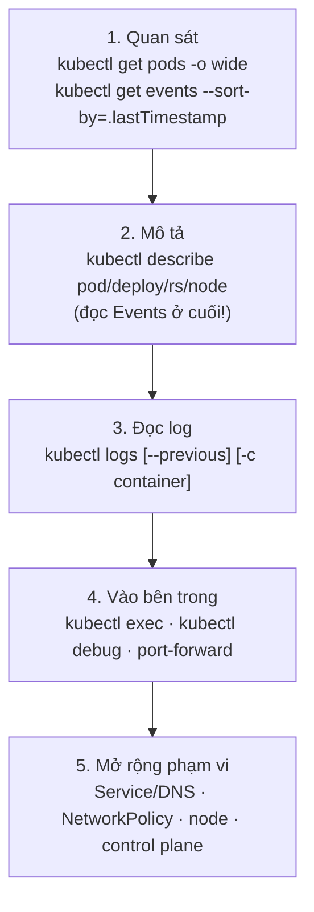
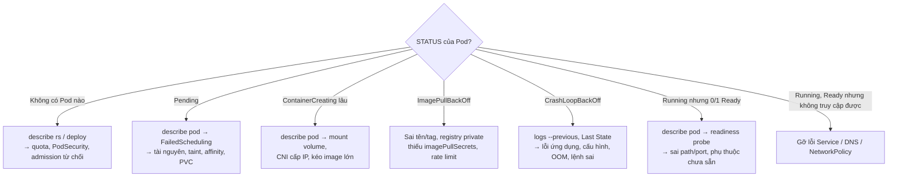

# Xử lý sự cố (troubleshooting)

::: info Mục tiêu bài học
- Gỡ lỗi theo **quy trình có hệ thống** thay vì đoán mò.
- Tra nhanh nguyên nhân và cách xử lý theo **trạng thái Pod**.
- Dùng **`kubectl debug`** với ephemeral container, bản sao Pod và debug node.
- Gỡ lỗi **Service/DNS**, **node NotReady**, **control plane**, tình huống **kẹt Terminating**.
- Luyện tập với bộ **5 tình huống hỏng** có sẵn.
:::

## 1. Quy trình 5 bước



Nguyên tắc vàng:

- **Đọc kỹ thông báo lỗi** — Kubernetes thường nói rất rõ chuyện gì sai (`describe` + Events).
- **Đi từ triệu chứng tới nguyên nhân** theo luồng: Deployment → ReplicaSet → Pod → container → node.
- **Thay đổi từng thứ một** và quan sát lại.
- Nhớ [hành trình của `kubectl apply`](/co-ban/kien-truc#_5-hanh-trinh-cua-kubectl-apply): lỗi ở bước nào thì triệu chứng hiện ở bước đó.

## 2. Pod không chạy — sơ đồ chẩn đoán



## 3. Bảng tra cứu theo trạng thái

| Trạng thái | Nguyên nhân thường gặp | Lệnh kiểm tra |
| --- | --- | --- |
| `Pending` | Thiếu CPU/RAM (requests), taint, nodeSelector/affinity không khớp, PVC chưa bound | `kubectl describe pod` → Events `FailedScheduling` |
| `ContainerCreating` (lâu) | Volume không mount được (Multi-Attach, NFS), CNI lỗi, image rất lớn | `describe pod` → `FailedMount`, `FailedCreatePodSandBox` |
| `ErrImagePull` / `ImagePullBackOff` | Sai tên/tag, thiếu quyền registry private, bị giới hạn tốc độ (Docker Hub), mạng chặn | `describe pod` → `Failed to pull image ...: not found / unauthorized / toomanyrequests` |
| `CrashLoopBackOff` | Ứng dụng lỗi khi khởi động, thiếu biến môi trường, lệnh sai, tiến trình chính thoát | `kubectl logs <pod> --previous`, Last State |
| `CreateContainerConfigError` | ConfigMap/Secret hoặc key được tham chiếu không tồn tại | `describe pod` → `configmap "x" not found` |
| `RunContainerError` / `StartError` | Lệnh/entrypoint không tồn tại, lỗi quyền thực thi, mount sai | `describe pod` → `exec: "xyz": executable file not found` |
| `OOMKilled` (exit 137) | Vượt `limits.memory` | `describe pod`, `kubectl top pod` |
| `Error` (exit ≠ 0) | Ứng dụng thoát với lỗi | `kubectl logs --previous` |
| `Completed` (với dịch vụ) | Tiến trình chính kết thúc (chạy nền, lệnh ngắn) | Kiểm tra command/args |
| `Evicted` | Node thiếu tài nguyên (RAM, ổ đĩa), Pod bị trục xuất | `describe pod` → `The node was low on resource: memory/ephemeral-storage` |
| `Init:CrashLoopBackOff` | Init container lỗi | `kubectl logs <pod> -c <init-container>` |
| `Terminating` (kẹt) | Finalizer, node mất liên lạc, ứng dụng không thoát | Xem mục 7 |
| `Unknown` | Mất liên lạc với kubelet của node | `kubectl get nodes`, `describe node` |

::: tip Đọc Exit Code
`0` thoát bình thường · `1` lỗi ứng dụng chung · `126` không có quyền thực thi · `127` không tìm thấy lệnh · `137` SIGKILL (thường là OOM) · `139` segmentation fault · `143` SIGTERM (bị yêu cầu dừng).
:::

## 4. `kubectl debug` — công cụ mạnh nhất

### Gắn ephemeral container vào Pod đang chạy

Image production thường tối giản (distroless) — không có shell, không có `curl`. **Ephemeral container** được gắn tạm vào Pod, dùng chung mạng (và với `--target`, chung không gian tiến trình) với container đích:

```bash
kubectl debug -it api-7c9f5-x2k9p --image=nicolaka/netshoot:v0.16 --target=api
# Trong shell của netshoot:
ps aux                       # thấy cả tiến trình của container api
ss -lntp                     # cổng nào đang lắng nghe
curl -s localhost:8080/healthz
ls /proc/1/root/app          # xem file system của container đích qua /proc
```

### Tạo bản sao Pod để thử nghiệm

Pod crash ngay khi khởi động nên không `exec` vào được? Tạo bản sao với lệnh khác:

```bash
kubectl debug api-7c9f5-x2k9p -it --copy-to=api-debug --container=api -- sh
# bản sao chạy "sh" thay vì lệnh gốc → vào kiểm tra file cấu hình, biến môi trường...
kubectl delete pod api-debug
```

### Debug node

```bash
kubectl debug node/k8s-learn-worker -it --image=ubuntu:24.04
# File system của node được mount tại /host
chroot /host
journalctl -u kubelet --since "10 min ago"
crictl ps
df -h
```

Các profile (`--profile=general|baseline|restricted|netadmin|sysadmin`) điều chỉnh quyền của container debug cho phù hợp tình huống và chính sách bảo mật.

## 5. Gỡ lỗi Service và DNS

Làm theo thứ tự, dừng ở bước đầu tiên thất bại:

```bash
# 1. Service có tồn tại, selector và cổng đúng?
kubectl get svc web -o wide
kubectl describe svc web

# 2. Có endpoint không? (rỗng = selector sai hoặc Pod chưa Ready)
kubectl get endpointslices -l kubernetes.io/service-name=web
kubectl get pods -l app=web -o wide

# 3. Pod có thực sự trả lời trên targetPort?
kubectl port-forward pod/<pod> 8080:<targetPort>   # rồi curl localhost:8080

# 4. DNS phân giải được không? (từ cùng namespace với client)
kubectl run tmp --rm -it --image=nicolaka/netshoot:v0.16 -- bash
nslookup web
curl -sv http://web:80

# 5. CoreDNS khỏe không?
kubectl get pods -n kube-system -l k8s-app=kube-dns
kubectl logs -n kube-system -l k8s-app=kube-dns --tail=20

# 6. Có NetworkPolicy chặn không?
kubectl get networkpolicy -A
```

## 6. Node có vấn đề

```bash
kubectl get nodes
kubectl describe node k8s-learn-worker      # Conditions, Taints, Allocated resources, Events
```

| Condition | Ý nghĩa | Hướng xử lý |
| --- | --- | --- |
| `Ready=False/Unknown` | kubelet ngừng báo cáo | Kiểm tra kubelet, container runtime, mạng tới API server |
| `MemoryPressure=True` | Node thiếu RAM | Pod bị evict; xem Pod nào ăn RAM, đặt requests/limits |
| `DiskPressure=True` | Ổ đĩa đầy (image, log, emptyDir) | Dọn image (`crictl rmi --prune`), giới hạn log, tăng đĩa |
| `PIDPressure=True` | Quá nhiều tiến trình | Tìm ứng dụng sinh tiến trình mất kiểm soát |

Trên node (SSH hoặc `kubectl debug node/...`):

```bash
systemctl status kubelet
journalctl -u kubelet -n 100 --no-pager
systemctl status containerd
crictl ps -a                      # container trên node, kể cả đã thoát
crictl logs <container-id>
```

## 7. Kẹt ở `Terminating`

**Pod kẹt Terminating:**

- Node chứa Pod đã chết → kubelet không xác nhận được việc xóa. Kiểm tra node; khi chắc chắn container không còn chạy: `kubectl delete pod <pod> --grace-period=0 --force`.
- Ứng dụng không thoát khi nhận SIGTERM → chờ hết `terminationGracePeriodSeconds`.

**Tài nguyên/namespace kẹt vì finalizer:** finalizer là "lời hứa dọn dẹp" do một controller xử lý (ví dụ xóa load balancer, volume). Nếu controller đó đã bị gỡ, đối tượng kẹt mãi.

```bash
kubectl get <loai> <ten> -o jsonpath='{.metadata.finalizers}'
# Tìm tài nguyên còn sót trong namespace đang Terminating
kubectl api-resources --verbs=list --namespaced -o name \
  | xargs -n 1 kubectl get --show-kind --ignore-not-found -n <ns>
kubectl get apiservice | grep False        # APIService hỏng cũng làm namespace kẹt
```

::: danger Gỡ finalizer bằng tay là biện pháp cuối cùng
`kubectl patch <loai> <ten> -p '{"metadata":{"finalizers":null}}' --type=merge` bỏ qua bước dọn dẹp — có thể để lại tài nguyên "mồ côi" (ổ đĩa, load balancer trên cloud vẫn tính tiền). Hãy khôi phục controller nếu có thể.
:::

## 8. Control plane

```bash
kubectl get --raw='/readyz?verbose'          # từng kiểm tra sức khỏe của API server
kubectl get pods -n kube-system              # static Pod của control plane
kubectl logs -n kube-system kube-apiserver-<node>
kubeadm certs check-expiration               # (trên node control plane) chứng chỉ sắp hết hạn?
```

Chứng chỉ do kubeadm tạo có hạn **1 năm** — cluster không nâng cấp suốt một năm sẽ "đột tử" khi chứng chỉ hết hạn. Xem [bài Vận hành cluster](/nang-cao/van-hanh-cluster).

## 9. Phòng cấp cứu — luyện tập

Áp dụng file sau: 5 Deployment, mỗi cái hỏng một kiểu. Chẩn đoán và sửa từng cái **mà không xem lời giải trước**.

```yaml
# er.yaml
apiVersion: v1
kind: Namespace
metadata:
  name: er
---
apiVersion: apps/v1
kind: Deployment
metadata: { name: case1, namespace: er }
spec:
  selector: { matchLabels: { app: case1 } }
  template:
    metadata: { labels: { app: case1 } }
    spec:
      containers:
        - name: web
          image: ngnix:1.30
---
apiVersion: apps/v1
kind: Deployment
metadata: { name: case2, namespace: er }
spec:
  selector: { matchLabels: { app: case2 } }
  template:
    metadata: { labels: { app: case2 } }
    spec:
      containers:
        - name: web
          image: nginx:1.30
          env:
            - name: DB_PASSWORD
              valueFrom:
                secretKeyRef: { name: db-secret, key: password }
---
apiVersion: apps/v1
kind: Deployment
metadata: { name: case3, namespace: er }
spec:
  selector: { matchLabels: { app: case3 } }
  template:
    metadata: { labels: { app: case3 } }
    spec:
      containers:
        - name: web
          image: nginx:1.30
          command: ["nginx", "-g", "daemon on;"]
---
apiVersion: apps/v1
kind: Deployment
metadata: { name: case4, namespace: er }
spec:
  selector: { matchLabels: { app: case4 } }
  template:
    metadata: { labels: { app: case4 } }
    spec:
      containers:
        - name: web
          image: nginx:1.30
          resources:
            requests: { cpu: "64", memory: 128Mi }
---
apiVersion: apps/v1
kind: Deployment
metadata: { name: case5, namespace: er }
spec:
  selector: { matchLabels: { app: case5 } }
  template:
    metadata: { labels: { app: case5 } }
    spec:
      containers:
        - name: web
          image: nginx:1.30
          readinessProbe:
            httpGet: { path: /, port: 8080 }
```

```bash
kubectl apply -f er.yaml
kubectl get pods -n er
```

::: details Lời giải case 1 — ImagePullBackOff
`describe pod` → `Failed to pull image "ngnix:1.30": ... pull access denied, repository does not exist`. Gõ sai tên image. Sửa thành `nginx:1.30`.
:::

::: details Lời giải case 2 — CreateContainerConfigError
`describe pod` → `Error: secret "db-secret" not found`. Tạo Secret: `kubectl create secret generic db-secret -n er --from-literal=password=abc`. Pod tự chuyển sang Running sau lần thử lại kế tiếp.
:::

::: details Lời giải case 3 — CrashLoopBackOff
`kubectl logs --previous` không có lỗi rõ ràng, `Last State: Completed, Exit Code 0`. Với `daemon on;`, nginx chuyển sang chạy nền rồi tiến trình chính (PID 1) thoát → container kết thúc → bị khởi động lại liên tục. Container cần tiến trình chính chạy ở foreground: bỏ `command` (image mặc định đã dùng `daemon off;`).
:::

::: details Lời giải case 4 — Pending
`describe pod` → `0/3 nodes are available: ... Insufficient cpu`. Yêu cầu 64 CPU — không node nào đáp ứng. Giảm `requests.cpu` (ví dụ `100m`).
:::

::: details Lời giải case 5 — Running nhưng 0/1 Ready
`describe pod` → `Readiness probe failed: ... connect: connection refused`. nginx nghe cổng 80, probe gọi 8080. Sửa `port: 80`. Trong lúc chưa Ready, Pod không nhận traffic từ Service nào.
:::

Muốn luyện thêm không cần cluster? Nhiệm vụ cuối của [Playground](/thuc-hanh/playground) là một tình huống gỡ lỗi tương tự.

## Tóm tắt

- Quy trình: get → describe (Events) → logs (`--previous`) → exec/debug → mở rộng (Service, node, control plane).
- Mỗi trạng thái Pod gợi ý một nhóm nguyên nhân; Exit Code giúp khoanh vùng nhanh.
- `kubectl debug`: ephemeral container cho image tối giản, `--copy-to` để thử lệnh khác, debug node với `/host`.
- Service lỗi: kiểm tra endpoint → targetPort → Pod trả lời → DNS → NetworkPolicy.
- Finalizer và APIService hỏng gây kẹt Terminating — gỡ finalizer bằng tay là biện pháp cuối.

## Kiểm tra kiến thức

<Quiz />
