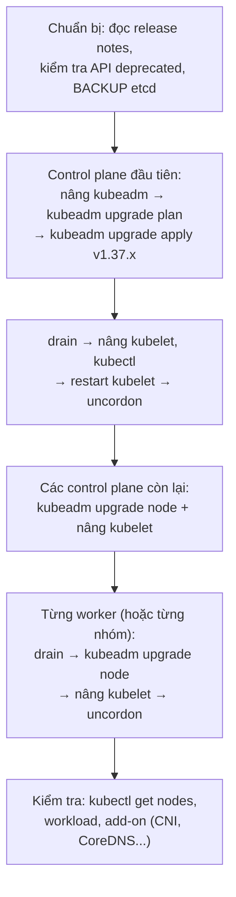

# Vận hành cluster với kubeadm

::: info Mục tiêu bài học
- Biết các cách dựng cluster và khi nào tự dựng bằng **kubeadm**.
- Dựng cluster nhiều node: chuẩn bị máy, `kubeadm init`, cài CNI, `kubeadm join`.
- **Nâng cấp** cluster đúng quy trình và chính sách lệch phiên bản.
- **Sao lưu/khôi phục etcd**, gia hạn **chứng chỉ**, **bảo trì node** an toàn.
- Chuẩn bị cho **API bị loại bỏ** và lập kế hoạch vòng đời cluster.
:::

## 1. Chọn cách dựng cluster

| Cách | Phù hợp | Ghi chú |
| --- | --- | --- |
| **Managed** (EKS, GKE, AKS, cloud trong nước...) | Đa số doanh nghiệp | Control plane, etcd, nâng cấp do nhà cung cấp lo |
| **kubeadm** | On-premise, học sâu, thi CKA | Công cụ chính thức, "chuẩn" nhất, bạn tự lo mọi thứ |
| **RKE2 / k3s** | On-premise, edge | Đóng gói sẵn, bảo mật mặc định tốt, dễ vận hành hơn |
| **Talos Linux** | On-premise hiện đại | Hệ điều hành bất biến chỉ để chạy Kubernetes, quản lý qua API |
| **Kubespray / Cluster API** | Tự động hóa nhiều cluster | Ansible / quản lý cluster bằng chính Kubernetes |

Bài này dùng **kubeadm** vì nó cho thấy rõ từng mảnh ghép — kiến thức áp dụng được cho mọi cách khác.

## 2. Dựng cluster với kubeadm

### Chuẩn bị mỗi máy (Ubuntu/Debian)

```bash
# Kernel module và sysctl cho mạng container
cat <<EOF | sudo tee /etc/modules-load.d/k8s.conf
overlay
br_netfilter
EOF
sudo modprobe overlay && sudo modprobe br_netfilter

cat <<EOF | sudo tee /etc/sysctl.d/k8s.conf
net.bridge.bridge-nf-call-iptables  = 1
net.bridge.bridge-nf-call-ip6tables = 1
net.ipv4.ip_forward                 = 1
EOF
sudo sysctl --system

# Tắt swap (mặc định kubelet vẫn yêu cầu, trừ khi bạn cấu hình riêng để dùng swap)
sudo swapoff -a && sudo sed -i '/ swap / s/^/#/' /etc/fstab

# Container runtime: containerd 2.x (Kubernetes ≥ v1.36 không còn hỗ trợ containerd 1.x)
sudo apt-get update && sudo apt-get install -y containerd
sudo mkdir -p /etc/containerd
containerd config default | sudo tee /etc/containerd/config.toml >/dev/null
sudo systemctl restart containerd
```

::: warning cgroup v2 là bắt buộc
Từ v1.35, kubelet mặc định **từ chối khởi động trên node dùng cgroup v1**. Các bản phân phối Linux hiện đại (Ubuntu 22.04+, Debian 12+, RHEL 9+) đều dùng cgroup v2. Kiểm tra: `stat -fc %T /sys/fs/cgroup` phải trả về `cgroup2fs`.
:::

### Cài kubeadm, kubelet, kubectl (kho `pkgs.k8s.io`)

```bash
sudo apt-get install -y apt-transport-https ca-certificates curl gpg
sudo mkdir -p -m 755 /etc/apt/keyrings
curl -fsSL https://pkgs.k8s.io/core:/stable:/v1.37/deb/Release.key \
  | sudo gpg --dearmor -o /etc/apt/keyrings/kubernetes-apt-keyring.gpg
echo 'deb [signed-by=/etc/apt/keyrings/kubernetes-apt-keyring.gpg] https://pkgs.k8s.io/core:/stable:/v1.37/deb/ /' \
  | sudo tee /etc/apt/sources.list.d/kubernetes.list

sudo apt-get update
sudo apt-get install -y kubelet kubeadm kubectl
sudo apt-mark hold kubelet kubeadm kubectl      # chặn tự nâng cấp ngoài ý muốn
sudo systemctl enable --now kubelet
```

Mỗi bản minor có một kho riêng (`.../v1.37/deb/`) — khi nâng cấp lên v1.38 bạn đổi đường dẫn kho.

### Khởi tạo control plane

```bash
sudo kubeadm init \
  --control-plane-endpoint "k8s-api.example.local:6443" \
  --pod-network-cidr 10.244.0.0/16 \
  --upload-certs

mkdir -p $HOME/.kube
sudo cp -i /etc/kubernetes/admin.conf $HOME/.kube/config
sudo chown $(id -u):$(id -g) $HOME/.kube/config
```

- `--control-plane-endpoint`: tên DNS/IP của load balancer trước các API server — **đặt ngay từ đầu** dù hiện chỉ có 1 control plane, để sau này thêm node HA mà không phải dựng lại.
- `--upload-certs`: cho phép control plane khác tham gia bằng `--certificate-key`.

### Cài CNI và thêm node

```bash
# Ví dụ cài Cilium bằng Helm (hoặc Calico theo tài liệu của dự án)
helm repo add cilium https://helm.cilium.io/
helm install cilium cilium/cilium -n kube-system

# Trên mỗi worker, chạy lệnh join mà kubeadm init đã in ra:
sudo kubeadm join k8s-api.example.local:6443 --token <token> \
  --discovery-token-ca-cert-hash sha256:<hash>

# Token hết hạn sau 24h — tạo lệnh join mới:
kubeadm token create --print-join-command
```

Node chỉ chuyển sang `Ready` sau khi CNI được cài.

## 3. Nâng cấp cluster

### Chính sách lệch phiên bản (version skew)

- Nâng **lần lượt từng bản minor** (v1.36 → v1.37 → v1.38).
- **Control plane trước**, worker sau. kubelet có thể cũ hơn API server tối đa 3 bản minor, nhưng **không được mới hơn**.
- kubectl lệch tối đa ±1 bản minor so với API server.

### Quy trình



Trên control plane đầu tiên (ví dụ nâng lên v1.37.1):

```bash
# 1. Đổi kho sang v1.37 (nếu đang ở v1.36), nâng kubeadm
sudo apt-mark unhold kubeadm && sudo apt-get update
sudo apt-get install -y kubeadm='1.37.1-*' && sudo apt-mark hold kubeadm

# 2. Xem kế hoạch rồi áp dụng
sudo kubeadm upgrade plan
sudo kubeadm upgrade apply v1.37.1

# 3. Nâng kubelet/kubectl trên node này
kubectl drain cp-1 --ignore-daemonsets
sudo apt-mark unhold kubelet kubectl
sudo apt-get install -y kubelet='1.37.1-*' kubectl='1.37.1-*'
sudo apt-mark hold kubelet kubectl
sudo systemctl daemon-reload && sudo systemctl restart kubelet
kubectl uncordon cp-1
```

Trên mỗi worker: `kubectl drain <node> --ignore-daemonsets --delete-emptydir-data` (chạy từ máy có kubectl) → trên node: nâng kubeadm, `sudo kubeadm upgrade node`, nâng kubelet, restart → `kubectl uncordon <node>`.

::: tip Đừng để cluster tụt hậu
Mỗi bản minor chỉ được vá khoảng 14 tháng, và mỗi năm có 3 bản mới. Cluster bỏ bê 2 năm cần nâng **6 lần liên tiếp** — rất rủi ro. Hãy lên lịch nâng cấp định kỳ (ví dụ mỗi quý), thử trên cluster staging trước.
:::

## 4. Sao lưu và khôi phục etcd

etcd chứa **toàn bộ trạng thái** cluster. Sao lưu định kỳ (ví dụ CronJob hoặc systemd timer trên control plane) và **lưu ra ngoài cluster**:

```bash
sudo ETCDCTL_API=3 etcdctl \
  --endpoints=https://127.0.0.1:2379 \
  --cacert=/etc/kubernetes/pki/etcd/ca.crt \
  --cert=/etc/kubernetes/pki/etcd/server.crt \
  --key=/etc/kubernetes/pki/etcd/server.key \
  snapshot save /backup/etcd-$(date +%F-%H%M).db

sudo etcdutl snapshot status /backup/etcd-2026-10-26-0200.db -w table
```

Khôi phục (khi cluster hỏng nặng — **diễn tập trước** trên môi trường thử nghiệm):

```bash
# 1. Khôi phục snapshot ra thư mục dữ liệu mới
sudo etcdutl snapshot restore /backup/etcd-2026-10-26-0200.db --data-dir /var/lib/etcd-restore

# 2. Trỏ static Pod etcd sang thư mục mới: sửa /etc/kubernetes/manifests/etcd.yaml
#    volumes → etcd-data → hostPath.path: /var/lib/etcd-restore
#    kubelet tự khởi động lại etcd với dữ liệu đã khôi phục
```

Ngoài etcd, dùng **Velero** để sao lưu theo namespace/ứng dụng (tài nguyên + dữ liệu volume) và di chuyển workload giữa các cluster. Với cluster managed, bạn không truy cập được etcd — Velero là lựa chọn chính.

## 5. Chứng chỉ

```bash
sudo kubeadm certs check-expiration
sudo kubeadm certs renew all        # gia hạn thủ công (rồi khởi động lại các static Pod control plane)
```

- Chứng chỉ thành phần: **1 năm**; CA: **10 năm**.
- `kubeadm upgrade` tự gia hạn chứng chỉ — thêm một lý do để nâng cấp đều đặn.
- Theo dõi ngày hết hạn bằng cảnh báo (Prometheus có metric về chứng chỉ của API server/kubelet).

## 6. Bảo trì node

```bash
kubectl cordon worker-3                       # ngừng xếp Pod mới lên node
kubectl drain worker-3 --ignore-daemonsets --delete-emptydir-data   # đuổi Pod theo PDB
# ... bảo trì: vá OS, thay RAM, khởi động lại ...
kubectl uncordon worker-3
```

- `drain` tôn trọng **PodDisruptionBudget** — đảm bảo ứng dụng luôn đủ bản sao.
- Pod không do controller quản lý (Pod "trần") cần `--force` và sẽ **mất hẳn**.
- Gỡ node vĩnh viễn: drain → `kubectl delete node worker-3` → `kubeadm reset` trên máy đó.
- **Node Problem Detector** phát hiện lỗi phần cứng/kernel và báo thành condition của node.

## 7. API bị loại bỏ (deprecated/removed)

Mỗi bản Kubernetes có thể **deprecated** và sau đó **loại bỏ** các API cũ (ví dụ `extensions/v1beta1` Ingress, `policy/v1beta1` PodSecurityPolicy). Manifest dùng API đã bị loại bỏ sẽ **không apply được** sau khi nâng cấp.

```bash
# API server cảnh báo khi dùng API deprecated:
# Warning: <group/version> <Kind> is deprecated in v1.xx+, unavailable in v1.yy+; use <thay thế>

# Kiểm tra request tới API deprecated trên cluster đang chạy
kubectl get --raw /metrics | grep apiserver_requested_deprecated_apis
```

Công cụ quét manifest/Helm chart: **pluto**, **kubent** (kube-no-trouble). Đưa vào CI để phát hiện sớm.

## 8. Checklist vận hành định kỳ

| Tần suất | Việc |
| --- | --- |
| Hằng ngày | Theo dõi cảnh báo, node NotReady, Pod CrashLoop, dung lượng đĩa |
| Hằng tuần | Kiểm tra backup thành công, vá bảo mật image nền |
| Hằng tháng | Diễn tập khôi phục backup, rà soát RBAC và chi phí |
| Hằng quý | Nâng cấp Kubernetes và add-on (CNI, CoreDNS, ingress/gateway, cert-manager...) |
| Hằng năm | Kiểm tra chứng chỉ, kế hoạch dung lượng, diễn tập thảm họa (DR) |

## Thực hành

**Bài 1 (trên kind).** Sao lưu etcd của cluster kind. Gợi ý: node control plane là container `k8s-learn-control-plane`, chứng chỉ etcd nằm trong `/etc/kubernetes/pki/etcd/`, và Pod `etcd-...` có sẵn `etcdctl`.

::: details Xem lời giải
```bash
kubectl -n kube-system exec etcd-k8s-learn-control-plane -- etcdctl \
  --endpoints=https://127.0.0.1:2379 \
  --cacert=/etc/kubernetes/pki/etcd/ca.crt \
  --cert=/etc/kubernetes/pki/etcd/server.crt \
  --key=/etc/kubernetes/pki/etcd/server.key \
  snapshot save /var/lib/etcd/backup.db
docker cp k8s-learn-control-plane:/var/lib/etcd/backup.db ./etcd-backup.db
```
Image etcd tối giản (không có shell) nên gọi thẳng `etcdctl`. Thư mục `/var/lib/etcd` được mount từ node, nên `docker cp` lấy được file từ container node. File backup giờ nằm trên máy bạn — "ngoài cluster".
:::

**Bài 2 (trên kind).** Mô phỏng bảo trì: drain `k8s-learn-worker` với một Deployment 4 replicas có PDB `maxUnavailable: 1`, quan sát thứ tự Pod bị đuổi và được tạo lại, rồi uncordon.

::: details Xem lời giải
```bash
kubectl create deployment maint --image=nginx:1.30 --replicas=4
kubectl create pdb maint --selector=app=maint --max-unavailable=1
# Mở một terminal khác để quan sát: kubectl get pods -l app=maint -o wide -w
kubectl drain k8s-learn-worker --ignore-daemonsets --delete-emptydir-data
kubectl get nodes                                   # worker: Ready,SchedulingDisabled
kubectl uncordon k8s-learn-worker
```
drain đuổi từng Pod một (mỗi lần chỉ 1 Pod không sẵn sàng theo PDB), Pod mới được xếp sang worker2. Sau uncordon, Pod **không tự quay lại** worker — chúng chỉ được xếp lại khi có Pod mới (hoặc dùng công cụ như descheduler).
:::

## Tóm tắt

- kubeadm: chuẩn bị node (module, sysctl, containerd 2.x, cgroup v2) → `init` → CNI → `join`; đặt `--control-plane-endpoint` ngay từ đầu.
- Nâng cấp từng bản minor, control plane trước worker sau, drain/uncordon từng node; backup etcd trước khi nâng.
- Backup etcd bằng `etcdctl snapshot save`, khôi phục bằng `etcdutl snapshot restore`; Velero cho backup theo ứng dụng.
- Chứng chỉ kubeadm hết hạn sau 1 năm — nâng cấp/gia hạn đều đặn.
- Theo dõi API deprecated bằng cảnh báo, metric và công cụ quét trước mỗi lần nâng cấp.

## Kiểm tra kiến thức

<Quiz />
