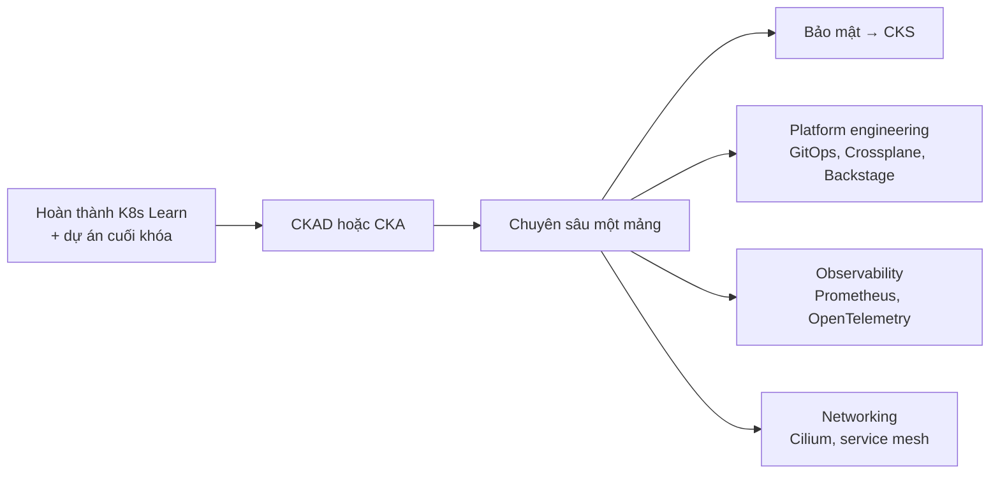

# Chứng chỉ & tài nguyên học tiếp

## 1. Các chứng chỉ Kubernetes

Chứng chỉ do **The Linux Foundation** và **CNCF** cấp, thi trực tuyến có giám sát.

| Chứng chỉ | Dành cho | Hình thức | Nên thi sau khi học |
| --- | --- | --- | --- |
| **KCNA** — Kubernetes and Cloud Native Associate | Người mới, vai trò không thuần kỹ thuật | Trắc nghiệm | Phần 1 |
| **KCSA** — Kubernetes and Cloud Native Security Associate | Người mới về bảo mật cloud-native | Trắc nghiệm | Phần 1 + bài Bảo mật |
| **CKAD** — Certified Kubernetes Application Developer | Lập trình viên triển khai ứng dụng | **Thực hành trên terminal** | Phần 1 + Phần 2 |
| **CKA** — Certified Kubernetes Administrator | DevOps, SRE, quản trị hệ thống | **Thực hành trên terminal** | Cả ba phần |
| **CKS** — Certified Kubernetes Security Specialist | Chuyên gia bảo mật (yêu cầu có CKA còn hiệu lực) | **Thực hành trên terminal** | Sau CKA |

Đạt đủ cả 5 chứng chỉ trên, bạn được công nhận danh hiệu **Kubestronaut** của CNCF.

::: warning Thông tin thay đổi theo thời gian
Giá thi, thời lượng, điểm đạt và nội dung (curriculum) được cập nhật định kỳ — hãy kiểm tra trên trang chính thức của Linux Foundation / CNCF trước khi đăng ký. Các đợt giảm giá lớn thường rơi vào dịp Black Friday / Cyber Monday và sự kiện KubeCon.
:::

### Nội dung CKA và CKAD — đối chiếu với khóa học

| Lĩnh vực thi (CKA) | Bài học liên quan |
| --- | --- |
| Cluster Architecture, Installation & Configuration | Kiến trúc, Cài đặt, RBAC, Helm, Kustomize, Vận hành cluster, CRD & Operator |
| Workloads & Scheduling | Pod, Deployment, ConfigMap/Secret, Tài nguyên, Lập lịch, Autoscaling |
| Services & Networking | Service, Ingress & Gateway API, NetworkPolicy, Mạng chuyên sâu |
| Storage | Lưu trữ, StatefulSet |
| Troubleshooting (chiếm tỉ trọng lớn nhất) | Xử lý sự cố, Observability, Probes |

| Lĩnh vực thi (CKAD) | Bài học liên quan |
| --- | --- |
| Application Design and Build | Container & Docker, Pod (init/sidecar), Job/CronJob, Lưu trữ |
| Application Deployment | Deployment (rolling update, canary/blue-green), Helm, Kustomize |
| Application Observability and Maintenance | Probes, kubectl (logs, debug), API deprecated |
| Application Environment, Configuration and Security | ConfigMap & Secret, Tài nguyên, securityContext, ServiceAccount, CRD |
| Services and Networking | Service, Ingress & Gateway API, NetworkPolicy |

## 2. Mẹo ôn thi CKA/CKAD

1. **Tốc độ là tất cả** — đề thi thực hành, thời gian rất sát. Luyện đến mức gõ lệnh không cần nghĩ.
2. **Dùng lệnh mệnh lệnh + `--dry-run=client -o yaml`** để sinh khung YAML thay vì gõ tay (xem [cheat sheet](/tham-khao/cheatsheet#sinh-yaml-nhanh)).
3. **Thiết lập môi trường** ngay đầu giờ: `alias k=kubectl`, `export do="--dry-run=client -o yaml"`, cấu hình vim (`set expandtab tabstop=2 shiftwidth=2`).
4. **Luôn chuyển đúng context** mà đề bài yêu cầu trước khi làm mỗi câu — đây là lỗi mất điểm phổ biến nhất.
5. **Thành thạo tra tài liệu**: được mở tài liệu chính thức kubernetes.io trong lúc thi; tập tìm nhanh ví dụ YAML (NetworkPolicy, PV/PVC, Ingress/Gateway...).
6. **Bỏ qua câu khó**, làm câu điểm cao/dễ trước, quay lại sau.
7. **Luyện bằng trình mô phỏng**: đăng ký thi thường kèm 2 lượt trình mô phỏng [killer.sh](https://killer.sh) — khó hơn đề thật, rất đáng làm. Thêm các bài lab miễn phí trên [Killercoda](https://killercoda.com).
8. Làm lại các bài **Thực hành** và nhiệm vụ trong [kubectl Playground](/thuc-hanh/playground) của khóa học này cho thành phản xạ.

## 3. Tài nguyên học tiếp

### Chính thức

- [Tài liệu Kubernetes](https://kubernetes.io/docs/) — nguồn tham khảo số 1, có phần Tasks và Tutorials rất thực tế.
- [Kubernetes Blog](https://kubernetes.io/blog/) — thông báo phát hành, tính năng mới, deprecation.
- [CNCF Landscape](https://landscape.cncf.io/) — bản đồ hệ sinh thái cloud-native.
- Kênh YouTube **CNCF** — video các bài nói tại KubeCon + CloudNativeCon.

### Thực hành

- [Kubernetes The Hard Way](https://github.com/kelseyhightower/kubernetes-the-hard-way) — dựng cluster từng mảnh bằng tay, hiểu sâu từng thành phần.
- [Killercoda](https://killercoda.com) — lab Kubernetes miễn phí trên trình duyệt.
- [iximiuz Labs](https://labs.iximiuz.com) — bài tập và giải thích trực quan về container, mạng, Kubernetes.

### Sách

- *Kubernetes Up & Running* — Brendan Burns, Joe Beda, Kelsey Hightower, Lachlan Evenson.
- *Kubernetes in Action* — Marko Lukša.
- *Kubernetes Patterns* — Bilgin Ibryam, Roland Huß.
- *Production Kubernetes* — Josh Rosso, Rich Lander, Alex Brand, John Harris.
- *Kubernetes Best Practices* — Brendan Burns, Eddie Villalba, Dave Strebel, Lachlan Evenson.

### Cộng đồng

- Kubernetes Slack (`slack.k8s.io`) — kênh hỗ trợ người dùng và các nhóm SIG.
- Các nhóm DevOps/Kubernetes Việt Nam trên mạng xã hội và các buổi meetup của Cloud Native Community Groups (CNCG) tại Việt Nam.
- Đóng góp cho Kubernetes: bắt đầu từ tài liệu (kể cả bản dịch tiếng Việt của kubernetes.io), issue gắn nhãn `good first issue`.

## 4. Sau khóa học: lộ trình gợi ý

Chúc bạn học tốt và sớm đưa ứng dụng của mình lên Kubernetes một cách tự tin! 🚀
