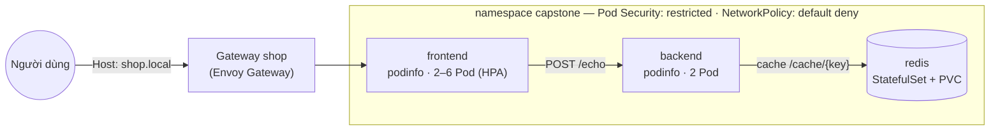

# Dự án cuối khóa: cửa hàng "shop" trên Kubernetes

::: info Bạn sẽ làm gì?
Triển khai một ứng dụng 3 tầng hoàn chỉnh lên cluster kind theo tiêu chuẩn gần với production — áp dụng kiến thức của **cả ba phần** khóa học. Thời gian dự kiến: 2–4 giờ.
:::

## 1. Kiến trúc

Ứng dụng dùng [podinfo](https://github.com/stefanprodan/podinfo) — web app mẫu chuyên cho Kubernetes, có sẵn health check, metric, chuyển tiếp request tới backend và cache bằng Redis.



## 2. Chuẩn bị

- Cluster kind 3 node từ [bài Cài đặt](/co-ban/cai-dat) (kindnet có hỗ trợ NetworkPolicy).
- **metrics-server** — xem [bài Tài nguyên](/trung-cap/resources#_5-xem-muc-dung-thuc-te-metrics-server).
- **Envoy Gateway** và GatewayClass `eg` — xem [bài Ingress & Gateway API](/trung-cap/ingress-gateway#thuc-hanh-gateway-api-voi-envoy-gateway).
- (Tùy chọn) kube-prometheus-stack, Argo CD cho phần mở rộng.

Tạo thư mục làm việc:

```text
shop/
├── base/
│   ├── kustomization.yaml
│   ├── namespace.yaml
│   ├── redis.yaml
│   ├── backend.yaml
│   ├── frontend.yaml
│   ├── network-policies.yaml
│   └── gateway.yaml
└── overlays/
    ├── dev/kustomization.yaml
    └── prod/kustomization.yaml
```

## 3. Các cột mốc

Làm lần lượt, **kiểm tra xong mốc này mới sang mốc sau**. Gợi ý nằm trong các bài học được liên kết; lời giải tham khảo ở mục 5.

### Mốc 1 — Namespace và quản trị tài nguyên

- [ ] Namespace `capstone` áp **Pod Security `restricted`** (enforce, warn, audit). → [Bảo mật Pod](/nang-cao/bao-mat)
- [ ] `LimitRange` gán mặc định requests cho container quên khai báo. → [Tài nguyên](/trung-cap/resources)
- [ ] `ResourceQuota` giới hạn tổng CPU/RAM, số Pod và số PVC.

### Mốc 2 — Redis

- [ ] **StatefulSet** `redis` 1 replica, image `redis:8`, bật AOF (`--appendonly yes`). → [StatefulSet](/trung-cap/statefulset)
- [ ] `volumeClaimTemplates` 1Gi mount vào `/data`; headless Service `redis` cổng 6379.
- [ ] readinessProbe `redis-cli ping`, livenessProbe TCP 6379.
- [ ] Chạy non-root với UID **999** (user `redis` của image), `fsGroup: 999`, đủ các trường securityContext của mức restricted.

### Mốc 3 — Backend

- [ ] **Deployment** `backend` 2 replicas, image `ghcr.io/stefanprodan/podinfo:6.15.0`, lệnh `./podinfo --port=9898 --cache-server=tcp://redis:6379`.
- [ ] Probes `/readyz` và `/healthz`; requests/limits; rolling update `maxUnavailable: 0`. → [Probes](/trung-cap/probes)
- [ ] Image podinfo khai báo `USER app` (dạng tên) → phải đặt `runAsUser: 100`, `runAsGroup: 101`.
- [ ] `readOnlyRootFilesystem: true` (mount `emptyDir` vào `/data`); Service `backend` cổng 9898; **PDB** `minAvailable: 1`.

### Mốc 4 — Frontend

- [ ] **ConfigMap** (sinh bằng Kustomize `configMapGenerator`) chứa `PODINFO_UI_MESSAGE`, `PODINFO_UI_COLOR`. → [Kustomize](/trung-cap/kustomize)
- [ ] **Deployment** `frontend` 2 replicas với `--backend-url=http://backend:9898/echo`, nạp ConfigMap bằng `envFrom`.
- [ ] **topologySpreadConstraints** rải Pod theo node. → [Lập lịch](/trung-cap/scheduling)
- [ ] **HPA** 2–6 replicas theo CPU 70%, **PDB** `minAvailable: 1`. → [Autoscaling](/trung-cap/autoscaling)

### Mốc 5 — NetworkPolicy

- [ ] **Default deny** cả ingress lẫn egress cho mọi Pod trong namespace. → [NetworkPolicy](/nang-cao/network-policy)
- [ ] Cho phép **DNS** tới kube-dns.
- [ ] Chỉ mở: gateway (namespace `envoy-gateway-system`) → frontend:9898 → backend:9898 → redis:6379.

### Mốc 6 — Cổng vào HTTP

- [ ] **Gateway** `shop` (GatewayClass `eg`) với listener HTTP cổng 80, hostname `shop.local`.
- [ ] **HTTPRoute** đưa mọi request của `shop.local` tới Service `frontend`. → [Gateway API](/trung-cap/ingress-gateway)

### Mốc 7 — Nhiều môi trường

- [ ] Overlay **dev**: 1 backend, lời chào/màu riêng. Chú ý PDB của backend khi chỉ còn 1 replica!
- [ ] Overlay **prod**: 3 replicas mỗi tầng, HPA tối thiểu 3, PDB `minAvailable: 2`.

## 4. Kiểm thử nghiệm thu

```bash
kubectl apply -k shop/overlays/dev
kubectl get all,pvc,gateway,httproute -n capstone
kubectl wait --for=condition=Available deployment --all -n capstone --timeout=180s
```

**Truy cập qua Gateway** (giữ cửa sổ port-forward mở):

::: code-group

```bash [bash]
SVC=$(kubectl get svc -n envoy-gateway-system \
  -l gateway.envoyproxy.io/owning-gateway-namespace=capstone,gateway.envoyproxy.io/owning-gateway-name=shop \
  -o jsonpath='{.items[0].metadata.name}')
kubectl -n envoy-gateway-system port-forward svc/$SVC 8888:80
```

```powershell [PowerShell]
$SVC = kubectl get svc -n envoy-gateway-system `
  -l gateway.envoyproxy.io/owning-gateway-namespace=capstone,gateway.envoyproxy.io/owning-gateway-name=shop `
  -o jsonpath='{.items[0].metadata.name}'
kubectl -n envoy-gateway-system port-forward svc/$SVC 8888:80
```

:::

Ở terminal khác:

| # | Kiểm thử | Lệnh | Kết quả mong đợi |
| --- | --- | --- | --- |
| 1 | Frontend qua Gateway | `curl -H "Host: shop.local" http://localhost:8888/` | JSON có `"message": "[DEV] Dự án cuối khóa..."` |
| 2 | Frontend → backend | `curl -X POST -H "Host: shop.local" -d "xin chao" http://localhost:8888/echo` | `["xin chao"]` — frontend chuyển tiếp tới backend và gom kết quả |
| 3 | Backend ghi cache | `kubectl -n capstone exec deploy/backend -- curl -s -X POST -d "K8s Learn" localhost:9898/cache/greeting` | Thành công, không lỗi |
| 4 | Dữ liệu bền vững | `kubectl -n capstone delete pod redis-0`, chờ Ready, rồi `kubectl -n capstone exec deploy/backend -- curl -s localhost:9898/cache/greeting` | Vẫn trả về `K8s Learn` |
| 5 | NetworkPolicy chặn sai luồng | `kubectl -n capstone exec deploy/frontend -- nc -zv -w 2 redis 6379` | Thất bại (timeout) |
| 6 | Pod lạ bị chặn | `kubectl run test --rm -it --image=busybox:1.37 --restart=Never -- wget -qO- -T 3 http://frontend.capstone:9898` | `download timed out` |
| 7 | Pod Security | `kubectl -n capstone run bad --image=nginx:1.30` | Bị từ chối: `violates PodSecurity "restricted:latest"` |
| 8 | Tự phục hồi | Xóa một Pod frontend khi đang gọi liên tục kiểu (1) | Không có request lỗi |
| 9 | Autoscaling | Tạo tải liên tục qua Gateway, theo dõi `kubectl get hpa -n capstone -w` | Số replicas frontend tăng, giảm lại khi hết tải |
| 10 | Bảo trì node | `kubectl drain <node> --ignore-daemonsets --delete-emptydir-data` rồi `uncordon` | drain tôn trọng PDB, dịch vụ không gián đoạn |

::: warning Kiểm thử 10 và lưu trữ local
Nếu node bị drain đang chạy `redis-0`, Pod thay thế sẽ `Pending` cho tới khi bạn `uncordon` — PV của local-path gắn chặt với node đó. Đây là giới hạn của lưu trữ local trên kind; trên cloud, ổ đĩa mạng được gắn sang node khác (cùng zone). Backend vẫn chạy nhưng thao tác cache sẽ lỗi trong lúc Redis vắng mặt.
:::

::: tip Tạo tải cho kiểm thử 9
Port-forward là một kết nối đơn nên tải sinh ra khá nhỏ. Cách đơn giản: chạy nhiều vòng lặp song song, hoặc tạm hạ ngưỡng HPA xuống `averageUtilization: 20` để quan sát. Lưu ý Pod tạo tải trong cluster sẽ bị NetworkPolicy chặn nếu gọi thẳng frontend.
:::

## 5. Lời giải tham khảo

Toàn bộ lời giải nằm trong thư mục `examples/capstone` của mã nguồn trang web này — dùng được ngay với `kubectl apply -k examples/capstone/overlays/dev`. Hãy tự làm trước khi mở!

::: details base/kustomization.yaml
<<< @/../examples/capstone/base/kustomization.yaml
:::

::: details base/namespace.yaml — Namespace, LimitRange, ResourceQuota
<<< @/../examples/capstone/base/namespace.yaml
:::

::: details base/redis.yaml
<<< @/../examples/capstone/base/redis.yaml
:::

::: details base/backend.yaml
<<< @/../examples/capstone/base/backend.yaml
:::

::: details base/frontend.yaml
<<< @/../examples/capstone/base/frontend.yaml
:::

::: details base/network-policies.yaml
<<< @/../examples/capstone/base/network-policies.yaml
:::

::: details base/gateway.yaml
<<< @/../examples/capstone/base/gateway.yaml
:::

::: details overlays/dev/kustomization.yaml
<<< @/../examples/capstone/overlays/dev/kustomization.yaml
:::

::: details overlays/prod/kustomization.yaml
<<< @/../examples/capstone/overlays/prod/kustomization.yaml
:::

## 6. Mở rộng (không bắt buộc)

1. **GitOps** — đẩy thư mục `shop/` lên Git, tạo Argo CD Application trỏ vào `overlays/dev`, bật `selfHeal`. Đổi lời chào trong Git và quan sát Argo CD tự rollout (ConfigMap có hash nên Pod được thay mới). → [GitOps](/nang-cao/gitops)

   ::: details extras/argocd-application.yaml
   <<< @/../examples/capstone/extras/argocd-application.yaml
   :::

2. **Giám sát** — cài kube-prometheus-stack, tạo ServiceMonitor cho frontend/backend (nhớ mở NetworkPolicy cho Prometheus!), dựng dashboard tỉ lệ request theo mã trạng thái và cảnh báo khi tỉ lệ lỗi tăng. → [Observability](/nang-cao/observability)

   ::: details extras/servicemonitor.yaml
   <<< @/../examples/capstone/extras/servicemonitor.yaml
   :::

3. **Chính sách** — viết ValidatingAdmissionPolicy bắt buộc mọi Deployment trong `capstone` có label `app.kubernetes.io/part-of` và không dùng tag `latest`. → [Admission & Policy](/nang-cao/admission-policy)
4. **Canary** — chạy thêm `frontend-v2` (màu khác) và dùng HTTPRoute chia 90/10.
5. **HTTPS** — cài cert-manager, cấp chứng chỉ tự ký cho `shop.local` và thêm listener HTTPS cho Gateway.

## 7. Tự đánh giá

- [ ] Mọi Pod chạy được dưới Pod Security `restricted`.
- [ ] Không container nào thiếu requests, probes hay securityContext.
- [ ] Xóa bất kỳ Pod nào, ứng dụng vẫn phục vụ; dữ liệu Redis còn nguyên.
- [ ] Chỉ các luồng mạng cần thiết được mở; Pod lạ không gọi được vào.
- [ ] Đổi môi trường dev ↔ prod chỉ bằng một lệnh `kubectl apply -k`.
- [ ] Bạn giải thích được **vì sao** cho từng dòng cấu hình.

🎉 Hoàn thành dự án là bạn đã có nền tảng vững để vận hành ứng dụng thật trên Kubernetes. Bước tiếp theo: xem [Chứng chỉ & tài nguyên](/tham-khao/chung-chi) để định hướng học tiếp.
