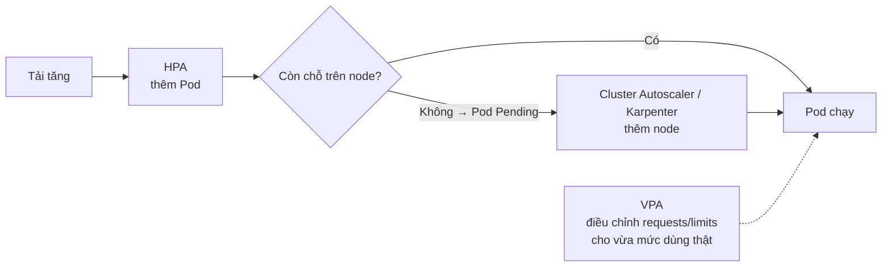

# Autoscaling: HPA, VPA & node

::: info Mục tiêu bài học
- Hiểu 3 chiều mở rộng: **số Pod** (HPA), **kích thước Pod** (VPA), **số node** (Cluster Autoscaler/Karpenter).
- Cấu hình **HorizontalPodAutoscaler** theo CPU và tinh chỉnh hành vi scale.
- Biết khi nào cần **metric tùy chỉnh** và **KEDA** (scale theo sự kiện, scale về 0).
- Tự chạy bài thực hành tạo tải và quan sát HPA hoạt động.
:::

## 1. Ba chiều mở rộng



| Công cụ | Điều chỉnh | Có sẵn? |
| --- | --- | --- |
| **HPA** | Số replicas | Có sẵn trong Kubernetes (cần metrics-server) |
| **VPA** | requests/limits của Pod | Cài thêm |
| **KEDA** | Số replicas theo sự kiện (hàng đợi, cron...), scale về 0 | Cài thêm |
| **Cluster Autoscaler / Karpenter** | Số node | Cài thêm, thường có sẵn trên cloud managed |

## 2. HorizontalPodAutoscaler

HPA định kỳ (mặc định 15 giây) lấy metric và tính số Pod mong muốn:

```text
desiredReplicas = ceil( currentReplicas × currentMetric / targetMetric )
```

Ví dụ: 4 Pod, CPU trung bình 90%, mục tiêu 60% → `ceil(4 × 90/60) = 6` Pod.

```yaml
apiVersion: autoscaling/v2
kind: HorizontalPodAutoscaler
metadata:
  name: php-apache
spec:
  scaleTargetRef:
    apiVersion: apps/v1
    kind: Deployment
    name: php-apache
  minReplicas: 1
  maxReplicas: 10
  metrics:
    - type: Resource
      resource:
        name: cpu
        target:
          type: Utilization
          averageUtilization: 50      # 50% của requests.cpu
  behavior:
    scaleDown:
      stabilizationWindowSeconds: 300  # chờ 5 phút ổn định mới giảm (chống dao động)
      policies:
        - type: Percent
          value: 50                    # mỗi phút giảm tối đa 50% số Pod
          periodSeconds: 60
    scaleUp:
      stabilizationWindowSeconds: 0
      policies:
        - type: Pods
          value: 4                     # mỗi 15 giây thêm tối đa 4 Pod
          periodSeconds: 15
```

::: warning Bắt buộc có requests
Utilization tính theo `requests`. Container không khai báo `requests.cpu` → HPA không tính được và báo `missing request for cpu`.
:::

## 3. Thực hành: HPA với tải thật

**Chuẩn bị:** cài metrics-server như ở [bài Tài nguyên](/trung-cap/resources#_5-xem-muc-dung-thuc-te-metrics-server).

Triển khai ứng dụng mẫu của Kubernetes — mỗi request thực hiện một phép tính tốn CPU:

```yaml
# php-apache.yaml
apiVersion: apps/v1
kind: Deployment
metadata:
  name: php-apache
spec:
  selector:
    matchLabels:
      run: php-apache
  template:
    metadata:
      labels:
        run: php-apache
    spec:
      containers:
        - name: php-apache
          image: registry.k8s.io/hpa-example
          ports:
            - containerPort: 80
          resources:
            requests:
              cpu: 200m
            limits:
              cpu: 500m
---
apiVersion: v1
kind: Service
metadata:
  name: php-apache
spec:
  selector:
    run: php-apache
  ports:
    - port: 80
```

```bash
kubectl apply -f php-apache.yaml
kubectl autoscale deployment php-apache --cpu=50% --min=1 --max=10
kubectl get hpa
```

```text
NAME         REFERENCE               TARGETS       MINPODS   MAXPODS   REPLICAS   AGE
php-apache   Deployment/php-apache   cpu: 0%/50%   1         10        1          30s
```

Mở terminal thứ hai, tạo tải:

```bash
kubectl run load-generator --rm -it --image=busybox:1.37 --restart=Never -- \
  /bin/sh -c "while sleep 0.01; do wget -q -O- http://php-apache; done"
```

Ở terminal đầu tiên, theo dõi:

```bash
kubectl get hpa php-apache --watch
```

```text
NAME         REFERENCE               TARGETS         MINPODS   MAXPODS   REPLICAS
php-apache   Deployment/php-apache   cpu: 0%/50%     1         10        1
php-apache   Deployment/php-apache   cpu: 250%/50%   1         10        1
php-apache   Deployment/php-apache   cpu: 250%/50%   1         10        5
php-apache   Deployment/php-apache   cpu: 68%/50%    1         10        7
php-apache   Deployment/php-apache   cpu: 49%/50%    1         10        7
```

Dừng tải (Ctrl+C ở terminal hai). Sau khoảng 5 phút (cửa sổ ổn định khi giảm), số replicas về lại 1.

```bash
kubectl describe hpa php-apache   # Events: New size: 5; reason: cpu resource utilization above target
```

## 4. Metric khác ngoài CPU

`autoscaling/v2` hỗ trợ 4 loại metric:

| Loại | Ví dụ | Cần gì |
| --- | --- | --- |
| `Resource` | CPU, memory | metrics-server |
| `Pods` | Request/giây trung bình mỗi Pod | Custom Metrics API (Prometheus Adapter...) |
| `Object` | Request/giây của một Ingress | Custom Metrics API |
| `External` | Độ dài hàng đợi RabbitMQ/SQS/Kafka lag | External Metrics API (KEDA, adapter của cloud) |

CPU không phải lúc nào cũng phản ánh tải: dịch vụ chờ I/O, worker xử lý hàng đợi... nên scale theo **metric nghiệp vụ** (request/giây, độ dài hàng đợi) thường chính xác hơn.

### KEDA — scale theo sự kiện

[KEDA](https://keda.sh) có hơn 60 "scaler" (Kafka, RabbitMQ, Redis, PostgreSQL, Prometheus, cron, Azure/AWS/GCP...) và hỗ trợ **scale về 0** khi không có việc:

```yaml
apiVersion: keda.sh/v1alpha1
kind: ScaledObject
metadata:
  name: order-worker
spec:
  scaleTargetRef:
    name: order-worker            # Deployment cần scale
  minReplicaCount: 0              # không có tin nhắn → 0 Pod
  maxReplicaCount: 30
  triggers:
    - type: rabbitmq
      metadata:
        queueName: orders
        mode: QueueLength
        value: "20"               # mỗi Pod xử lý ~20 tin nhắn tồn đọng
      authenticationRef:
        name: rabbitmq-auth
```

Bản thân HPA cũng đang được bổ sung khả năng scale về 0 (beta ở v1.37) cho metric dạng Object/External.

## 5. VerticalPodAutoscaler

VPA quan sát mức dùng thực tế và **đề xuất hoặc tự đặt** requests/limits phù hợp:

```yaml
apiVersion: autoscaling.k8s.io/v1
kind: VerticalPodAutoscaler
metadata:
  name: api-vpa
spec:
  targetRef:
    apiVersion: apps/v1
    kind: Deployment
    name: api
  updatePolicy:
    updateMode: "Off"     # Off: chỉ khuyến nghị | Initial: áp khi tạo Pod | Recreate/InPlaceOrRecreate: tự áp
```

```bash
kubectl describe vpa api-vpa      # xem Recommendation: Target, Lower Bound, Upper Bound
```

Chế độ `Off` rất hữu ích để **tìm requests hợp lý** cho ứng dụng mới. Phiên bản VPA mới kết hợp được với tính năng resize tại chỗ (v1.35+) để điều chỉnh mà không cần tạo lại Pod.

## 6. Mở rộng node

- **Cluster Autoscaler**: thấy Pod `Pending` vì thiếu tài nguyên → tăng kích thước node group; node rảnh lâu → thu hồi (tôn trọng PDB).
- **Karpenter**: tạo node "vừa khít" với nhu cầu (chọn loại máy, spot/on-demand) thay vì theo node group cố định; gom Pod để giảm số node (consolidation). Phổ biến trên AWS và đã hỗ trợ thêm các cloud khác.

Trên cloud managed, bật autoscaling cho node pool thường chỉ là một tùy chọn trong cấu hình.

## 7. Thực hành tốt

- Đặt `requests` sát thực tế — HPA và Cluster Autoscaler đều dựa vào đó.
- Đặt `minReplicas` ≥ 2 cho dịch vụ quan trọng (sẵn sàng cao), kèm PDB.
- Đảm bảo ứng dụng **khởi động nhanh** và có **readinessProbe** — Pod mới vô dụng nếu mất 2 phút mới nhận được traffic.
- Dùng `behavior` để scale lên nhanh, scale xuống chậm.
- Kiểm thử tải trước khi tin vào cấu hình autoscaling.

## Thực hành

**Bài 1.** Viết HPA dạng YAML cho Deployment `web`: 2–8 replicas, mục tiêu CPU 70% và memory 80%.

::: details Xem lời giải
```yaml
apiVersion: autoscaling/v2
kind: HorizontalPodAutoscaler
metadata:
  name: web
spec:
  scaleTargetRef: { apiVersion: apps/v1, kind: Deployment, name: web }
  minReplicas: 2
  maxReplicas: 8
  metrics:
    - type: Resource
      resource: { name: cpu, target: { type: Utilization, averageUtilization: 70 } }
    - type: Resource
      resource: { name: memory, target: { type: Utilization, averageUtilization: 80 } }
```
Với nhiều metric, HPA tính số replicas cho từng metric và lấy **giá trị lớn nhất**.
:::

**Bài 2.** Trong bài thực hành php-apache, xóa `requests` khỏi Deployment rồi xem `kubectl describe hpa`. Giải thích.

::: details Xem lời giải
HPA báo lỗi kiểu `failed to get cpu utilization: missing request for cpu in container php-apache` và cột TARGETS hiện `<unknown>/50%`. Không có requests thì không tính được phần trăm sử dụng.
:::

## Tóm tắt

- HPA điều chỉnh số Pod theo metric: `desired = ceil(current × actual/target)`; CPU tính theo % `requests`.
- metrics-server cho CPU/RAM; metric nghiệp vụ cần Prometheus Adapter hoặc **KEDA** (có scale về 0).
- VPA điều chỉnh kích thước Pod — dùng chế độ khuyến nghị để tìm requests hợp lý; tránh “giằng co” với HPA.
- Cluster Autoscaler/Karpenter thêm/bớt node khi Pod Pending hoặc node rảnh.

## Kiểm tra kiến thức

<Quiz />
