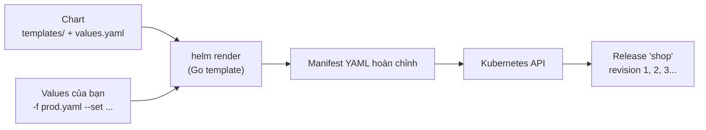

# Helm — trình quản lý gói

::: info Mục tiêu bài học
- Hiểu **chart**, **release**, **repository**, **values**.
- Tìm, cài, cấu hình, nâng cấp, rollback và gỡ ứng dụng bằng Helm.
- Tự viết chart: template, values, helper, điều kiện, vòng lặp.
- Đóng gói và phát hành chart lên **OCI registry**.
:::

## 1. Vì sao cần Helm?

Một ứng dụng thật gồm hàng chục manifest: Deployment, Service, ConfigMap, Secret, Ingress, HPA, PDB, ServiceAccount... và mỗi môi trường khác nhau một chút (số replicas, tên miền, tài nguyên). Copy-paste YAML cho từng môi trường nhanh chóng trở thành ác mộng.

**Helm** là "apt/npm của Kubernetes":

| Khái niệm | Ý nghĩa |
| --- | --- |
| **Chart** | Gói chứa các template manifest + giá trị mặc định |
| **Values** | Tham số để tùy biến chart (`values.yaml`, `-f`, `--set`) |
| **Release** | Một lần cài chart vào cluster, có tên và lịch sử revision |
| **Repository** | Nơi lưu chart: HTTP repo hoặc **OCI registry** (GHCR, Harbor, ECR...) |



Phiên bản hiện tại là **Helm 4** (phát hành 11/2025): hệ thống plugin mới, hỗ trợ server-side apply, chờ tài nguyên sẵn sàng chính xác hơn. Chart `apiVersion: v2` của Helm 3 vẫn dùng bình thường.

## 2. Cài Helm

::: code-group

```powershell [Windows]
winget install Helm.Helm
```

```bash [macOS]
brew install helm
```

```bash [Linux]
curl -fsSL https://raw.githubusercontent.com/helm/helm/main/scripts/get-helm-4 | bash
```

:::

```bash
helm version
```

## 3. Dùng chart có sẵn

Ví dụ với chart của **podinfo**:

```bash
# Thêm repository và cập nhật danh mục
helm repo add podinfo https://stefanprodan.github.io/podinfo
helm repo update
helm search repo podinfo

# Xem giá trị cấu hình được
helm show values podinfo/podinfo | less

# Cài đặt release tên "frontend"
helm install frontend podinfo/podinfo \
  --namespace demo --create-namespace \
  --set replicaCount=2 \
  --set ui.message="Xin chao tu Helm"

helm list -n demo
kubectl get all -n demo
kubectl port-forward -n demo svc/frontend-podinfo 8080:9898
```

Nhiều chart cũng phát hành dạng **OCI** — không cần `helm repo add`:

```bash
helm install frontend oci://ghcr.io/stefanprodan/charts/podinfo --version 6.15.0 -n demo
```

### Tùy biến bằng file values

```yaml
# values-prod.yaml
replicaCount: 3
ui:
  message: "Production"
  color: "#326ce5"
resources:
  requests:
    cpu: 100m
    memory: 64Mi
hpa:
  enabled: true
  maxReplicas: 10
```

```bash
helm upgrade --install frontend podinfo/podinfo -n demo -f values-prod.yaml
```

Thứ tự ưu tiên: `values.yaml` của chart < các file `-f` (file sau đè file trước) < `--set`.

::: tip `helm upgrade --install`
Lệnh "cài nếu chưa có, nâng cấp nếu đã có" — idempotent, rất hợp cho pipeline CI/CD.
:::

### Quản lý release

```bash
helm status frontend -n demo
helm get values frontend -n demo          # values bạn đã truyền vào
helm get manifest frontend -n demo        # manifest thực tế đã áp dụng
helm history frontend -n demo
helm rollback frontend 1 -n demo          # quay về revision 1
helm uninstall frontend -n demo
```

Helm lưu thông tin mỗi revision trong một **Secret** ở namespace của release (`sh.helm.release.v1.frontend.v1`...).

## 4. Tự viết chart

```bash
helm create myapp
```

```text
myapp/
├── Chart.yaml          # tên, phiên bản chart, appVersion
├── values.yaml         # giá trị mặc định
├── charts/             # chart phụ thuộc
└── templates/
    ├── deployment.yaml
    ├── service.yaml
    ├── ingress.yaml
    ├── hpa.yaml
    ├── serviceaccount.yaml
    ├── _helpers.tpl    # các hàm template dùng chung
    ├── NOTES.txt       # thông báo in ra sau khi cài
    └── tests/
```

```yaml
# Chart.yaml
apiVersion: v2
name: myapp
description: Ứng dụng mẫu của khóa K8s Learn
type: application
version: 0.1.0        # phiên bản CHART — tăng khi chart thay đổi
appVersion: "1.30"    # phiên bản ỨNG DỤNG bên trong
```

### Template cơ bản

Helm dùng cú pháp **Go template**. Đây là phần `templates/deployment.yaml` rút gọn:

```yaml
apiVersion: apps/v1
kind: Deployment
metadata:
  name: {{ include "myapp.fullname" . }}
  labels:
    {{- include "myapp.labels" . | nindent 4 }}
spec:
  {{- if not .Values.autoscaling.enabled }}
  replicas: {{ .Values.replicaCount }}
  {{- end }}
  selector:
    matchLabels:
      {{- include "myapp.selectorLabels" . | nindent 6 }}
  template:
    metadata:
      annotations:
        checksum/config: {{ include (print $.Template.BasePath "/configmap.yaml") . | sha256sum }}
      labels:
        {{- include "myapp.selectorLabels" . | nindent 8 }}
    spec:
      containers:
        - name: {{ .Chart.Name }}
          image: "{{ .Values.image.repository }}:{{ .Values.image.tag | default .Chart.AppVersion }}"
          ports:
            - name: http
              containerPort: {{ .Values.service.targetPort }}
          env:
            {{- range $key, $value := .Values.env }}
            - name: {{ $key }}
              value: {{ $value | quote }}
            {{- end }}
          {{- with .Values.resources }}
          resources:
            {{- toYaml . | nindent 12 }}
          {{- end }}
```

```yaml
# values.yaml
replicaCount: 2
image:
  repository: nginx
  tag: ""             # rỗng → dùng appVersion
service:
  port: 80
  targetPort: 80
autoscaling:
  enabled: false
env:
  APP_MODE: production
  LOG_LEVEL: info
resources:
  requests:
    cpu: 100m
    memory: 64Mi
```

| Cú pháp | Ý nghĩa |
| --- | --- |
| `.Values.x` | Giá trị từ values |
| `.Chart.Name`, `.Release.Name`, `.Release.Namespace` | Thông tin chart và release |
| `include "ten" .` | Gọi template con định nghĩa trong `_helpers.tpl` |
| `default`, `quote`, `upper`, `toYaml`, `nindent` | Hàm xử lý chuỗi/định dạng |
| `if` / `with` / `range` | Điều kiện, đổi ngữ cảnh, vòng lặp |
| Dấu `-` ở đầu/cuối thẻ | Xóa khoảng trắng/xuống dòng thừa |

::: warning Thụt lề là cái bẫy lớn nhất
Template sinh YAML nên sai một khoảng trắng là manifest hỏng. Dùng `nindent` thay vì tự căn lề, và luôn kiểm tra kết quả bằng `helm template`.
:::

### Kiểm tra và cài chart của bạn

```bash
helm lint ./myapp                                # bắt lỗi cú pháp, best practice
helm template web ./myapp -f values-dev.yaml     # xem manifest render ra
helm install web ./myapp --dry-run --debug       # kiểm tra với cluster
helm upgrade --install web ./myapp -n dev --create-namespace
```

## 5. Tính năng nâng cao

- **Dependencies**: khai báo chart phụ thuộc (ví dụ PostgreSQL) trong `Chart.yaml` → `helm dependency update`.
- **Hooks**: chạy Job ở các thời điểm `pre-install`, `pre-upgrade`, `post-install`... (ví dụ migration database trước khi upgrade) bằng annotation `helm.sh/hook`.
- **Tests**: Pod kiểm thử trong `templates/tests/`, chạy bằng `helm test <release>`.
- **Schema**: file `values.schema.json` kiểm tra kiểu dữ liệu của values trước khi render.
- **`--wait`**: chờ tài nguyên sẵn sàng, kết hợp timeout để pipeline báo lỗi khi deploy hỏng.

## 6. Đóng gói và phát hành qua OCI registry

```bash
helm package ./myapp                                  # tạo myapp-0.1.0.tgz
helm registry login ghcr.io -u <user>                 # nhập token khi được hỏi
helm push myapp-0.1.0.tgz oci://ghcr.io/<org>/charts
helm install web oci://ghcr.io/<org>/charts/myapp --version 0.1.0
```

## 7. Helm hay tự viết YAML?

- **Dùng chart có sẵn** cho phần mềm bên thứ ba (cert-manager, Prometheus, Argo CD, ingress/gateway controller...) — tiết kiệm rất nhiều công.
- **Tự viết chart** khi bạn cần phát hành ứng dụng cho nhiều môi trường/khách hàng với nhiều tham số.
- Với ứng dụng nội bộ ít biến thể, **Kustomize** (bài tiếp theo) thường đơn giản hơn vì không có ngôn ngữ template.

::: danger Đọc kỹ chart trước khi cài
Chart có thể tạo ClusterRole, chạy container đặc quyền, mở cổng ra ngoài... Hãy `helm template` và đọc manifest trước khi cài chart lạ, đặc biệt trên cluster production.
:::

## Thực hành

**Bài 1.** Cài podinfo bằng Helm với 3 replicas, màu giao diện `#e91e63` và lời chào tùy ý. Sau đó nâng lên 4 replicas bằng `helm upgrade` và rollback về revision 1.

::: details Xem lời giải
```bash
helm upgrade --install pi podinfo/podinfo -n demo --create-namespace \
  --set replicaCount=3 --set ui.color="#e91e63" --set ui.message="Hello K8s Learn"
helm upgrade pi podinfo/podinfo -n demo --reuse-values --set replicaCount=4
helm history pi -n demo
helm rollback pi 1 -n demo
kubectl get deploy -n demo           # trở lại 3 replicas
```
`--reuse-values` giữ lại các giá trị đã truyền ở lần trước, chỉ đè giá trị mới.
:::

**Bài 2.** Tạo chart `myapp` bằng `helm create`, đổi image thành `traefik/whoami` tag `v1.11`, render ra file và đếm số đối tượng được tạo.

::: details Xem lời giải
```bash
helm create myapp
# sửa values.yaml:
#   image:
#     repository: traefik/whoami
#     tag: "v1.11"
helm lint ./myapp
helm template demo ./myapp > rendered.yaml
grep -c "^kind:" rendered.yaml       # ServiceAccount, Service, Deployment, Pod test...
helm install demo ./myapp && kubectl get all -l app.kubernetes.io/instance=demo
```
:::

## Lỗi thường gặp

| Lỗi | Nguyên nhân |
| --- | --- |
| `cannot re-use a name that is still in use` | Release đã tồn tại → dùng `helm upgrade --install` |
| `another operation (install/upgrade/rollback) is in progress` | Lần chạy trước bị ngắt giữa chừng; xem `helm history` và rollback về revision tốt |
| `YAML parse error on myapp/templates/...` | Sai thụt lề trong template → kiểm tra bằng `helm template` |
| Đổi ConfigMap nhưng Pod không cập nhật | Thiếu annotation `checksum/config` trong Pod template |
| `--set` với giá trị có dấu phẩy/chấm bị hiểu sai | Dùng `--set-string`, escape `\,` hoặc chuyển sang file values |

## Tóm tắt

- Chart = template + values; release = một lần cài chart, có lịch sử revision để rollback.
- Vòng đời: `repo add` → `show values` → `upgrade --install -f values.yaml` → `history`/`rollback` → `uninstall`.
- Tự viết chart với Go template; kiểm tra bằng `lint`, `template`, `--dry-run`.
- Phát hành chart qua OCI registry; luôn đọc manifest của chart lạ trước khi cài.

## Kiểm tra kiến thức

<Quiz />
