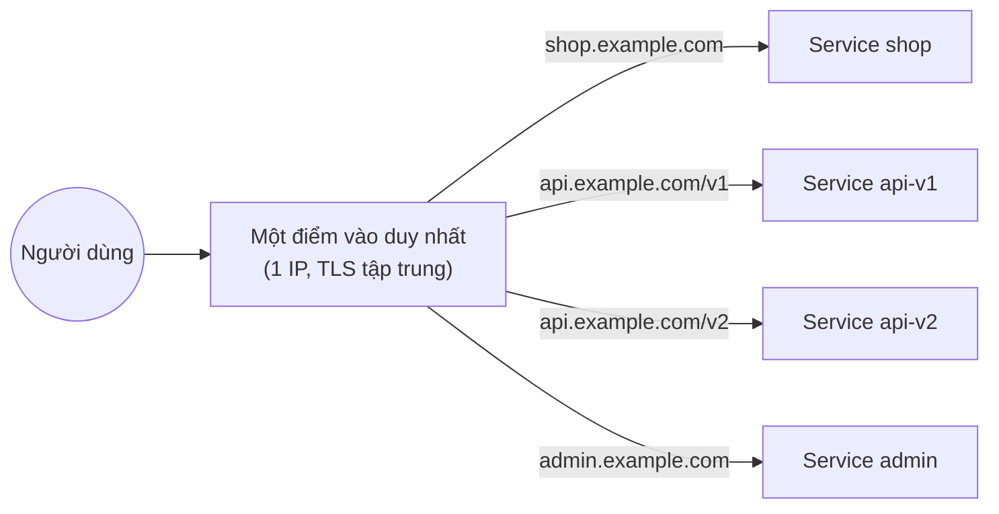
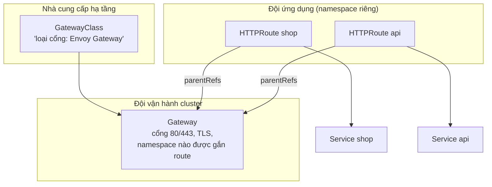

# Ingress & Gateway API

::: info Mục tiêu bài học
- Hiểu vì sao cần một "cổng vào" HTTP chung thay vì mỗi dịch vụ một LoadBalancer.
- Viết **Ingress** định tuyến theo tên miền, đường dẫn, kèm TLS.
- Nắm tình trạng **ingress-nginx đã ngừng phát triển** và các lựa chọn thay thế.
- Dùng **Gateway API** (GatewayClass, Gateway, HTTPRoute), chia traffic canary.
:::

## 1. Bài toán

Bạn có 10 dịch vụ web. Dùng Service `LoadBalancer` cho từng cái nghĩa là 10 IP công khai, 10 load balancer tính phí, cấu hình TLS ở 10 nơi. Điều ta muốn:



Kubernetes có hai API cho việc này: **Ingress** (cũ, đơn giản, rất phổ biến) và **Gateway API** (mới, mạnh hơn, là hướng đi chính thức).

## 2. Ingress

**Ingress** là đối tượng mô tả luật định tuyến HTTP. Bản thân nó **không làm gì** — cần một **Ingress controller** (một reverse proxy chạy trong cluster) đọc các Ingress và xử lý traffic.

```yaml
apiVersion: networking.k8s.io/v1
kind: Ingress
metadata:
  name: shop
spec:
  ingressClassName: traefik         # controller nào xử lý Ingress này
  tls:
    - hosts: [shop.example.com]
      secretName: shop-tls          # Secret kiểu kubernetes.io/tls
  rules:
    - host: shop.example.com
      http:
        paths:
          - path: /api
            pathType: Prefix        # Prefix | Exact | ImplementationSpecific
            backend:
              service:
                name: shop-api
                port:
                  number: 8080
          - path: /
            pathType: Prefix
            backend:
              service:
                name: shop-web
                port:
                  number: 80
```

- `pathType: Prefix` khớp theo từng đoạn đường dẫn: `/api` khớp `/api`, `/api/orders` nhưng không khớp `/apis`.
- Đường dẫn dài hơn được ưu tiên khi nhiều luật cùng khớp.
- Tính năng nâng cao (rewrite, rate limit, xác thực...) không có trong chuẩn — mỗi controller tự định nghĩa bằng **annotation** riêng, khiến cấu hình khó chuyển đổi giữa các controller.

::: danger ingress-nginx đã ngừng phát triển
Dự án **ingress-nginx** của cộng đồng Kubernetes — từng là Ingress controller phổ biến nhất — đã bị **cho nghỉ hưu**: chỉ được bảo trì "best-effort" tới **tháng 3/2026**, sau đó **không còn bản phát hành, bản sửa lỗi hay bản vá bảo mật**. Bản đã cài vẫn chạy, nhưng bạn nên lên kế hoạch chuyển đổi:

- Sang **Gateway API** (khuyến nghị) — công cụ [ingress2gateway](https://github.com/kubernetes-sigs/ingress2gateway) giúp chuyển đổi manifest tự động.
- Hoặc sang một Ingress controller còn được duy trì: **Traefik**, **HAProxy Ingress**, **Contour**, **Kong**, **NGINX Ingress Controller** của F5/NGINX (dự án khác, không phải ingress-nginx)...

Nhiều hướng dẫn cũ trên mạng (kể cả `minikube addons enable ingress`) vẫn dùng ingress-nginx — hãy lưu ý khi tham khảo.
:::

### Thực hành Ingress với Traefik

Cluster kind trong bài cài đặt đã map cổng **30100** ra máy bạn. Cài Traefik bằng Helm (Helm được giới thiệu chi tiết ở [bài Helm](/trung-cap/helm); tạm thời chỉ cần [cài Helm](https://helm.sh/docs/intro/install/)):

```bash
helm repo add traefik https://traefik.github.io/charts
helm repo update
helm install traefik traefik/traefik -n traefik --create-namespace \
  --set service.type=NodePort \
  --set ports.web.nodePort=30100
kubectl get pods -n traefik
kubectl get ingressclass          # traefik (default)
```

Triển khai hai ứng dụng và một Ingress:

```yaml
# ingress-demo.yaml
apiVersion: apps/v1
kind: Deployment
metadata:
  name: whoami
spec:
  replicas: 2
  selector: { matchLabels: { app: whoami } }
  template:
    metadata: { labels: { app: whoami } }
    spec:
      containers:
        - name: whoami
          image: traefik/whoami:v1.11
          ports: [{ containerPort: 80 }]
---
apiVersion: v1
kind: Service
metadata:
  name: whoami
spec:
  selector: { app: whoami }
  ports: [{ port: 80 }]
---
apiVersion: apps/v1
kind: Deployment
metadata:
  name: podinfo
spec:
  replicas: 1
  selector: { matchLabels: { app: podinfo } }
  template:
    metadata: { labels: { app: podinfo } }
    spec:
      containers:
        - name: podinfo
          image: ghcr.io/stefanprodan/podinfo:6.15.0
          ports: [{ containerPort: 9898 }]
---
apiVersion: v1
kind: Service
metadata:
  name: podinfo
spec:
  selector: { app: podinfo }
  ports: [{ port: 80, targetPort: 9898 }]
---
apiVersion: networking.k8s.io/v1
kind: Ingress
metadata:
  name: demo
spec:
  ingressClassName: traefik
  rules:
    - host: whoami.local
      http:
        paths:
          - path: /
            pathType: Prefix
            backend: { service: { name: whoami, port: { number: 80 } } }
    - host: podinfo.local
      http:
        paths:
          - path: /
            pathType: Prefix
            backend: { service: { name: podinfo, port: { number: 80 } } }
```

```bash
kubectl apply -f ingress-demo.yaml
curl -H "Host: whoami.local" http://localhost:30100
curl -H "Host: podinfo.local" http://localhost:30100
```

Header `Host` quyết định request đi tới dịch vụ nào — cùng một IP/cổng phục vụ nhiều website. Muốn mở bằng trình duyệt, thêm `127.0.0.1 whoami.local podinfo.local` vào file hosts (Windows: `C:\Windows\System32\drivers\etc\hosts`) rồi truy cập `http://whoami.local:30100`.

## 3. Gateway API

**Gateway API** là thế hệ kế tiếp của Ingress (GA từ 2023, hiện ở v1.6), giải quyết các hạn chế của Ingress:

- **Tách vai trò** rõ ràng thay vì một đối tượng ôm mọi thứ.
- **Tính năng chuẩn hóa** (chia trọng số, khớp header, chuyển hướng, rewrite, mirror...) — không phụ thuộc annotation riêng.
- Hỗ trợ cả **HTTP, gRPC, TLS, TCP, UDP**.



| Đối tượng | Ai quản lý | Mô tả |
| --- | --- | --- |
| `GatewayClass` | Nhà cung cấp hạ tầng | Loại gateway (controller nào triển khai) — giống `IngressClass` |
| `Gateway` | Đội vận hành | Một điểm vào cụ thể: listener (cổng, giao thức, hostname), TLS, chính sách gắn route |
| `HTTPRoute` | Đội ứng dụng | Luật định tuyến tới Service của mình |

Các implementation phổ biến: **Envoy Gateway**, **Cilium**, **Istio**, **Traefik**, **Kong**, **NGINX Gateway Fabric**, **Contour**, cùng gateway của các cloud (GKE, AWS, Azure).

### Thực hành Gateway API với Envoy Gateway

```bash
# 1. Cài Envoy Gateway (kèm CRD của Gateway API)
kubectl apply --server-side -f https://github.com/envoyproxy/gateway/releases/download/v1.9.2/install.yaml
kubectl wait --timeout=5m -n envoy-gateway-system deployment/envoy-gateway --for=condition=Available

# 2. Ví dụ mẫu: GatewayClass "eg", Gateway "eg", backend và HTTPRoute cho www.example.com
kubectl apply -f https://github.com/envoyproxy/gateway/releases/download/v1.9.2/quickstart.yaml -n default
kubectl get gatewayclass,gateway,httproute
```

Trên kind, Service của gateway là `LoadBalancer` nên `EXTERNAL-IP` sẽ `<pending>` — ta dùng port-forward để thử:

::: code-group

```bash [bash]
ENVOY_SERVICE=$(kubectl get svc -n envoy-gateway-system \
  --selector=gateway.envoyproxy.io/owning-gateway-namespace=default,gateway.envoyproxy.io/owning-gateway-name=eg \
  -o jsonpath='{.items[0].metadata.name}')
kubectl -n envoy-gateway-system port-forward service/$ENVOY_SERVICE 8888:80 &
curl --header "Host: www.example.com" http://localhost:8888/get
```

```powershell [PowerShell]
$ENVOY_SERVICE = kubectl get svc -n envoy-gateway-system `
  --selector=gateway.envoyproxy.io/owning-gateway-namespace=default,gateway.envoyproxy.io/owning-gateway-name=eg `
  -o jsonpath='{.items[0].metadata.name}'
Start-Job { kubectl -n envoy-gateway-system port-forward service/$using:ENVOY_SERVICE 8888:80 }
curl.exe --header "Host: www.example.com" http://localhost:8888/get
```

:::

### Viết HTTPRoute của riêng bạn

Định tuyến `podinfo.example.com` tới Service `podinfo` (đã tạo ở phần Ingress), kèm khớp header:

```yaml
apiVersion: gateway.networking.k8s.io/v1
kind: HTTPRoute
metadata:
  name: podinfo
spec:
  parentRefs:
    - name: eg                       # gắn vào Gateway "eg"
  hostnames: ["podinfo.example.com"]
  rules:
    - matches:
        - headers:
            - name: x-beta-user
              value: "true"
      backendRefs:
        - name: whoami               # người dùng beta đi tới whoami
          port: 80
    - matches:
        - path: { type: PathPrefix, value: / }
      backendRefs:
        - name: podinfo
          port: 80
```

```bash
curl -H "Host: podinfo.example.com" http://localhost:8888/
curl -H "Host: podinfo.example.com" -H "x-beta-user: true" http://localhost:8888/
```

### Chia traffic canary bằng trọng số

```yaml
rules:
  - backendRefs:
      - name: shop-v1
        port: 80
        weight: 90          # 90% traffic
      - name: shop-v2
        port: 80
        weight: 10          # 10% traffic tới phiên bản mới
```

Tăng dần trọng số của `shop-v2` khi các chỉ số (tỉ lệ lỗi, độ trễ) ổn định — các công cụ như Argo Rollouts, Flagger tự động hóa quá trình này.

## 4. HTTPS và chứng chỉ

- TLS kết thúc tại Ingress/Gateway; chứng chỉ lưu trong Secret kiểu `kubernetes.io/tls`.
- **cert-manager** tự động xin và gia hạn chứng chỉ (Let's Encrypt, CA nội bộ) cho cả Ingress lẫn Gateway — gần như là công cụ bắt buộc trong production.

```yaml
# Listener HTTPS trên Gateway
listeners:
  - name: https
    protocol: HTTPS
    port: 443
    hostname: "*.example.com"
    tls:
      mode: Terminate
      certificateRefs:
        - name: wildcard-example-com-tls
```

## 5. Ingress hay Gateway API?

| Tiêu chí | Ingress | Gateway API |
| --- | --- | --- |
| Trạng thái | GA, ổn định nhưng không phát triển thêm tính năng | GA, đang phát triển tích cực — hướng đi chính thức |
| Tính năng nâng cao | Qua annotation riêng của controller | Chuẩn hóa trong API |
| Phân vai | Một đối tượng | GatewayClass / Gateway / Route |
| Giao thức | HTTP/HTTPS | HTTP, gRPC, TLS, TCP, UDP |
| Hệ sinh thái tài liệu | Rất nhiều (nhưng nhiều tài liệu dùng ingress-nginx) | Đang tăng nhanh |

**Lời khuyên:** dự án mới hãy bắt đầu với **Gateway API**. Hệ thống đang dùng Ingress vẫn chạy tốt — nếu đang dùng ingress-nginx, ưu tiên lập kế hoạch chuyển đổi.

## Thực hành

**Bài 1.** Thêm vào Ingress `demo` một đường dẫn `/api` trên host `whoami.local` trỏ tới Service `podinfo`. Kiểm tra bằng curl.

::: details Xem lời giải
Thêm vào rule của `whoami.local`, **trước** path `/` (dù thứ tự không bắt buộc vì path dài hơn được ưu tiên):
```yaml
          - path: /api
            pathType: Prefix
            backend: { service: { name: podinfo, port: { number: 80 } } }
```
```bash
kubectl apply -f ingress-demo.yaml
curl -H "Host: whoami.local" http://localhost:30100/api/info   # trả về JSON của podinfo
```
:::

**Bài 2.** Viết HTTPRoute chia traffic 80/20 giữa Service `whoami` và `podinfo` cho host `split.example.com`. Gọi 20 lần và đếm.

::: details Xem lời giải
```yaml
apiVersion: gateway.networking.k8s.io/v1
kind: HTTPRoute
metadata:
  name: split
spec:
  parentRefs: [{ name: eg }]
  hostnames: ["split.example.com"]
  rules:
    - backendRefs:
        - { name: whoami, port: 80, weight: 80 }
        - { name: podinfo, port: 80, weight: 20 }
```
```bash
for i in $(seq 1 20); do curl -s -H "Host: split.example.com" http://localhost:8888/ | head -c 20; echo; done
```
Khoảng 16 dòng bắt đầu bằng `Hostname:` (whoami) và 4 dòng JSON (podinfo) — tỉ lệ dao động quanh 80/20.
:::

## Lỗi thường gặp

| Triệu chứng | Nguyên nhân |
| --- | --- |
| 404 từ controller | Sai `host`/`path`, hoặc thiếu header Host khi thử bằng IP |
| 503 / "no healthy upstream" | Service không có endpoint (selector sai, Pod chưa Ready) |
| Ingress không được xử lý | Thiếu controller hoặc `ingressClassName` sai |
| HTTPRoute không có tác dụng | Xem `kubectl describe httproute` → điều kiện `Accepted`/`ResolvedRefs`; Gateway có cho phép route từ namespace đó không |
| Chứng chỉ không hợp lệ | Secret TLS sai namespace hoặc sai tên |

## Tóm tắt

- Ingress/Gateway là cổng vào HTTP tầng 7 dùng chung: định tuyến theo host, path, header và kết thúc TLS.
- Ingress cần controller; **ingress-nginx đã ngừng phát triển** (bảo trì tới 3/2026) — chọn controller khác hoặc chuyển sang Gateway API.
- Gateway API tách vai trò GatewayClass / Gateway / HTTPRoute, chuẩn hóa tính năng như chia trọng số canary.
- Dùng cert-manager để tự động hóa chứng chỉ HTTPS.

## Kiểm tra kiến thức

<Quiz />
