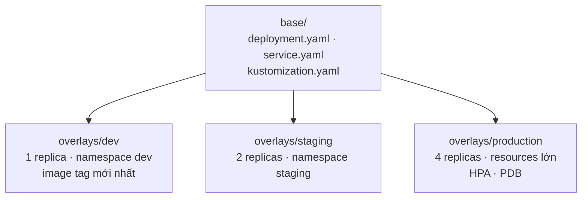

# Kustomize & nhiều môi trường

::: info Mục tiêu bài học
- Tổ chức manifest theo mô hình **base + overlays** cho dev, staging, production.
- Dùng các tính năng chính: `namespace`, `namePrefix`, `labels`, `images`, `replicas`, `patches`.
- Sinh ConfigMap/Secret có **hash** để tự động rollout khi cấu hình thay đổi.
- Biết khi nào chọn Kustomize, khi nào chọn Helm.
:::

## 1. Ý tưởng: YAML thuần + phần khác biệt

Thay vì template hóa (Helm), Kustomize giữ một bộ manifest **chuẩn, hợp lệ** làm **base**, và mỗi môi trường là một **overlay** chỉ mô tả *điểm khác*:



Kustomize **được tích hợp sẵn trong kubectl** — không cần cài thêm:

```bash
kubectl kustomize overlays/dev        # in ra manifest kết quả
kubectl apply -k overlays/dev         # áp dụng
kubectl diff -k overlays/production   # xem trước thay đổi
```

## 2. Cấu trúc dự án mẫu

```text
shop/
├── base/
│   ├── kustomization.yaml
│   ├── deployment.yaml
│   └── service.yaml
└── overlays/
    ├── dev/
    │   ├── kustomization.yaml
    │   └── app.env
    └── production/
        ├── kustomization.yaml
        ├── app.env
        ├── resources-patch.yaml
        └── pdb.yaml
```

### Base

::: code-group

```yaml [base/kustomization.yaml]
apiVersion: kustomize.config.k8s.io/v1beta1
kind: Kustomization
resources:
  - deployment.yaml
  - service.yaml
labels:
  - pairs:
      app.kubernetes.io/name: shop
    includeSelectors: true       # thêm cả vào selector của Deployment/Service
```

```yaml [base/deployment.yaml]
apiVersion: apps/v1
kind: Deployment
metadata:
  name: shop
spec:
  replicas: 1
  selector:
    matchLabels:
      app: shop
  template:
    metadata:
      labels:
        app: shop
    spec:
      containers:
        - name: web
          image: nginx:1.30
          ports:
            - containerPort: 80
          envFrom:
            - configMapRef:
                name: shop-config
```

```yaml [base/service.yaml]
apiVersion: v1
kind: Service
metadata:
  name: shop
spec:
  selector:
    app: shop
  ports:
    - port: 80
```

:::

### Overlay dev

::: code-group

```yaml [overlays/dev/kustomization.yaml]
apiVersion: kustomize.config.k8s.io/v1beta1
kind: Kustomization
namespace: shop-dev                # đặt namespace cho mọi đối tượng
namePrefix: dev-                   # shop → dev-shop
resources:
  - ../../base
images:
  - name: nginx                    # đổi image mà không cần patch
    newTag: "1.31"
configMapGenerator:
  - name: shop-config
    envs:
      - app.env
```

```ini [overlays/dev/app.env]
APP_MODE=development
LOG_LEVEL=debug
```

:::

### Overlay production

::: code-group

```yaml [overlays/production/kustomization.yaml]
apiVersion: kustomize.config.k8s.io/v1beta1
kind: Kustomization
namespace: shop-prod
resources:
  - ../../base
  - pdb.yaml                       # tài nguyên chỉ có ở production
replicas:
  - name: shop
    count: 4
images:
  - name: nginx
    newTag: "1.30.6"
configMapGenerator:
  - name: shop-config
    envs:
      - app.env
patches:
  - path: resources-patch.yaml     # strategic merge patch
  - target:                        # JSON patch nhắm theo kind/name
      kind: Deployment
      name: shop
    patch: |-
      - op: add
        path: /spec/template/spec/containers/0/readinessProbe
        value:
          httpGet: { path: /, port: 80 }
          periodSeconds: 5
```

```yaml [overlays/production/resources-patch.yaml]
apiVersion: apps/v1
kind: Deployment
metadata:
  name: shop
spec:
  template:
    spec:
      containers:
        - name: web               # khớp container theo tên rồi trộn trường
          resources:
            requests: { cpu: 250m, memory: 256Mi }
            limits: { memory: 512Mi }
```

```yaml [overlays/production/pdb.yaml]
apiVersion: policy/v1
kind: PodDisruptionBudget
metadata:
  name: shop
spec:
  minAvailable: 2
  selector:
    matchLabels:
      app: shop
```

```ini [overlays/production/app.env]
APP_MODE=production
LOG_LEVEL=warn
```

:::

```bash
kubectl create namespace shop-dev
kubectl create namespace shop-prod
kubectl apply -k overlays/dev
kubectl apply -k overlays/production
kubectl get deploy,cm -n shop-prod
```

```text
NAME                   READY   UP-TO-DATE   AVAILABLE   AGE
deployment.apps/shop   4/4     4            4           20s

NAME                              DATA   AGE
configmap/shop-config-2m8h9fk7bt  2      20s
```

## 3. Generator và hash

`configMapGenerator`/`secretGenerator` sinh ConfigMap/Secret với **hậu tố hash** theo nội dung, và tự sửa mọi tham chiếu (`envFrom`, `volumes`...) sang tên mới. Đổi `LOG_LEVEL` trong `app.env` → tên ConfigMap đổi → Pod template đổi → **Deployment tự rollout**. Không cần `kubectl rollout restart` nữa.

```yaml
secretGenerator:
  - name: db-credentials
    literals:
      - DB_USER=shop
    files:
      - password.txt            # đừng commit file này! dùng SOPS/External Secrets
```

## 4. Các trường hay dùng

| Trường | Tác dụng |
| --- | --- |
| `resources` | File/thư mục/base đầu vào (có thể là URL Git) |
| `namespace` | Gán namespace cho mọi đối tượng |
| `namePrefix` / `nameSuffix` | Thêm tiền tố/hậu tố cho tên (tham chiếu tự cập nhật theo) |
| `labels` | Thêm label (tùy chọn cả selector) — thay cho `commonLabels` cũ |
| `commonAnnotations` | Thêm annotation |
| `images` | Đổi tên/tag/digest image |
| `replicas` | Đổi số replicas |
| `patches` | Strategic merge patch hoặc JSON patch (RFC 6902) |
| `configMapGenerator` / `secretGenerator` | Sinh ConfigMap/Secret có hash |
| `components` | Khối tính năng tái sử dụng, bật/tắt theo overlay (ví dụ "monitoring", "tls") |

## 5. Kustomize trong CI/CD

Pipeline build image mới rồi cập nhật tag trong overlay:

```bash
cd overlays/production
kustomize edit set image nginx=registry.example.com/shop:sha-3f2c9a1
git commit -am "deploy shop sha-3f2c9a1" && git push
```

Công cụ GitOps (Argo CD, Flux — Phần 3) hiểu Kustomize sẵn: chỉ cần trỏ vào thư mục overlay trong Git.

## 6. Kustomize hay Helm?

| | Kustomize | Helm |
| --- | --- | --- |
| Cách tiếp cận | Patch trên YAML thuần | Template + values |
| Đường cong học tập | Thấp | Trung bình (Go template) |
| Phân phối cho người khác | Kém (không có khái niệm gói/phiên bản) | Tốt (chart, repo, OCI, phiên bản) |
| Logic điều kiện, vòng lặp | Hạn chế (cố ý) | Mạnh |
| Quản lý vòng đời (rollback, hook) | Không — dựa vào kubectl/GitOps | Có |
| Có sẵn trong kubectl | Có | Không |

**Thực tế** nhiều đội dùng **cả hai**: Helm để cài phần mềm bên thứ ba, Kustomize cho ứng dụng nội bộ — hoặc dùng Kustomize để "vá" thêm lên output của một Helm chart.

## Thực hành

**Bài 1.** Dựng cấu trúc `shop/` như trên. Kiểm tra kết quả render của overlay dev: tên Deployment, namespace, image và tên ConfigMap là gì?

::: details Xem lời giải
```bash
kubectl kustomize overlays/dev | grep -E "name:|namespace:|image:"
```
Deployment `dev-shop`, namespace `shop-dev`, image `nginx:1.31`, ConfigMap `dev-shop-config-<hash>` — và `envFrom` trong Deployment đã tự trỏ sang đúng tên có hash.
:::

**Bài 2.** Đổi `LOG_LEVEL=info` trong `overlays/dev/app.env`, apply lại và quan sát Pod.

::: details Xem lời giải
```bash
kubectl apply -k overlays/dev
kubectl get cm -n shop-dev          # xuất hiện ConfigMap mới với hash khác
kubectl get pods -n shop-dev -w     # Pod cũ được thay bằng Pod mới (rollout tự động)
```
ConfigMap cũ vẫn còn (Kustomize không tự xóa); có thể dọn bằng `kubectl apply -k ... --prune` có chọn lọc label, hoặc để công cụ GitOps quản lý việc dọn dẹp.
:::

**Bài 3.** Thêm một `component` tên `debug` (sidecar busybox) chỉ bật trong overlay dev.

::: details Xem lời giải
```yaml
# components/debug/kustomization.yaml
apiVersion: kustomize.config.k8s.io/v1alpha1
kind: Component
patches:
  - target: { kind: Deployment, name: shop }
    patch: |-
      - op: add
        path: /spec/template/spec/containers/-
        value:
          name: debug
          image: busybox:1.37
          command: ["sh", "-c", "sleep infinity"]
```
```yaml
# overlays/dev/kustomization.yaml — thêm:
components:
  - ../../components/debug
```
:::

## Tóm tắt

- Kustomize = base (YAML thuần) + overlays (điểm khác biệt), tích hợp sẵn: `kubectl apply -k`.
- `images`, `replicas`, `namespace`, `namePrefix`, `labels`, `patches` xử lý phần lớn nhu cầu khác biệt giữa môi trường.
- Generator thêm hash vào tên ConfigMap/Secret → tự rollout khi cấu hình đổi.
- Helm mạnh về đóng gói/phân phối; Kustomize gọn nhẹ cho ứng dụng nội bộ — thường dùng kết hợp.

## Kiểm tra kiến thức

<Quiz />
