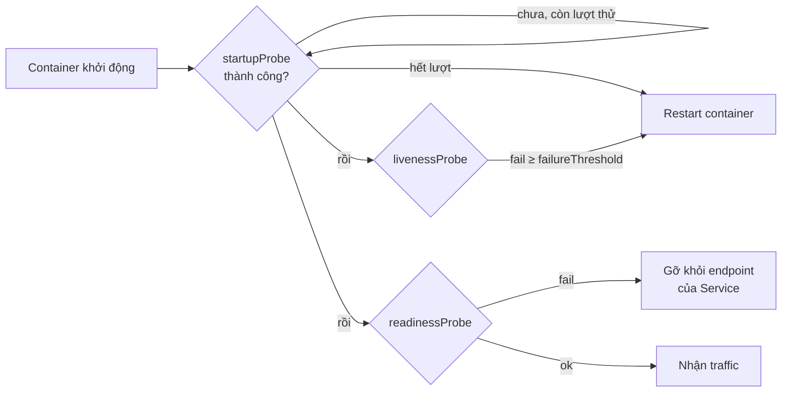

# Health check với Probes

::: info Mục tiêu bài học
- Phân biệt **liveness**, **readiness** và **startup** probe.
- Dùng 4 cơ chế kiểm tra: `httpGet`, `tcpSocket`, `exec`, `grpc`.
- Tinh chỉnh tham số thời gian cho phù hợp ứng dụng.
- Tránh các sai lầm khiến probe gây ra sự cố thay vì ngăn chặn sự cố.
:::

## 1. Tiến trình còn chạy ≠ ứng dụng khỏe

Mặc định, kubelet chỉ biết container **đang chạy hay đã thoát**. Nhưng nhiều tình huống tiến trình vẫn chạy mà ứng dụng vô dụng:

- Bị **deadlock** hoặc treo, không trả lời request.
- Đang **khởi động**: nạp cấu hình, làm nóng cache, chạy migration...
- **Quá tải** tạm thời, cần được "nghỉ" không nhận thêm traffic.

**Probe** là cách bạn dạy Kubernetes kiểm tra sức khỏe *thật* của ứng dụng.

## 2. Ba loại probe

| Probe | Câu hỏi | Khi thất bại | Dùng khi |
| --- | --- | --- | --- |
| **startupProbe** | Đã khởi động xong chưa? | Hết lượt thử → khởi động lại container | Ứng dụng khởi động chậm |
| **livenessProbe** | Còn sống không? | **Khởi động lại container** | Ứng dụng có thể treo |
| **readinessProbe** | Sẵn sàng nhận traffic chưa? | **Gỡ khỏi Service** (không restart) | Hầu hết mọi dịch vụ |



Khi có startupProbe, liveness và readiness **chỉ bắt đầu chạy sau khi startupProbe thành công**.

## 3. Cơ chế kiểm tra

```yaml
# HTTP: thành công nếu mã trạng thái 200–399
httpGet:
  path: /healthz
  port: 8080
  httpHeaders:
    - name: X-Probe
      value: kubelet

# TCP: thành công nếu mở được kết nối
tcpSocket:
  port: 5432

# Lệnh: thành công nếu lệnh thoát với mã 0
exec:
  command: ["redis-cli", "ping"]

# gRPC: dùng chuẩn gRPC Health Checking Protocol
grpc:
  port: 9090
```

::: tip Ưu tiên httpGet / tcpSocket / grpc
`exec` phải tạo tiến trình mới trong container ở mỗi lần kiểm tra — tốn tài nguyên hơn khi có hàng trăm Pod. Hãy để ứng dụng tự cung cấp endpoint `/healthz`, `/readyz`.
:::

## 4. Tham số thời gian

| Tham số | Mặc định | Ý nghĩa |
| --- | --- | --- |
| `initialDelaySeconds` | 0 | Chờ bao lâu sau khi container khởi động mới bắt đầu probe |
| `periodSeconds` | 10 | Chu kỳ kiểm tra |
| `timeoutSeconds` | 1 | Quá thời gian này coi như thất bại |
| `failureThreshold` | 3 | Số lần thất bại liên tiếp để kết luận "hỏng" |
| `successThreshold` | 1 | Số lần thành công liên tiếp để kết luận "khỏe" (liveness/startup bắt buộc là 1) |

Thời gian phát hiện sự cố ≈ `periodSeconds × failureThreshold`. Với startupProbe, thời gian chờ khởi động tối đa ≈ `failureThreshold × periodSeconds`.

## 5. Ví dụ hoàn chỉnh với podinfo

[podinfo](https://github.com/stefanprodan/podinfo) là ứng dụng mẫu có sẵn `/healthz`, `/readyz`, và cả endpoint để *bật/tắt* trạng thái sẵn sàng — rất hợp để thực hành.

```yaml
# podinfo.yaml
apiVersion: apps/v1
kind: Deployment
metadata:
  name: podinfo
spec:
  replicas: 2
  selector:
    matchLabels:
      app: podinfo
  template:
    metadata:
      labels:
        app: podinfo
    spec:
      containers:
        - name: podinfo
          image: ghcr.io/stefanprodan/podinfo:6.15.0
          ports:
            - name: http
              containerPort: 9898
          startupProbe:
            httpGet: { path: /healthz, port: http }
            periodSeconds: 2
            failureThreshold: 30          # cho phép tối đa 60 giây để khởi động
          livenessProbe:
            httpGet: { path: /healthz, port: http }
            periodSeconds: 10
            failureThreshold: 3
          readinessProbe:
            httpGet: { path: /readyz, port: http }
            periodSeconds: 5
            failureThreshold: 2
---
apiVersion: v1
kind: Service
metadata:
  name: podinfo
spec:
  selector:
    app: podinfo
  ports:
    - port: 9898
      targetPort: http
```

```bash
kubectl apply -f podinfo.yaml
kubectl get pods -l app=podinfo -w
```

### Thí nghiệm 1: readiness — Pod bị gỡ khỏi Service

```bash
POD=$(kubectl get pod -l app=podinfo -o jsonpath='{.items[0].metadata.name}')
kubectl port-forward pod/$POD 9898:9898 &      # PowerShell: mở cửa sổ terminal khác để chạy port-forward
curl -X POST http://localhost:9898/readyz/disable

kubectl get pods -l app=podinfo                 # Pod đó còn READY 0/1
kubectl get endpointslices -l kubernetes.io/service-name=podinfo   # chỉ còn 1 IP
```

Container **không** bị khởi động lại — chỉ ngừng nhận traffic. Bật lại bằng `curl -X POST http://localhost:9898/readyz/enable`.

### Thí nghiệm 2: liveness — container bị khởi động lại

```bash
curl http://localhost:9898/panic          # podinfo tự crash với mã thoát 255
kubectl get pods -l app=podinfo           # RESTARTS tăng lên 1
kubectl describe pod $POD | tail -n 15    # xem Events
```

Ở thí nghiệm này tiến trình thoát hẳn nên kubelet tự khởi động lại kể cả không có liveness. Liveness thực sự hữu ích khi ứng dụng **treo mà không thoát** — kubelet chỉ phát hiện được nhờ probe.

## 6. Probe và rolling update

Trong lúc cập nhật, Deployment chỉ xóa Pod cũ khi Pod mới đã **Ready**. Không có readinessProbe, Pod "Ready" ngay khi container chạy — kể cả khi ứng dụng chưa nghe cổng. Kết quả: người dùng gặp lỗi 502/connection refused mỗi lần deploy.

Kết hợp thêm `minReadySeconds` để Pod phải Ready ổn định một khoảng thời gian mới được tính là `Available`:

```yaml
spec:
  minReadySeconds: 10
```

## 7. Thực hành tốt

- **Luôn có readinessProbe** cho dịch vụ nhận traffic.
- **Liveness kiểm tra chính tiến trình**, không kiểm tra database, cache, API bên ngoài. Nếu không chắc chắn ứng dụng có thể treo, **có thể bỏ liveness** — một liveness sai còn tệ hơn không có.
- **Endpoint probe phải nhẹ và nhanh**: không truy vấn nặng, không gọi dây chuyền sang dịch vụ khác.
- **Dùng startupProbe** thay vì đặt `initialDelaySeconds` thật lớn cho liveness.
- **`timeoutSeconds: 1` là rất ngắn** với ứng dụng hay bị GC dừng lâu (Java, .NET): cân nhắc 2–5 giây.
- Readiness có thể dùng để **tự bảo vệ khi quá tải**: trả về lỗi khi hàng đợi nội bộ đầy để Service chuyển traffic sang Pod khác.

## Thực hành

**Bài 1.** Thêm probe cho Deployment `nginx` (image `nginx:1.30`): readiness kiểm tra HTTP `/` cổng 80 mỗi 5 giây; liveness kiểm tra TCP cổng 80 mỗi 10 giây.

::: details Xem lời giải
```yaml
containers:
  - name: nginx
    image: nginx:1.30
    ports:
      - containerPort: 80
    readinessProbe:
      httpGet: { path: /, port: 80 }
      periodSeconds: 5
    livenessProbe:
      tcpSocket: { port: 80 }
      periodSeconds: 10
```
:::

**Bài 2.** Đặt readinessProbe của podinfo trỏ tới đường dẫn sai `/khong-co`. Dự đoán và kiểm chứng: trạng thái Pod, endpoint của Service, và rollout có hoàn tất không?

::: details Xem lời giải
- Pod mới `Running` nhưng `READY 0/1` (podinfo trả 404 cho đường dẫn lạ → probe thất bại).
- Pod mới không được đưa vào EndpointSlice; Pod cũ vẫn phục vụ.
- Rollout kẹt: `kubectl rollout status` chờ mãi; Events có dòng `Readiness probe failed: HTTP probe failed with statuscode: 404`.
- Sửa lại đường dẫn hoặc `kubectl rollout undo deployment/podinfo`.
:::

**Bài 3.** Viết probe cho Redis dùng lệnh `redis-cli ping` cho readiness và kiểm tra TCP cổng 6379 cho liveness.

::: details Xem lời giải
```yaml
readinessProbe:
  exec:
    command: ["redis-cli", "ping"]
  periodSeconds: 5
livenessProbe:
  tcpSocket:
    port: 6379
  periodSeconds: 10
```
:::

## Lỗi thường gặp

| Triệu chứng | Nguyên nhân thường gặp |
| --- | --- |
| Pod `Running` nhưng `READY 0/1` mãi | readinessProbe sai path/port, hoặc ứng dụng nghe `127.0.0.1` thay vì `0.0.0.0` |
| Container restart đều đặn mỗi vài phút | livenessProbe quá chặt (timeout ngắn, ngưỡng thấp) hoặc kiểm tra phụ thuộc bên ngoài |
| Pod khởi động chậm bị kill liên tục | Thiếu startupProbe |
| Lỗi 502 ngắn mỗi lần deploy | Thiếu readinessProbe hoặc ứng dụng không xử lý SIGTERM |

## Tóm tắt

- **startup** bảo vệ giai đoạn khởi động; **liveness** khởi động lại container treo; **readiness** quyết định có nhận traffic hay không.
- Cơ chế: `httpGet`, `tcpSocket`, `exec`, `grpc`; điều chỉnh bằng `periodSeconds`, `timeoutSeconds`, `failureThreshold`...
- Readiness là điều kiện để rolling update an toàn.
- Liveness không kiểm tra phụ thuộc bên ngoài — tránh khởi động lại hàng loạt.

## Kiểm tra kiến thức

<Quiz />
