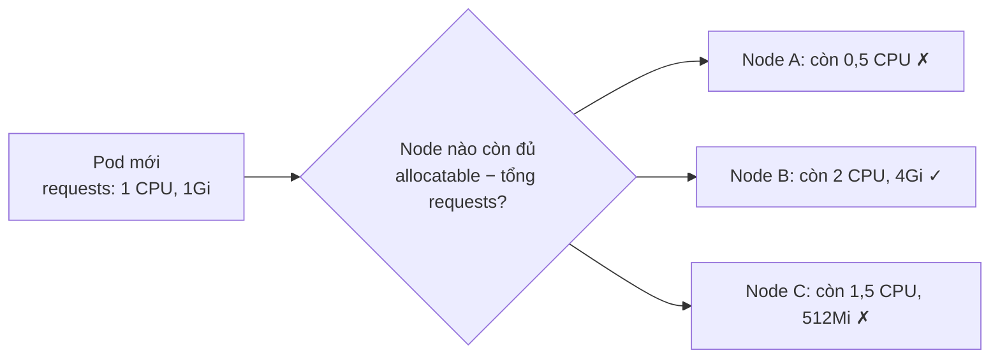

# Quản lý tài nguyên CPU & RAM

::: info Mục tiêu bài học
- Khai báo **requests** và **limits** đúng cách, hiểu đơn vị CPU và bộ nhớ.
- Giải thích được **OOMKilled** và **CPU throttling**.
- Nắm 3 **QoS class** và thứ tự Pod bị trục xuất khi node thiếu tài nguyên.
- Dùng **LimitRange** và **ResourceQuota** để quản trị namespace.
- Xem mức dùng thực tế với `kubectl top` và resize Pod tại chỗ.
:::

## 1. requests và limits

```yaml
spec:
  containers:
    - name: api
      image: ghcr.io/stefanprodan/podinfo:6.15.0
      resources:
        requests:          # mức đặt chỗ — dùng để XẾP LỊCH
          cpu: 250m
          memory: 128Mi
        limits:            # mức trần — bị CHẶN khi vượt
          cpu: "1"
          memory: 256Mi
```

| | requests | limits |
| --- | --- | --- |
| Dùng để | Scheduler chọn node có đủ chỗ | Kernel (cgroups) giới hạn mức dùng |
| CPU khi vượt | Được dùng thêm nếu node còn rảnh | **Bị throttle** (chạy chậm lại) |
| RAM khi vượt | Được dùng thêm nếu node còn rảnh | **Bị kill (OOMKilled)** |

**Đơn vị:**

- CPU: `1` = 1 vCPU/core; `500m` = 0,5 CPU; `100m` = 0,1 CPU.
- Bộ nhớ: `Mi`, `Gi` (lũy thừa 2: 1Mi = 1.048.576 byte) hoặc `M`, `G` (lũy thừa 10). Cẩn thận: `memory: 128m` là **128 milli-byte** — gần như chắc chắn là lỗi gõ!

## 2. Scheduler xếp Pod theo requests



- **Allocatable** = dung lượng node trừ phần dành cho hệ điều hành và kubelet.
- Scheduler cộng `requests` của các Pod — **không** nhìn mức dùng thực tế. Node có thể "đầy" về requests dù CPU đang rảnh, và ngược lại.
- Không còn node nào đủ → Pod `Pending` với sự kiện `0/3 nodes are available: 3 Insufficient cpu`.

```bash
kubectl describe node k8s-learn-worker | grep -A 8 "Allocated resources"
```

## 3. Khi vượt giới hạn

### Bộ nhớ: OOMKilled

Bộ nhớ không thể "lấy bớt lại", nên vượt `limits.memory` là kernel kill tiến trình:

```yaml
# oom-demo.yaml
apiVersion: v1
kind: Pod
metadata:
  name: oom-demo
spec:
  containers:
    - name: hog
      image: busybox:1.37
      command: ["sh", "-c", "tail /dev/zero"]   # đọc vô tận, giữ dữ liệu trong RAM
      resources:
        limits:
          memory: 64Mi
```

```bash
kubectl apply -f oom-demo.yaml
kubectl get pod oom-demo -w            # OOMKilled → CrashLoopBackOff
kubectl describe pod oom-demo | grep -A 3 "Last State"
#     Last State:     Terminated
#       Reason:       OOMKilled
#       Exit Code:    137
```

Exit code **137** = 128 + 9 (SIGKILL) — dấu hiệu kinh điển của OOM.

### CPU: throttling

CPU có thể chia theo thời gian, nên vượt `limits.cpu` chỉ khiến container bị **giới hạn** — ứng dụng chậm đi chứ không chết. Đây là nguồn gốc của nhiều sự cố "API thỉnh thoảng chậm bất thường" khó tìm.

::: tip Bàn luận: có nên đặt CPU limit?
Nhiều đội vận hành **luôn đặt memory limit** (tránh một Pod ăn hết RAM của node) nhưng **chỉ đặt CPU request, không đặt CPU limit** cho dịch vụ nhạy độ trễ — để Pod tận dụng CPU rảnh mà không bị throttle. Với môi trường nhiều team dùng chung, CPU limit giúp công bằng hơn. Hãy đo đạc thay vì đoán.
:::

## 4. QoS class và thứ tự bị trục xuất

Kubernetes tự xếp mỗi Pod vào một **QoS class** dựa trên requests/limits:

| QoS class | Điều kiện | Khi node thiếu RAM |
| --- | --- | --- |
| **Guaranteed** | Mọi container có `requests = limits` cho cả CPU và RAM | Bị trục xuất **sau cùng** |
| **Burstable** | Có ít nhất một request/limit nhưng không đạt Guaranteed | Ở giữa |
| **BestEffort** | Không khai báo requests/limits nào | Bị trục xuất **đầu tiên** |

```bash
kubectl get pod <pod> -o jsonpath='{.status.qosClass}'
```

Khi node cạn bộ nhớ, kubelet **trục xuất (evict)** Pod để tự bảo vệ — ưu tiên Pod BestEffort và Pod dùng vượt request nhiều nhất.

## 5. Xem mức dùng thực tế: metrics-server

`kubectl top` cần **metrics-server**. Cài trên kind (kubelet của kind dùng chứng chỉ tự ký nên cần thêm cờ `--kubelet-insecure-tls`):

```bash
kubectl apply -f https://github.com/kubernetes-sigs/metrics-server/releases/latest/download/components.yaml
kubectl patch -n kube-system deployment metrics-server --type=json \
  -p '[{"op":"add","path":"/spec/template/spec/containers/0/args/-","value":"--kubelet-insecure-tls"}]'
kubectl -n kube-system rollout status deployment metrics-server
```

Sau khoảng một phút:

```bash
kubectl top nodes
kubectl top pods -A --sort-by=memory
kubectl top pod <pod> --containers
```

::: warning Chỉ dùng `--kubelet-insecure-tls` cho môi trường học
Trên cluster thật, cấu hình chứng chỉ kubelet hợp lệ thay vì tắt xác minh TLS.
:::

## 6. Đặt requests/limits bao nhiêu là hợp lý?

1. Chạy ứng dụng với tải thực tế, quan sát qua `kubectl top` hoặc Prometheus/Grafana (Phần 3).
2. **requests ≈ mức dùng thường xuyên** (ví dụ phân vị P50–P90).
3. **memory limit** cao hơn đỉnh quan sát được một khoảng an toàn (ví dụ +25–50%).
4. Theo dõi `OOMKilled`, throttling, rồi điều chỉnh. **VerticalPodAutoscaler** (bài Autoscaling) có thể đưa ra khuyến nghị tự động.

Requests quá cao → lãng phí, cluster "đầy" sớm. Requests quá thấp → node bị nhồi quá tải, ứng dụng tranh chấp.

## 7. LimitRange — mặc định cho từng container

Ai quên khai báo resources sẽ có Pod BestEffort. **LimitRange** đặt giá trị mặc định và giới hạn trong một namespace:

```yaml
apiVersion: v1
kind: LimitRange
metadata:
  name: defaults
  namespace: dev
spec:
  limits:
    - type: Container
      defaultRequest:        # gán khi container không khai báo requests
        cpu: 100m
        memory: 128Mi
      default:               # gán khi container không khai báo limits
        memory: 256Mi
      max:                   # không ai được vượt
        cpu: "2"
        memory: 2Gi
```

## 8. ResourceQuota — trần cho cả namespace

```yaml
apiVersion: v1
kind: ResourceQuota
metadata:
  name: team-quota
  namespace: dev
spec:
  hard:
    requests.cpu: "4"
    requests.memory: 8Gi
    limits.memory: 16Gi
    pods: "30"
    services.loadbalancers: "1"
    persistentvolumeclaims: "10"
```

```bash
kubectl describe resourcequota team-quota -n dev
```

Khi namespace có quota về CPU/RAM, **mọi Pod mới bắt buộc khai báo** requests/limits tương ứng (hoặc được LimitRange gán mặc định) — nếu không sẽ bị từ chối với lỗi `failed quota: must specify limits.memory...`.

## 9. Resize Pod tại chỗ (GA từ v1.35)

Trước đây muốn đổi CPU/RAM phải tạo lại Pod. Từ v1.35, bạn có thể **thay đổi resources của Pod đang chạy** qua subresource `resize`:

```bash
kubectl patch pod api-0 --subresource resize --patch \
  '{"spec":{"containers":[{"name":"api","resources":{"requests":{"cpu":"500m"},"limits":{"cpu":"1"}}}]}}'

kubectl get pod api-0 -o jsonpath='{.status.containerStatuses[0].resources}'
```

`resizePolicy` trong container quy định có cần khởi động lại container khi đổi từng loại tài nguyên hay không (ví dụ CPU đổi nóng được, RAM thì cần restart với một số ứng dụng). Với Deployment, bạn vẫn sửa template như bình thường; resize tại chỗ hữu ích cho Pod lẻ, StatefulSet hoặc công cụ tự động như VPA.

## Thực hành

**Bài 1.** Tạo Pod yêu cầu `cpu: 100` (100 CPU). Quan sát trạng thái và đọc thông báo của scheduler.

::: details Xem lời giải
```bash
kubectl run greedy --image=nginx:1.30 --overrides='{"spec":{"containers":[{"name":"greedy","image":"nginx:1.30","resources":{"requests":{"cpu":"100"}}}]}}'
kubectl get pod greedy                   # Pending
kubectl describe pod greedy | tail -n 5  # 0/3 nodes are available: ... Insufficient cpu
kubectl delete pod greedy
```
:::

**Bài 2.** Tạo namespace `quota-lab` với ResourceQuota `pods: "2"`. Thử tạo Deployment 3 replicas trong đó. Có bao nhiêu Pod được tạo và lỗi hiện ở đâu?

::: details Xem lời giải
```bash
kubectl create namespace quota-lab
kubectl create quota pod-limit --hard=pods=2 -n quota-lab
kubectl create deployment web --image=nginx:1.30 --replicas=3 -n quota-lab
kubectl get pods -n quota-lab             # chỉ 2 Pod
kubectl get rs -n quota-lab               # DESIRED 3, CURRENT 2
kubectl describe rs -n quota-lab | grep -i quota
# Error creating: pods "web-..." is forbidden: exceeded quota: pod-limit ...
```
Lỗi không hiện ở Deployment hay Pod mà ở **ReplicaSet** — vì ReplicaSet là bên tạo Pod.
:::

**Bài 3.** Chạy lại `oom-demo` với `limits.memory: 64Mi`, kiểm tra QoS class. Sửa để Pod thuộc lớp Guaranteed.

::: details Xem lời giải
QoS hiện tại là `Burstable`... nhưng chú ý: khi chỉ khai báo `limits`, Kubernetes **tự gán requests = limits** cho tài nguyên đó. Pod chỉ có limit memory nên thiếu CPU → Burstable. Để Guaranteed, khai báo cả CPU và RAM với requests = limits:
```yaml
resources:
  requests: { cpu: 100m, memory: 64Mi }
  limits:   { cpu: 100m, memory: 64Mi }
```
(Pod này vẫn OOMKilled vì `tail /dev/zero` dùng RAM vô hạn — QoS không cứu được ứng dụng ngốn RAM.)
:::

## Lỗi thường gặp

- **Viết `memory: 512m`** thay vì `512Mi` → container gần như không có RAM, bị kill ngay.
- **Không đặt requests** → Pod BestEffort, scheduler xếp chồng lên một node, bị evict đầu tiên.
- **Requests bằng limits rất lớn "cho chắc"** → cluster nhanh chóng "hết chỗ" dù CPU thực tế nhàn rỗi.
- **Ứng dụng JVM/Node.js không biết giới hạn container** → đặt heap phù hợp (`-XX:MaxRAMPercentage`, `--max-old-space-size`) để tránh OOMKilled.

## Tóm tắt

- `requests` để xếp lịch, `limits` để chặn; vượt CPU limit bị throttle, vượt memory limit bị OOMKilled (exit 137).
- QoS: Guaranteed > Burstable > BestEffort (thứ tự được giữ lại khi thiếu tài nguyên).
- LimitRange đặt mặc định cho container; ResourceQuota đặt trần cho namespace.
- `kubectl top` cần metrics-server; v1.35+ hỗ trợ resize Pod tại chỗ.

## Kiểm tra kiến thức

<Quiz />
