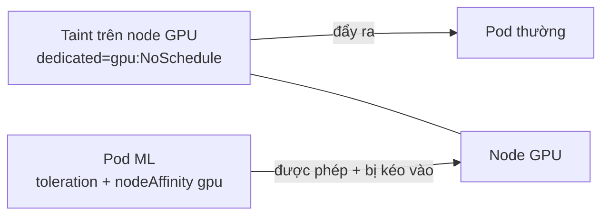

# Lập lịch Pod nâng cao

::: info Mục tiêu bài học
- Chỉ định Pod chạy trên node mong muốn bằng **nodeSelector** và **node affinity**.
- Đặt Pod gần nhau hoặc tách xa nhau bằng **pod affinity / anti-affinity**.
- Dành riêng node bằng **taints & tolerations**.
- Rải đều Pod theo node/zone với **topology spread constraints**.
- Ưu tiên Pod quan trọng (**PriorityClass**) và bảo vệ ứng dụng khi bảo trì (**PodDisruptionBudget**).
:::

## 1. Scheduler chọn node thế nào?

Với mỗi Pod chưa có node, scheduler:

1. **Lọc** các node không phù hợp: thiếu tài nguyên (requests), không khớp nodeSelector/affinity, có taint không chịu được, xung đột volume...
2. **Chấm điểm** các node còn lại: dàn đều Pod, cân bằng tài nguyên, ưu tiên node đã có image, affinity "ưu tiên"...
3. **Gán** Pod vào node điểm cao nhất.

Mặc định scheduler đã khá thông minh. Bài này dạy bạn đưa thêm "luật chơi" khi cần.

## 2. nodeSelector — đơn giản nhất

Gắn label cho node rồi yêu cầu Pod chạy trên node có label đó:

```bash
kubectl label node k8s-learn-worker disktype=ssd
kubectl get nodes --show-labels | grep disktype
```

```yaml
spec:
  nodeSelector:
    disktype: ssd
  containers:
    - name: app
      image: nginx:1.30
```

Node có sẵn nhiều label hữu ích: `kubernetes.io/hostname`, `kubernetes.io/os`, `kubernetes.io/arch`, và trên cloud `topology.kubernetes.io/zone`, `node.kubernetes.io/instance-type`.

## 3. Node affinity — linh hoạt hơn

```yaml
spec:
  affinity:
    nodeAffinity:
      requiredDuringSchedulingIgnoredDuringExecution:     # BẮT BUỘC
        nodeSelectorTerms:
          - matchExpressions:
              - key: kubernetes.io/arch
                operator: In
                values: ["amd64", "arm64"]
      preferredDuringSchedulingIgnoredDuringExecution:    # ƯU TIÊN (có trọng số)
        - weight: 80
          preference:
            matchExpressions:
              - key: disktype
                operator: In
                values: ["ssd"]
```

- `required...`: không thỏa thì Pod `Pending`.
- `preferred...`: cố gắng thỏa; không được thì vẫn chạy chỗ khác.
- `IgnoredDuringExecution`: đổi label node sau khi Pod đã chạy **không** đuổi Pod đi.
- Toán tử: `In`, `NotIn`, `Exists`, `DoesNotExist`, `Gt`, `Lt`.

## 4. Pod affinity & anti-affinity

Xếp Pod dựa trên **những Pod khác đang chạy ở đâu**:

```yaml
spec:
  affinity:
    podAntiAffinity:                 # tránh nằm chung node với replica khác của chính mình
      preferredDuringSchedulingIgnoredDuringExecution:
        - weight: 100
          podAffinityTerm:
            labelSelector:
              matchLabels:
                app: web
            topologyKey: kubernetes.io/hostname
    podAffinity:                     # muốn nằm cùng node với cache
      preferredDuringSchedulingIgnoredDuringExecution:
        - weight: 50
          podAffinityTerm:
            labelSelector:
              matchLabels:
                app: redis-cache
            topologyKey: kubernetes.io/hostname
```

`topologyKey` định nghĩa "cùng chỗ" nghĩa là gì: cùng node (`kubernetes.io/hostname`), cùng zone (`topology.kubernetes.io/zone`)...

::: tip Ưu tiên `preferred` cho anti-affinity
Anti-affinity **bắt buộc** với 4 replicas trên cluster 3 node → replica thứ 4 `Pending` vĩnh viễn. Ngoài ra, affinity giữa các Pod tốn nhiều tính toán ở cluster lớn. Để rải đều, hãy cân nhắc **topology spread constraints** (mục 6).
:::

## 5. Taints & tolerations — dành riêng node

**Taint** đặt trên node để **đẩy** Pod ra; **toleration** đặt trên Pod để **được phép** chạy trên node có taint.

```bash
kubectl taint nodes k8s-learn-worker2 dedicated=gpu:NoSchedule
kubectl describe node k8s-learn-worker2 | grep Taints
kubectl taint nodes k8s-learn-worker2 dedicated=gpu:NoSchedule-     # gỡ taint (dấu - ở cuối)
```

```yaml
spec:
  tolerations:
    - key: dedicated
      operator: Equal
      value: gpu
      effect: NoSchedule
```

| Effect | Pod mới không có toleration | Pod đang chạy không có toleration |
| --- | --- | --- |
| `PreferNoSchedule` | Cố tránh, nhưng vẫn có thể xếp vào | Không ảnh hưởng |
| `NoSchedule` | Không xếp vào | Không ảnh hưởng |
| `NoExecute` | Không xếp vào | **Bị đuổi** (sau `tolerationSeconds` nếu có) |

Kubernetes tự dùng taint cho các tình huống của node: `node-role.kubernetes.io/control-plane` (control plane), `node.kubernetes.io/not-ready`, `unreachable`, `memory-pressure`, `disk-pressure`, `unschedulable` (khi cordon). Mặc định mỗi Pod tự có toleration `not-ready`/`unreachable` với `tolerationSeconds: 300` — đó là lý do khi node mất liên lạc, Pod mất khoảng 5 phút mới được tạo lại ở node khác.

**Mẫu "node dành riêng":** taint để đuổi Pod lạ + node affinity để kéo Pod của mình vào:



## 6. Topology spread constraints — rải đều

```yaml
spec:
  topologySpreadConstraints:
    - maxSkew: 1                                  # chênh lệch tối đa giữa các miền
      topologyKey: topology.kubernetes.io/zone
      whenUnsatisfiable: DoNotSchedule            # bắt buộc (hoặc ScheduleAnyway)
      labelSelector:
        matchLabels:
          app: web
    - maxSkew: 1
      topologyKey: kubernetes.io/hostname
      whenUnsatisfiable: ScheduleAnyway           # cố gắng rải theo node
      labelSelector:
        matchLabels:
          app: web
```

Với 6 replicas trên 3 zone → 2-2-2. Một zone sập, bạn vẫn còn 2/3 năng lực phục vụ. Đây là cách được khuyến nghị để đạt **tính sẵn sàng cao** cho ứng dụng.

## 7. PriorityClass và preemption

Khi cluster hết chỗ, Pod quan trọng hơn có thể **chiếm chỗ** (preempt) của Pod kém quan trọng:

```yaml
apiVersion: scheduling.k8s.io/v1
kind: PriorityClass
metadata:
  name: business-critical
value: 100000
globalDefault: false
description: "Dịch vụ thanh toán, đặt hàng"
---
apiVersion: scheduling.k8s.io/v1
kind: PriorityClass
metadata:
  name: batch-low
value: 100
preemptionPolicy: Never          # không chiếm chỗ ai, chỉ chờ
description: "Job xử lý lô, chạy khi rảnh"
```

```yaml
spec:
  priorityClassName: business-critical
```

Kubernetes có sẵn `system-cluster-critical` và `system-node-critical` cho thành phần hệ thống — đừng dùng chúng cho ứng dụng.

## 8. PodDisruptionBudget — an toàn khi bảo trì

Khi bảo trì node (`kubectl drain`), nâng cấp cluster hoặc autoscaler thu hồi node, các Pod bị **trục xuất tự nguyện**. **PodDisruptionBudget (PDB)** giới hạn số Pod được phép bị gián đoạn cùng lúc:

```yaml
apiVersion: policy/v1
kind: PodDisruptionBudget
metadata:
  name: web-pdb
spec:
  minAvailable: 2          # hoặc maxUnavailable: 1
  selector:
    matchLabels:
      app: web
```

`kubectl drain` sẽ chờ (thử lại) khi việc trục xuất làm vi phạm PDB, thay vì đuổi hết Pod một lượt. Lưu ý PDB `minAvailable` bằng đúng số replicas (ví dụ 3/3) sẽ khiến drain **kẹt mãi**.

## 9. Gỡ lỗi Pod `Pending`

```bash
kubectl describe pod <pod> | tail -n 10
```

```text
Events:
  Type     Reason            Age   From               Message
  ----     ------            ----  ----               -------
  Warning  FailedScheduling  12s   default-scheduler  0/3 nodes are available: 1 node(s) had untolerated taint {node-role.kubernetes.io/control-plane: }, 2 node(s) didn't match Pod's node affinity/selector. preemption: 0/3 nodes are available: 3 Preemption is not helpful for scheduling.
```

Đọc kỹ thông báo: nó liệt kê **lý do loại từng nhóm node**. Các lý do thường gặp: `Insufficient cpu/memory`, `untolerated taint`, `didn't match Pod's node affinity/selector`, `didn't match pod anti-affinity rules`, `volume node affinity conflict`.

## Thực hành (trên cluster kind 2 worker)

**Bài 1.** Gắn label `zone=a` cho `k8s-learn-worker` và `zone=b` cho `k8s-learn-worker2`. Tạo Deployment 4 replicas rải đều theo label `zone` với `maxSkew: 1`. Kiểm tra phân bố.

::: details Xem lời giải
```bash
kubectl label node k8s-learn-worker zone=a
kubectl label node k8s-learn-worker2 zone=b
```
```yaml
apiVersion: apps/v1
kind: Deployment
metadata:
  name: spread
spec:
  replicas: 4
  selector: { matchLabels: { app: spread } }
  template:
    metadata: { labels: { app: spread } }
    spec:
      topologySpreadConstraints:
        - maxSkew: 1
          topologyKey: zone
          whenUnsatisfiable: DoNotSchedule
          labelSelector: { matchLabels: { app: spread } }
      containers:
        - name: web
          image: nginx:1.30
```
```bash
kubectl get pods -l app=spread -o wide     # 2 Pod mỗi worker
```
Control plane không có label `zone` nên không tham gia phép tính (và nó có taint).
:::

**Bài 2.** Taint `k8s-learn-worker2` với `maintenance=true:NoExecute`. Điều gì xảy ra với các Pod `spread`? Gỡ taint và quan sát.

::: details Xem lời giải
```bash
kubectl taint nodes k8s-learn-worker2 maintenance=true:NoExecute
kubectl get pods -l app=spread -o wide
```
Pod trên worker2 bị **đuổi ngay** (NoExecute). ReplicaSet tạo Pod thay thế nhưng chúng `Pending`: chỉ còn zone `a` khả dụng, xếp thêm vào đó sẽ làm lệch quá `maxSkew: 1` → vi phạm `DoNotSchedule`. Gỡ taint:
```bash
kubectl taint nodes k8s-learn-worker2 maintenance=true:NoExecute-
```
Các Pod Pending được xếp lên worker2. Nếu dùng `ScheduleAnyway`, Pod sẽ chạy tạm trên worker còn lại thay vì Pending.
:::

**Bài 3.** Tạo PDB `minAvailable: 3` cho Deployment `spread` (4 replicas) rồi drain `k8s-learn-worker`. Quan sát và giải thích.

::: details Xem lời giải
```bash
kubectl create pdb spread-pdb --selector=app=spread --min-available=3
kubectl drain k8s-learn-worker --ignore-daemonsets --delete-emptydir-data
```
1. drain đuổi được Pod thứ nhất trên worker (còn 3 Pod sẵn sàng — đúng bằng PDB).
2. Pod thay thế chỉ có thể lên worker2, nhưng khi đó zone `b` có 3 Pod còn zone `a` có 1 Pod → lệch 2 > `maxSkew: 1` → Pod thay thế `Pending`.
3. Đuổi Pod thứ hai sẽ làm số Pod sẵn sàng xuống 2 < 3 → bị từ chối: `Cannot evict pod as it would violate the pod's disruption budget`. drain thử lại mãi.

Dừng bằng Ctrl+C rồi `kubectl uncordon k8s-learn-worker`. Bài học: PDB kết hợp ràng buộc lập lịch quá chặt có thể khiến việc bảo trì **bế tắc** — hãy chừa dư địa (thêm node, dùng `ScheduleAnyway`, hoặc PDB lỏng hơn).
:::

Dọn dẹp: `kubectl delete deploy spread; kubectl delete pdb spread-pdb; kubectl label node k8s-learn-worker zone-; kubectl label node k8s-learn-worker2 zone-`.

## Tóm tắt

- **nodeSelector / node affinity**: chọn node theo label (bắt buộc hoặc ưu tiên).
- **pod affinity / anti-affinity**: đặt gần hoặc tách xa các Pod khác theo `topologyKey`.
- **taints & tolerations**: node đẩy Pod lạ ra; kết hợp affinity để dành riêng node.
- **topology spread constraints**: rải đều Pod theo node/zone — chìa khóa cho tính sẵn sàng cao.
- **PriorityClass** quyết định ai được ưu tiên khi thiếu chỗ; **PDB** giữ đủ Pod khi bảo trì.

## Kiểm tra kiến thức

<Quiz />
