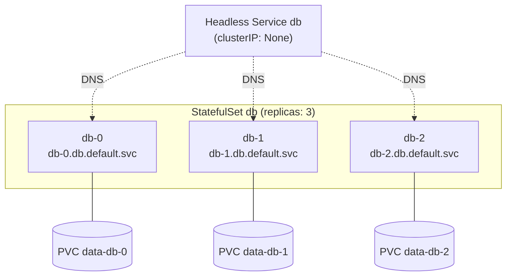

# StatefulSet — ứng dụng có trạng thái

::: info Mục tiêu bài học
- Hiểu vì sao Deployment không phù hợp với database và hệ thống phân tán.
- Nắm 3 đảm bảo của **StatefulSet**: danh tính ổn định, lưu trữ riêng, thứ tự.
- Viết StatefulSet với **headless Service** và **volumeClaimTemplates**.
- Biết khi nào nên dùng **Operator** hoặc database managed thay vì tự vận hành.
:::

## 1. Deployment thiếu gì?

Pod của Deployment **giống hệt nhau và có thể thay thế cho nhau**: tên ngẫu nhiên, dùng chung PVC (nếu có), tạo/xóa không theo thứ tự. Rất tốt cho web server không trạng thái, nhưng một cụm database cần:

- **Danh tính ổn định**: replica phải biết "primary là ai" và gọi đích danh nó.
- **Lưu trữ riêng cho từng thành viên**: mỗi node của cụm giữ dữ liệu của riêng nó, gắn lại đúng volume sau khi khởi động lại.
- **Thứ tự**: khởi tạo primary trước, replica sau; nâng cấp từng thành viên một.

## 2. Ba đảm bảo của StatefulSet



| Đảm bảo | Cụ thể |
| --- | --- |
| **Tên ổn định** | Pod tên `<statefulset>-<số thứ tự>`: `db-0`, `db-1`... Bị xóa thì tạo lại **đúng tên đó** |
| **DNS ổn định** | `<pod>.<headless-service>.<namespace>.svc.cluster.local` |
| **Lưu trữ ổn định** | `volumeClaimTemplates` tạo **PVC riêng** cho mỗi Pod (`data-db-0`...) và luôn gắn lại đúng PVC |
| **Thứ tự** | Tạo 0 → N-1 (chờ Pod trước Ready); xóa khi scale down từ N-1 về 0; cập nhật từ N-1 về 0 |

## 3. StatefulSet đầu tiên

```yaml
# web-sts.yaml
apiVersion: v1
kind: Service
metadata:
  name: web
spec:
  clusterIP: None              # headless
  selector:
    app: web-sts
  ports:
    - port: 80
      name: http
---
apiVersion: apps/v1
kind: StatefulSet
metadata:
  name: web
spec:
  serviceName: web             # tên headless Service ở trên
  replicas: 3
  selector:
    matchLabels:
      app: web-sts
  template:
    metadata:
      labels:
        app: web-sts
    spec:
      containers:
        - name: nginx
          image: nginx:1.30
          ports:
            - containerPort: 80
              name: http
          volumeMounts:
            - name: www
              mountPath: /usr/share/nginx/html
  volumeClaimTemplates:        # mỗi Pod một PVC theo mẫu này
    - metadata:
        name: www
      spec:
        accessModes: ["ReadWriteOnce"]
        resources:
          requests:
            storage: 100Mi
```

```bash
kubectl apply -f web-sts.yaml
kubectl get pods -l app=web-sts -w     # web-0 → Ready → web-1 → Ready → web-2
kubectl get pvc                        # www-web-0, www-web-1, www-web-2
```

Ghi "danh tính" của từng Pod vào volume của nó rồi kiểm tra DNS:

```bash
for i in 0 1 2; do
  kubectl exec web-$i -- sh -c "echo 'Toi la web-$i' > /usr/share/nginx/html/index.html"
done

kubectl run tmp --rm -it --image=busybox:1.37 --restart=Never -- sh
/ # nslookup web-0.web
/ # wget -qO- http://web-1.web          # Toi la web-1
/ # wget -qO- http://web-2.web          # Toi la web-2
```

Giờ xóa một Pod và kiểm tra lại:

```bash
kubectl delete pod web-1
kubectl get pods -l app=web-sts        # web-1 được tạo lại đúng tên
kubectl exec web-1 -- cat /usr/share/nginx/html/index.html
# Toi la web-1   ← cùng tên, cùng dữ liệu (IP có thể đổi)
```

::: info IP thay đổi, tên DNS thì không
Pod tạo lại có thể nhận IP mới, nhưng bản ghi DNS `web-1.web` được cập nhật theo. Ứng dụng có trạng thái nên **kết nối bằng tên DNS**, không lưu cứng IP.
:::

## 4. Scale và cập nhật

```bash
kubectl scale statefulset web --replicas=5   # tạo web-3 rồi web-4
kubectl scale statefulset web --replicas=2   # xóa web-4, web-3, web-2 (theo thứ tự ngược)
kubectl get pvc                              # www-web-2..4 VẪN CÒN — dữ liệu được giữ
```

Muốn tự động dọn PVC khi xóa/scale down (GA từ v1.32):

```yaml
spec:
  persistentVolumeClaimRetentionPolicy:
    whenDeleted: Retain     # xóa StatefulSet thì giữ PVC
    whenScaled: Delete      # scale down thì xóa PVC của Pod bị bỏ
```

**Chiến lược cập nhật:**

- `RollingUpdate` (mặc định): cập nhật từ ordinal cao về thấp, từng Pod một, chờ Ready.
- `partition`: chỉ cập nhật Pod có ordinal ≥ partition — cách làm **canary** cho database:

```yaml
spec:
  updateStrategy:
    type: RollingUpdate
    rollingUpdate:
      partition: 2          # chỉ web-2 (và cao hơn) nhận phiên bản mới
```

- `OnDelete`: chỉ cập nhật khi bạn tự xóa Pod — kiểm soát hoàn toàn bằng tay.

Nếu ứng dụng không cần thứ tự khởi động, đặt `podManagementPolicy: Parallel` để tạo/xóa đồng loạt cho nhanh.

## 5. Ví dụ thực tế: PostgreSQL một instance

```yaml
# postgres.yaml
apiVersion: v1
kind: Secret
metadata:
  name: pg-secret
stringData:
  POSTGRES_USER: app
  POSTGRES_PASSWORD: "doi-mat-khau-nay"
  POSTGRES_DB: shop
---
apiVersion: v1
kind: Service
metadata:
  name: pg
spec:
  clusterIP: None
  selector:
    app: pg
  ports:
    - port: 5432
---
apiVersion: apps/v1
kind: StatefulSet
metadata:
  name: pg
spec:
  serviceName: pg
  replicas: 1
  selector:
    matchLabels:
      app: pg
  template:
    metadata:
      labels:
        app: pg
    spec:
      containers:
        - name: postgres
          image: postgres:18
          envFrom:
            - secretRef:
                name: pg-secret
          ports:
            - containerPort: 5432
          readinessProbe:
            exec:
              command: ["sh", "-c", "pg_isready -U \"$POSTGRES_USER\" -d \"$POSTGRES_DB\""]
            periodSeconds: 5
          resources:
            requests: { cpu: 100m, memory: 256Mi }
            limits: { memory: 512Mi }
          volumeMounts:
            - name: data
              mountPath: /var/lib/postgresql   # image postgres 18+ lưu dữ liệu dưới thư mục này
  volumeClaimTemplates:
    - metadata:
        name: data
      spec:
        accessModes: ["ReadWriteOnce"]
        resources:
          requests:
            storage: 1Gi
```

```bash
kubectl apply -f postgres.yaml
kubectl exec -it pg-0 -- psql -U app -d shop -c "CREATE TABLE notes(id serial, body text);"
kubectl exec -it pg-0 -- psql -U app -d shop -c "INSERT INTO notes(body) VALUES ('xin chao');"
kubectl delete pod pg-0
kubectl exec -it pg-0 -- psql -U app -d shop -c "SELECT * FROM notes;"   # dữ liệu còn nguyên
```

Ứng dụng trong cluster kết nối tới `pg-0.pg:5432` (hoặc `pg:5432` — headless Service trả về IP của Pod).

## 6. Có nên chạy database trên Kubernetes?

StatefulSet chỉ giải quyết **danh tính và lưu trữ**. Một database production còn cần: sao chép dữ liệu (replication), tự động chuyển primary khi lỗi (failover), backup/restore theo thời điểm, nâng cấp phiên bản, giám sát...

| Lựa chọn | Khi nào |
| --- | --- |
| **Database managed** (RDS, Cloud SQL, Azure Database...) | Muốn ít vận hành nhất, chấp nhận chi phí |
| **Operator** trên Kubernetes | Cần chạy on-premise/đa cloud, có đội vận hành: **CloudNativePG** (PostgreSQL), **Percona Operator** (MySQL/MongoDB/PostgreSQL), **Strimzi** (Kafka), **MariaDB Operator**... |
| StatefulSet tự viết | Môi trường dev/test, hệ thống đơn giản, hoặc bạn thực sự hiểu rõ ứng dụng |

Bạn sẽ học cách Operator hoạt động ở bài [CRD & Operator](/nang-cao/crd-operator).

## Thực hành

**Bài 1.** Với StatefulSet `web` ở trên, đặt `partition: 2` rồi đổi image sang `nginx:1.31`. Kiểm tra image của từng Pod.

::: details Xem lời giải
```bash
kubectl patch statefulset web -p '{"spec":{"updateStrategy":{"type":"RollingUpdate","rollingUpdate":{"partition":2}}}}'
kubectl set image statefulset/web nginx=nginx:1.31
kubectl get pods -l app=web-sts -o custom-columns=NAME:.metadata.name,IMAGE:.spec.containers[0].image
# web-0 nginx:1.30, web-1 nginx:1.30, web-2 nginx:1.31
kubectl patch statefulset web -p '{"spec":{"updateStrategy":{"rollingUpdate":{"partition":0}}}}'
# → web-1 rồi web-0 được cập nhật
```
:::

**Bài 2.** Xóa StatefulSet `web` rồi tạo lại bằng cùng file. Dữ liệu "Toi la web-X" còn không? Vì sao?

::: details Xem lời giải
Còn. Xóa StatefulSet không xóa PVC (mặc định `whenDeleted: Retain`). Khi tạo lại, `web-0` tìm thấy PVC `www-web-0` cũ và gắn vào. Muốn xóa sạch phải xóa PVC: `kubectl delete pvc -l app=web-sts` (PVC sinh từ volumeClaimTemplates được gắn các label trong `spec.selector.matchLabels` của StatefulSet).
:::

## Lỗi thường gặp

- **Quên tạo headless Service** hoặc `serviceName` sai → DNS từng Pod không hoạt động.
- **Pod kẹt `Pending` vì PVC** → kiểm tra StorageClass, dung lượng và node affinity của PV.
- **StatefulSet kẹt khi cập nhật** → với `OrderedReady`, một Pod không Ready sẽ chặn cả quá trình. Sửa template rồi xóa Pod lỗi để nó được tạo lại.
- **Không thể sửa `volumeClaimTemplates`** sau khi tạo (trừ một số trường) → cần tạo StatefulSet mới hoặc dùng công cụ chuyên dụng.

## Tóm tắt

- StatefulSet cho Pod tên ổn định (`name-0..N-1`), DNS riêng qua headless Service và PVC riêng qua volumeClaimTemplates.
- Tạo/xóa/cập nhật có thứ tự; `partition` cho cập nhật từng phần; `Parallel` khi không cần thứ tự.
- PVC được giữ lại khi xóa/scale down (có thể cấu hình).
- Database production nên dùng Operator hoặc dịch vụ managed.

## Kiểm tra kiến thức

<Quiz />
