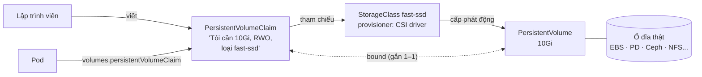

# Lưu trữ: Volume, PV, PVC

::: info Mục tiêu bài học
- Phân biệt volume **tạm thời** và **bền vững**.
- Hiểu bộ ba **PersistentVolume (PV)**, **PersistentVolumeClaim (PVC)**, **StorageClass** và cấp phát động.
- Chọn đúng **access mode**, **reclaim policy**, **binding mode**.
- Mở rộng volume, tạo snapshot và tránh các lỗi lưu trữ kinh điển.
:::

## 1. Vì sao cần volume?

File hệ thống của container là **tạm**: container khởi động lại là mất mọi thứ đã ghi. **Volume** là thư mục được gắn (mount) vào container với vòng đời riêng.

| Nhóm | Ví dụ | Sống bao lâu |
| --- | --- | --- |
| Tạm thời | `emptyDir`, `configMap`, `secret`, `downwardAPI`, `projected`, `image` | Bằng vòng đời Pod |
| Bền vững | `persistentVolumeClaim` → PV (ổ đĩa cloud, Ceph, NFS, local...) | Độc lập với Pod |
| Của node | `hostPath` | Bằng node — **tránh dùng** |

::: danger Tránh hostPath
`hostPath` mount thẳng thư mục của node vào container: dữ liệu gắn chặt vào một node, và là lỗ hổng bảo mật lớn (container có thể đọc/ghi file hệ thống của node). Chỉ dùng cho agent hệ thống (thu thập log, giám sát) và đã được kiểm soát bằng chính sách bảo mật.
:::

### emptyDir

```yaml
volumes:
  - name: cache
    emptyDir:
      sizeLimit: 500Mi       # vượt giới hạn → Pod bị evict
  - name: fast-scratch
    emptyDir:
      medium: Memory         # dùng RAM (tmpfs) — tính vào memory limit của container
```

## 2. PV, PVC, StorageClass



- **PersistentVolume (PV)**: đại diện cho một ổ đĩa thật trong cluster. Tài nguyên **cấp cluster**.
- **PersistentVolumeClaim (PVC)**: "phiếu yêu cầu" lưu trữ của ứng dụng (dung lượng, access mode, loại). Thuộc **namespace**.
- **StorageClass**: "loại" lưu trữ (SSD, HDD, có mã hóa...) kèm **provisioner** (CSI driver) để **tự động tạo PV** khi có PVC.

Mô hình này tách vai trò: lập trình viên chỉ viết PVC, không cần biết ổ đĩa nằm ở đâu; quản trị viên định nghĩa StorageClass.

Cluster kind có sẵn StorageClass `standard` (local-path-provisioner — ổ đĩa nằm trên node):

```bash
kubectl get storageclass
```

```text
NAME                 PROVISIONER             RECLAIMPOLICY   VOLUMEBINDINGMODE      ALLOWVOLUMEEXPANSION
standard (default)   rancher.io/local-path   Delete          WaitForFirstConsumer   false
```

## 3. Thực hành: dữ liệu sống sót khi Pod bị xóa

```yaml
# notes.yaml
apiVersion: v1
kind: PersistentVolumeClaim
metadata:
  name: notes-data
spec:
  accessModes: ["ReadWriteOnce"]
  storageClassName: standard        # bỏ trống = dùng StorageClass mặc định
  resources:
    requests:
      storage: 1Gi
---
apiVersion: apps/v1
kind: Deployment
metadata:
  name: notes
spec:
  replicas: 1
  strategy:
    type: Recreate                  # RWO: không để Pod cũ và mới cùng giữ volume
  selector:
    matchLabels: { app: notes }
  template:
    metadata:
      labels: { app: notes }
    spec:
      containers:
        - name: nginx
          image: nginx:1.30
          volumeMounts:
            - name: data
              mountPath: /usr/share/nginx/html
      volumes:
        - name: data
          persistentVolumeClaim:
            claimName: notes-data
```

```bash
kubectl apply -f notes.yaml
kubectl get pvc,pv
```

```text
NAME                               STATUS   VOLUME                                     CAPACITY   ACCESS MODES   STORAGECLASS
persistentvolumeclaim/notes-data   Bound    pvc-5b1e0c7a-9f3d-4c2e-8a51-2f7d9e3b6c10   1Gi        RWO            standard

NAME                                                        CAPACITY   RECLAIM POLICY   STATUS   CLAIM
persistentvolume/pvc-5b1e0c7a-9f3d-4c2e-8a51-2f7d9e3b6c10   1Gi        Delete           Bound    default/notes-data
```

Ghi dữ liệu, xóa Pod, kiểm tra lại:

```bash
kubectl exec deploy/notes -- sh -c 'echo "Ghi chu quan trong" > /usr/share/nginx/html/index.html'
kubectl delete pod -l app=notes
kubectl rollout status deployment/notes
kubectl exec deploy/notes -- cat /usr/share/nginx/html/index.html
# Ghi chu quan trong   ← dữ liệu vẫn còn
```

## 4. Các thuộc tính quan trọng

### Access mode

| Mode | Viết tắt | Ý nghĩa | Ví dụ backend |
| --- | --- | --- | --- |
| ReadWriteOnce | RWO | Đọc-ghi bởi **một node** | Ổ đĩa block: EBS, PD, Azure Disk, local-path |
| ReadWriteOncePod | RWOP | Đọc-ghi bởi **đúng một Pod** | Driver CSI hỗ trợ |
| ReadOnlyMany | ROX | Chỉ đọc từ nhiều node | NFS, ổ đĩa clone |
| ReadWriteMany | RWX | Đọc-ghi từ nhiều node | NFS, CephFS, EFS, Azure Files |

### Reclaim policy

- **Delete** (mặc định với cấp động): xóa PVC → xóa PV và ổ đĩa thật.
- **Retain**: xóa PVC → PV chuyển `Released`, dữ liệu còn nguyên, quản trị viên tự xử lý. Nên dùng cho dữ liệu quan trọng.

### Volume binding mode

- **Immediate**: tạo volume ngay khi có PVC.
- **WaitForFirstConsumer**: chờ có Pod dùng PVC mới tạo, để volume nằm đúng node/zone của Pod. PVC `Pending` trước khi có Pod là **bình thường**.

### StorageClass mẫu (trên cloud)

```yaml
apiVersion: storage.k8s.io/v1
kind: StorageClass
metadata:
  name: fast-ssd
provisioner: ebs.csi.aws.com          # mỗi nền tảng một CSI driver
parameters:
  type: gp3
  encrypted: "true"
reclaimPolicy: Retain
volumeBindingMode: WaitForFirstConsumer
allowVolumeExpansion: true
```

## 5. Mở rộng và snapshot

**Mở rộng**: nếu StorageClass có `allowVolumeExpansion: true`, chỉ cần tăng `spec.resources.requests.storage` của PVC rồi `apply` — driver sẽ nới ổ đĩa và file system (không hỗ trợ thu nhỏ).

**Snapshot**: với CSI driver hỗ trợ và snapshot controller được cài, bạn tạo bản chụp nhanh:

```yaml
apiVersion: snapshot.storage.k8s.io/v1
kind: VolumeSnapshot
metadata:
  name: notes-snap-2026-10-26
spec:
  volumeSnapshotClassName: csi-snapclass
  source:
    persistentVolumeClaimName: notes-data
```

Và khôi phục bằng một PVC mới có `dataSource` trỏ tới snapshot. Snapshot **không thay thế backup** ra khỏi cluster — xem Velero ở bài Vận hành cluster.

## 6. PV tĩnh — khi không có cấp phát động

Môi trường on-premise thường có sẵn NFS. Quản trị viên tạo PV thủ công, PVC sẽ được gắn vào PV phù hợp:

```yaml
apiVersion: v1
kind: PersistentVolume
metadata:
  name: nfs-share-01
spec:
  capacity:
    storage: 50Gi
  accessModes: ["ReadWriteMany"]
  persistentVolumeReclaimPolicy: Retain
  storageClassName: nfs-manual
  nfs:
    server: 10.0.0.20
    path: /exports/share01
---
apiVersion: v1
kind: PersistentVolumeClaim
metadata:
  name: shared-files
spec:
  accessModes: ["ReadWriteMany"]
  storageClassName: nfs-manual      # khớp với PV ở trên
  resources:
    requests:
      storage: 50Gi
```

Trong thực tế nên dùng **CSI driver** (ví dụ `nfs.csi.k8s.io`) để có cả cấp phát động. Các lựa chọn phổ biến cho on-premise: **Longhorn**, **Rook-Ceph**, **OpenEBS**, CSI của SAN/vSphere.

## Thực hành

**Bài 1.** Tạo PVC `scratch` 200Mi rồi kiểm tra trạng thái **trước** và **sau** khi tạo Pod dùng nó. Giải thích.

::: details Xem lời giải
```bash
kubectl apply -f - <<'EOF'
apiVersion: v1
kind: PersistentVolumeClaim
metadata:
  name: scratch
spec:
  accessModes: ["ReadWriteOnce"]
  resources:
    requests:
      storage: 200Mi
EOF
kubectl get pvc scratch        # Pending — StorageClass standard dùng WaitForFirstConsumer
kubectl describe pvc scratch   # waiting for first consumer to be created before binding
```
Tạo một Pod mount `scratch`, PVC sẽ chuyển sang `Bound` ngay sau khi Pod được xếp lịch.
:::

**Bài 2.** Scale Deployment `notes` lên 3 replicas. Quan sát và giải thích điều gì xảy ra trên cluster kind 2 worker.

::: details Xem lời giải
```bash
kubectl scale deployment notes --replicas=3
kubectl get pods -l app=notes -o wide
```
Với local-path, PV mang **node affinity** trỏ tới node chứa thư mục dữ liệu, nên scheduler xếp **cả 3 Pod lên cùng node đó**. Chúng đều chạy (RWO cho phép nhiều Pod trên một node) nhưng mất ý nghĩa phân tán: node đó chết là cả 3 Pod chết theo. Với ổ đĩa cloud (EBS, PD...), Pod bị xếp sang node khác sẽ kẹt `ContainerCreating` với `Multi-Attach error`.

Bài học: ứng dụng nhiều bản sao cần **mỗi Pod một volume** → StatefulSet (bài tiếp theo), hoặc storage RWX nếu thật sự cần chia sẻ.
:::

**Bài 3.** Xóa Deployment `notes` và PVC `notes-data`. PV có còn không? Làm sao để giữ dữ liệu lại trong lần sau?

::: details Xem lời giải
PV bị xóa theo vì reclaim policy `Delete`. Để giữ lại: dùng StorageClass có `reclaimPolicy: Retain`, hoặc đổi chính sách của PV hiện có trước khi xóa PVC:
```bash
kubectl patch pv <ten-pv> -p '{"spec":{"persistentVolumeReclaimPolicy":"Retain"}}'
```
:::

## Lỗi thường gặp

| Triệu chứng | Nguyên nhân |
| --- | --- |
| PVC `Pending` mãi dù đã có Pod | Không có StorageClass mặc định / sai tên StorageClass / provisioner lỗi |
| Pod `ContainerCreating` lâu, Events `Multi-Attach error` | Volume RWO đang gắn ở node khác |
| `Permission denied` khi ghi vào volume | Container chạy user không phải root; đặt `securityContext.fsGroup` |
| Dữ liệu mất sau khi xóa và tạo lại | Reclaim policy `Delete`, hoặc dùng `emptyDir` nhầm chỗ |
| Volume đầy | Theo dõi dung lượng, bật `allowVolumeExpansion` và nới PVC |

## Tóm tắt

- emptyDir sống theo Pod; dữ liệu bền vững cần PVC → PV.
- StorageClass + CSI driver cho phép cấp phát động; `WaitForFirstConsumer` làm PVC Pending cho tới khi có Pod.
- Access mode: RWO (một node), RWOP (một Pod), ROX, RWX (nhiều node).
- Reclaim policy `Delete` xóa cả dữ liệu — dùng `Retain` + backup cho dữ liệu quan trọng.

## Kiểm tra kiến thức

<Quiz />
